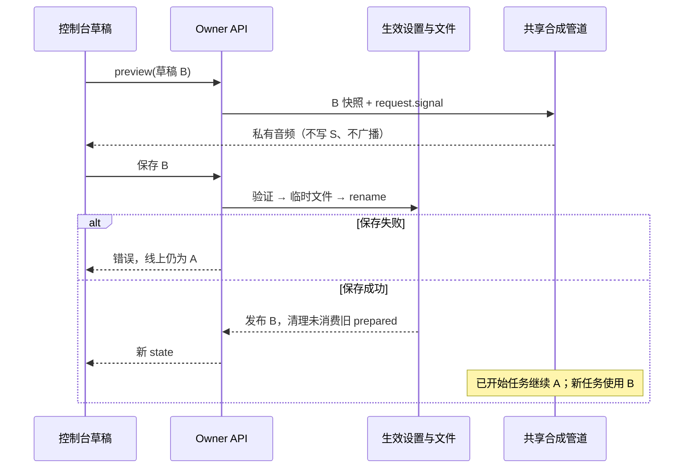

# 工程上下文：FEAT-001 直播语音配置热更新与私有试听

## 当前有效方案

以下为主 Agent 已验收的当前有效方案；Backlog / Spec / Plan 已依次接受，唯一 TASK-001 已登记。生命周期进度只以 `state.json` 为准。本文件篇幅主要用于新增 API、文件保存失败、取消和缓存契约，不扩展产品范围。

### 架构设计

**关联产品上下文**：`.sdlc-v1/context/REQ-001.product.md`
**工程上下文**：`.sdlc-v1/context/FEAT-001.engineering.md`
**绑定输入**：产品 NEED-001/002/003、CON-001；主 Agent 明确提供的 CON-002、DEC-001/002、OUT-001 和本方案工程默认。后者不是用户逐项确认。
**创建日期**：2026-11-09
**状态**：当前有效方案；分支 `codex/macos-yovoice`，不包含 checkout/迁移指令。

#### 背景

长期工程/产品索引为 `none`，直接使用本次请求和 `../project.md` 的源码事实。已有 `runtime.ts` 的 settings、预合成与 speech 管道，`index.ts` 注册路由，`console.tsx` 有 Drawer/SecretField，`body/` 有三个适配器。目标为产品 SC-01～04；现有行为和历史验证不作为新功能已通过的证据。

复用评估：

| 候选 | 证据与适配范围 | 决定 |
|---|---|---|
| 扩展现有实现 | 已有 provider、设置 API、DSH credentials、Drawer、yovoice 单队列/取消、FFmpeg 转码；缺少热配置、私有试听和 Web 旅程测试。 | 采用；生产实现不引入新的 TTS SDK、UI 框架或配置仓库。 |
| 引入通用语音/表单框架 | 当前依赖没有这类能力；既有三个适配器已覆盖产品范围，新框架不能消除缓存/队列契约。 | 不采用，无需外部比较或网络调研。 |
| 测试工具补齐 | 项目已有 Vitest 3.2.4；父仓库共享 e2e 0.23.0/Web 0.15.5 已可运行帮助，项目尚无资产。 | 仅引入固定测试依赖和必要覆盖率/DOM 测试能力；不是生产架构替换。 |

原型：复用产品 DEC-001 的现有 Drawer baseline，不新建；无原型代码/token 待搬迁。设计模式 Operate。主 Agent 已取得 Impeccable `SCOPED_EXISTING_ALLOWED` 结果，无 PRODUCT.md/DESIGN.md；本阶段不重跑 context、不 init、不安装 Hook。Build UI 编辑前读 craft-floor，完成后手动 detect 一次，检测不替代真实旅程验收。

#### 架构与组件

##### 共享声音配置

- **职责**：新增纯 TS `src/shared/ttsSettings.ts`，集中类型、字段验证/规范化、兼容默认值和身份计算；浏览器不导入 Node 模块或读取 secret。工程 schema 是唯一字段定义。
- **接口**：接受显式 defaults/env 输入，返回独立的有效配置；PATCH 合并与试听覆盖使用同一验证逻辑。
- **覆盖**：FR-01/02/05/07；AC-01/02/03/07/09。

##### 运行时与现有适配器

- **职责**：`src/dsh/runtime.ts` 拥有持久化和生效设置；每次合成捕获不可变快照，再调用现有豆包/macOS/yovoice 适配器。`src/body/yovoiceTts.ts` 保留唯一客户端、串行队列和未知终态 blocked 状态，参数改为逐请求传入。
- **接口**：普通直播与试听调用同一 provider 执行函数，后者只拿音频返回。实际覆写的嘉宾 speaker 也进入快照/缓存身份；本地 provider 不把豆包嘉宾 ID 当本地音色描述。
- **覆盖**：FR-02/03/05/07；AC-01/04/05/08/09。

##### Owner API 与控制台声音表单

- **职责**：`src/dsh/index.ts` 扩展既有 settings 路由并增加私有 preview 路由；`src/console/console.tsx` 可提取 `TtsSettingsPanel.tsx`，承载草稿、保存状态、试听生命周期和现有凭据输入。保留现有 `dl-*` 风格。
- **接口**：下文唯一 API 契约；GET state 是线上值，UI 草稿不被轮询覆盖，保存成功后用返回的完整有效值刷新基线。
- **覆盖**：FR-01～08；AC-01～09。

#### 关键设计决定

##### 决定 1：增量配置与原子发布

在原 settings JSON 增加 `tts`，保留未知旧字段和 `voice` alias，不引入格式版本迁移。配置提交先验证、同目录临时文件写入并 rename，成功后才发布内存；失败保持旧文件和旧内存。相较独立 TTS 文件，这保留一个配置事实源。覆盖 AC-02/03/09。

##### 决定 2：每请求快照与单个 yovoice 队列

不通过重建客户端实现热更新，也不改服务端协议；逐请求传入模型/描述。保存成功只取消/清除未消费的旧预合成，已开始或已从 prepared 取走的任务继续原快照。覆盖 AC-01/05/09；取消仍沿用既有 DELETE + 终态确认，未知终态不提交新任务。

##### 决定 3：直接返回私有音频

使用有界 owner HTTP 请求返回音频，并把连接断开传播为取消，不新增试听 job 状态机。编排方已确认 `../upstream/packages/client/connection/src/http-bridge.ts:44-54` 的异常 close 会 abort Request.signal，以及 `rpc-host.ts:215-230` 的 exact fetch 路由仅 owner 可达。试听不经过 `show.say/guestSay`、stage、attention 或会话。覆盖 AC-04/05/06。

#### 数据模型 / 关键实体

新增 `Settings.tts: TtsSettings`，所有下列字段均为普通配置，不含凭据：

| 字段 | 类型与验证 | 旧配置缺字段时的默认/来源 |
|---|---|---|
| backend | `yovoice` / `macos` / `doubao` 严格枚举 | 有效 `DSH_LIVESTREAM_TTS_BACKEND`，否则 doubao |
| yovoiceModel | `voxcpm2-q8` / `voxcpm2-bf16` | 已有 `DSH_LIVESTREAM_YOVOICE_MODEL`；缺省 q8。其他模型不伪称支持设计模式，应清楚提示当前适配范围。 |
| yovoiceVoice | trim 后非空 string，最多 500 Unicode 字符 | `DSH_LIVESTREAM_YOVOICE_VOICE` 或现有中文女声描述常量 |
| macosVoice | trim 后非空 string，最多 100 Unicode 字符 | `DSH_LIVESTREAM_MACOS_VOICE` 或 Tingting |
| doubaoVoice | trim 后 string，最多 200 Unicode 字符；空串合法 | 旧 `settings.voice` 或空串；空串始终表示跟随角色，不在 load 时冻结角色默认 |
| doubaoRate | 有限整数，-50～100 | 0 |

长度、试听短句及枚举为主方案工程默认；当前仅 q8 已安装，bf16 需要事先安装，不查询/下载模型。对于旧 JSON 已存在 `tts` 的字段，以保存值逐字段优先，未保存字段才取兼容默认；有效完整配置由 state 输出。对旧 env 的不支持模型显示可恢复错误，不静默使用另一模型。

`settings.voice` 保留为 `tts.doubaoVoice` alias，包含空串；旧 PATCH voice 更新同一值。每次真正合成才解析 `doubaoVoice || currentCharacter.voice || DEFAULT_VOICE`，嘉宾显式 override 优先。不把 yovoice 描述回写 voice。请求同时提供不一致 alias 值时拒绝，避免歧义；其他已存在设置字段的 API 行为不顺带改变。

一个合成快照包含生效 TTS 配置、解析后的实际 speaker/override 及其身份。快照为新对象、只读标量，不引用可变 settings。prepared key 必须包含所有影响输出的配置与实际 override；不能继续只用旧 voice + text。

#### API / 接口契约

**公共边界**：仍挂在 Harness connection 的 owner exact route 上；没有新增登录/匿名路由。URL/token 继续来自启动环境，正文不接受任意目标 URL。credentials 使用 DSH 现有服务；SecretField 复用新版 API Key 与旧版 APP ID/Access Key 引用，不建立第二套存储。

**凭据 resolver 所有权**：当前 `agent.ts:302-312` 才绑定 DSH credentials，不能用于“从未开播也可试听”的依赖。按主 Agent 已核实的 provider 接口（`../upstream/packages/credentials/credentials/src/index.ts`），将共享 `hooks.secret/setSecret` 的绑定移至根插件 apply 的 effect：每次调用动态 `ctx.get?.('credentials')`，读取保持 `resolve(name) → hit.value → env`，写入复用既有 `set`。Agent 不再用会话 context 覆盖这些 hook。根插件仍只 required connection，credentials 可选，纯 env 的 Mac/yovoice 不受影响；销毁时只在 hook 仍等于本实例绑定时清理为默认值，避免旧实例清除新实例。试听不启动 Agent 或创建会话。

| 接口 | 输入/输出与行为 | 覆盖 |
|---|---|---|
| GET `/api/dsh-livestream/state` | 保留旧字段；`settings.tts` 为完整有效配置，`settings.voice` 为云 speaker alias，`runtime.ttsBackend` 为当前有效 backend。不返回 TTS 服务 token/Key；既有舞台地址与其认证行为保留。 | AC-02/07/09 |
| POST `/api/dsh-livestream/settings` | 现有字段加 `tts?: Partial<TtsSettings>`。`tts` 必须是普通对象且只含已知字段/正确类型；与当前值合并后整体验证，失败 400 且没有内存/文件/缓存副作用；成功返回现有 state 形状。新音色字段不做隐式数值/布尔转换；顶层其他字段沿用既有白名单处理。 | AC-01/02/03/07/09 |
| POST `/api/dsh-livestream/tts/preview` | body 为 `{text: string, tts?: Partial<TtsSettings>}`；以当前值合并草稿但不保存。text trim 后 1～200 Unicode 字符；默认 UI 短句为“你好，欢迎来到我的直播间。”。成功 `audio/mpeg` 二进制、`Cache-Control: no-store`；不发 stage/SSE say、不写直播或会话、不调用 LLM。 | AC-04/05/06/08 |

设置保存由当前单个 Harness 进程顺序提交小配置文件：同一处理段内验证、写临时文件、关闭、rename、发布内存，不跨 await 留下陈旧合并窗口；多浏览器是最后一次成功提交生效，不新增锁或版本 API。临时文件同目录、唯一名、独占创建，绝不与目标别名，失败只清理本次临时文件，不破坏原文件或其他设置；保留原未知字段。配置路径固定来自既有 dataDir，不受请求正文控制。

preview 总时限 90 秒，合并 `request.signal` 与 timeout；取消继续触发 yovoice 服务端 job 删除与有限终态确认。服务端未确认取消时保留 shared client 的 blocked 状态。正常网络错误不自动重试云端或切换 provider。错误沿用 `{ok:false,error}`：无效输入 400，未配置/不可用 503，下游失败 502，超时 504，保存 I/O 失败 500；文字做脱敏，不回显凭据、原始响应、内部路径或堆栈。已断开的请求不制造成功结果，前端主动取消显示为取消。

保存配置不要求云端凭据已经可用；UI 将“已保存”与“语音可用”分开，缺少相应凭据必须显式提示。实际合成/试听不能暗中 fallback。豆包新旧凭据选择继续由现有 `routeOf/usesNewConsole` 判断。

#### 时序与数据流

1. 打开 Drawer：GET state 提供线上基线，初始化独立草稿；轮询只更新线上显示，不覆盖脏草稿。
2. 试听：先取消旧请求/播放并释放旧 ObjectURL → 捕获草稿与单调请求标识 → 请求 preview → 同一 provider 管道合成 → 仅最新标识的结果创建 ObjectURL 并交给当前 audio controls。任何旧响应都丢弃。
3. 保存：校验当前草稿 → settings API 原子提交 → 发布新配置/更新 runtime backend → 清理未消费旧 prepared → 返回 state。失败保留原基线与可重试草稿。
4. 普通直播：每次新合成捕获快照；已消费 prepared 不在保存清理范围；yovoice 正式语音、预合成和试听都用同一个队列。新增音色不重建服务或客户端。



图未启动浏览器渲染；上方有序说明为等价定义。取消与终态规则见 API 契约，不因图中省略而取消。

#### 横切质量设计

表单展示所选后端参数和适用凭据，切换不丢其他后端草稿/保存值；豆包提供已知 2.0 音色和自定义 ID、“跟随角色默认”，1.0 ID 显示旧凭据输入。yovoice 描述、Mac 音色名使用不同标签。保存按钮只提交声音草稿，不覆盖其他直播设置。

试听状态至少区分 idle/generating/ready/playing/cancelled/error；空文本禁用发起并有提示。修改草稿、切后端、关 Drawer、替换结果时 abort 请求、停止音频、清空旧结果并 revoke ObjectURL；卸载亦清理。请求标识防迟到响应。原生 audio controls、明确 label/status/error、键盘 focus-visible、桌面和窄屏布局沿用现有样式；不把凭据或工程细节写入产品操作文案。

所有 speech 超时、成本标签和 `show_stats` 的本地/云判断改用同一有效 backend helper，不再散读 env；不改 GLM 模型/提示/工具范围。因此 eval-bench 不适用：不改变模型策略，只对既有 stats 语义做确定性回归。

#### 风险与取舍

| 风险 | 影响 | 机制与计划检查 |
|---|---|---|
| 音色切换遗留预合成或隐含可变引用 | 后续句使用旧声音 | 快照/完整身份/未消费清理；保存前后请求参数及 consumed/unconsumed 回归 |
| 试听和直播各开客户端 | 破坏单任务/未知终态保护 | 保留一个 client/queue/blocked；并发与取消确认测试 |
| 保存失败或并发合并丢失字段 | UI 与磁盘分歧 | 原子提交、发布后置、原始字段保留；rename/write 失败注入、连续 partial patch |
| 关 Drawer 后旧响应继续播放 | 隐私与资源问题 | AbortController、请求标识、audio/ObjectURL 清理；延迟响应 E2E |
| 真实云端缺凭据 | 无法证明真实豆包听感 | 不调用云；适配器确定性测试 + 缺配置提示，明确真实未测 |

#### 需求覆盖

此表为唯一“验收 → 设计 → Task → 计划验证”关联，实施计划和任务引用它。

| 验收条件 | 设计/契约 | Task | 计划验证 |
|---|---|---|---|
| AC-01 | 快照、共享适配器、prepared 身份/清理 | TASK-001 | 参数热变/在途旧快照/consumed 缓存测试；J1 |
| AC-02 | 增量 settings、state、原子持久化 | TASK-001 | reload/重新载入模块、未知字段保留；J1 |
| AC-03 | 统一验证、发布后置、顺序 partial commit | TASK-001 | 无效输入/write/rename 失败原文件/内存不变、最后成功提交 |
| AC-04 | preview 直返、同管道、根生命周期 credentials、独立草稿 | TASK-001 | 从未开播/Agent 未 apply 也能使用根 credentials 试听；音频响应 + 零 stage/会话/LLM 断言；J1 |
| AC-05 | AbortSignal/单队列/客户端请求标识 | TASK-001 | cancel 终态/blocked/迟到音频/URL 清理；J3 |
| AC-06 | schema、超时、错误、空态、无 fallback | TASK-001 | 空白/长度/错误/超时/缺模型边界；J2/J3 |
| AC-07 | 按后端字段、保留各自值、partial patch | TASK-001 | 三 provider 真实参数与状态；J2 |
| AC-08 | 现有 credentials/routeOf、安全错误 | TASK-001 | 2.0/1.0/复刻 ID 头和 rate、缺凭据、零泄漏；J2 |
| AC-09 | env/default/voice alias/角色 sentinel/backend helper | TASK-001 | 旧 JSON/env、切角色、旧 API、彩排/show_stats 回归 |

### 实施计划

**关联产品上下文**：`REQ-001.product.md`；**关联设计**：上文架构设计；**创建日期**：2026-11-09；**状态**：当前有效方案。

#### 背景

一个纵向 TASK-001 覆盖声音表单、设置/试听路由、适配器参数和必要验证；同一实现者完成修正，不按文件或测试另派实现者。

#### 目标 / 非目标

目标为产品 SC-01～04 与覆盖表全部 AC；非目标见产品 OUT-001/范围外。保持当前维护分支，不做 main 合并、云部署或正式推流。

#### 技术栈

沿用 TypeScript/Node ESM、React 18、esbuild、Vitest 3.2.4；无数据库。测试固定 `e2e@0.23.0`、`@e2e-dev/web@0.15.5` 与 `@vitest/coverage-v8@3.2.4`；必要 DOM 测试可增加与当前 Node/Vitest 兼容并锁定的 jsdom，或现有等价能力。不在生产引入新框架。实际本机 Node/pnpm 与环境变量约束见 project.md。

#### 实施层决定

先做 yovoice 的完整真实增量，再补其余后端与失败边界。相比先完成全部基础抽象，这能及早检验热更新/试听路径；不增加阶段完成审批。新增 e2e 工程资产复用项目包管理器，首选包内固定 devDependencies，保持可迁移模块解析；不把 `/Users/mac/...` 或共享全局 node_modules 写进运行脚本。

#### 风险 / 取舍

共享服务不能由 worker 自动重启；初次加载新插件构建由主 Agent 统一协调一次，yovoice 服务不动。真实冷启动不用于替代确定性回归；真实短样本预算和云缺凭据范围见产品观察计划。需要改变接口、并发语义或外部范围时返回主 Agent，不自行更换方案。

#### 实施阶段

1. **最小真实旅程**：TASK-001 首先补配置/preview 必需的失败测试，再实现 yovoice 路径。最早可检验结果为“Drawer 改中文描述 → 未保存试听 → 保存 → 下一句真实请求携带新描述”；用隔离真实路由/可观测 provider 先证明参数和私有性，有稳定构建后主 Agent 按既有预算复用真实 yovoice 验证。覆盖 AC-01/04；设计：共享配置、preview、声音表单。不等待云/Mac 或无关基础工作，增量展示不等于 Task done。
2. **完成已有后端和兼容性**：同 Task 补 Mac/Doubao、旧别名/角色默认、凭据、有效 backend 计费/超时、预合成取消与失败保存。覆盖其余 AC；设计：覆盖表对应项。
3. **正式验证准备与收尾**：同 Task 完成下面三条已提交 Web 旅程、覆盖率、文档和资源清理，实际运行后记证据；主 Agent 再派独立 Validate/Review。覆盖全部 AC；设计：同覆盖表。

#### 需求覆盖

沿用架构设计的唯一覆盖表；阶段 1 是首个增量，阶段 2/3 完成同一 Task 的剩余验收，不生成额外 Task。

### 工程任务

**输入**：上文设计/实施计划与产品规格；**前置条件**：主 Agent 逐项接受 Backlog/Spec/Plan，实际 start-feature 并登记 TASK-001。
**测试**：默认先写能复现差异的失败测试，再实现；文档/机械配置用必要静态检查。
**格式**：`TASK-001 [US1/US2/US3]`；不设置无独立交付边界的并行任务。

#### 路径约定

源码路径前缀为 `packages/dsh-livestream/`。可写 `src/shared/ttsSettings.ts`、`src/dsh/{runtime,index,agent}.ts`、必要 `src/body/` TTS/音频模块、`src/console/`、`test/`、必要测试/覆盖率/E2E 配置、包文件/lock、`.gitignore`、README/示例操作说明，以及本工程上下文的实际证据。不改 yovoice/DSH 核心、GLM 配置、无关业务或 stage 广播协议；不写 project.md/state.json。

#### 阶段 1：准备（共享基础设施）

TASK-001 内部准备：核对既有假服务/credentials/console bind 复用位置，安装已授权固定测试依赖，使用现有 Chromium，不新建仓库/工作树、Hook、模型或设计系统。

#### 阶段 2：基础（故事所需前置条件）

仅做实施阶段 1 的实际依赖：共享 schema、原子提交、按请求配置与 preview 路由；测试夹具复用真实 route handler 与真实 React。其余后端补齐按阶段 2 顺序，不先做通用任务系统。

#### 阶段 3：用户故事 1/2/3 — TASK-001 统一直播语音设置、热更新和私有试听（优先级：P1）

- **唯一交付物**：产品所有 AC 在上述实现边界内满足，声音在同一控制台可编辑、私有试听、热保存，并具备可重复验证资产。
- **依赖**：none；阶段内部顺序见实施阶段，不另登记子 Task。
- **实施**：按组件/契约及覆盖表执行，不复制另一套方案。最早真实增量按实施阶段 1 报告入口、版本、参数证据与未覆盖项，并继续此 Task。
- **完成条件**：覆盖表无缺项；校验/保存失败/取消/并发边界有确定性证据；无凭据回显、舞台/会话试听副作用或自动 fallback；类型检查、构建、适用测试、覆盖率与三条已提交 Web 旅程通过；文档一致；仅任务专属资源被清理，保持共享服务；实际结果记于下方。

##### 用户故事的验证

**单元/集成（correctness + OpenAPI）**：复用现有 Vitest 和假 yovoice 服务；覆盖 schema 类型/Unicode/最大边界、旧 JSON/env/alias/角色 sentinel、原子 write/rename 失败与未知字段、在途快照/新请求参数、完整 prepared identity/consumed 隔离、单队列/取消终态/blocked、preview 音频与零 stage/会话/LLM、错误与无 fallback。必须测试“从未开播且 Agent 未 apply、env 无豆包 Key、根 credentials 已保存测试 Key”时 preview 使用正确 adapter 认证头并返回音频，无 LLM/session 创建/舞台广播；另测 root 销毁不清除更新实例的绑定。Mac/Doubao 测试观察真实适配器参数/协议；只替换外部 I/O，不把 provider 选择或设置 API 换成空响应。

**可执行覆盖率策略**：同 Task 增加 Vitest V8 coverage 配置与必要 DOM 行为测试（原生 ReactDOM act + 兼容 DOM 环境即可）。数值来自真实 instrumented 执行；保存 coverage-final.json/LCOV，针对新模块和真实改动代码统计行 ≥80%、分支 ≥70%。若旧大文件影响统计，用 Git diff 的改动行/分支与 coverage 数据交集计算并输出分子/分母和失败 exit，不施加全仓旧代码阈值，不为旧分支补无关测试。纯样式/静态模板可说明不适用；状态、事件绑定、清理和错误分支不得排除来达标。原始报告与范围选择必须可复核，不能用 E2E 截图或纯 helper 覆盖冒充 UI 行为覆盖；工具缺口保持未通过。

**Web E2E 资产**：在包内提交 `e2e.config.ts`、`test/e2e/voice-settings.e2e.ts` 与 fixture/cleanup。固定 CLI + Web engine；仅精确 locator/确定性断言，不使用任何 `agent.*`、模型或模型过滤器；模型调用预算 0。fixture 必须运行真实 React Console/声音组件、真实 settings/preview handler/存储及可观测的 fake 外部 provider，使用隔离 DSH_HOME、凭据替身、局部 HTTP 依赖，不能用假 settings/preview API 掩盖真实路径。fixture owner 身份与上游真实 owner 限制分别记录，不把假身份当生产鉴权证明。

| 旅程 | 确定性终态与检查 |
|---|---|
| J1：草稿试听、保存、刷新 | 未保存 B 的音频可用而线上/磁盘仍 A；保存后新请求 B、刷新保持；stage/直播/会话/LLM 计数为零。 |
| J2：三后端配置和错误 | 条件字段/凭据需求正确，切换保留值；真实 handler + adapter 参数含正确 model/description、Mac voice、Doubao speaker/rate；缺配置/错误无 fallback。 |
| J3：取消与陈旧响应 | 生成中取消、改草稿、换后端、关 Drawer/再次试听；旧 job 收到取消且终态确认，迟到音频不替换新结果，播放器/URL 被释放；可恢复。 |

运行范围：Chromium，桌面 1440×900 和窄屏 375×812（必要时 320 宽静态/布局补查），键盘完成关键流程，检查 focus、可见 label/status/error、横向溢出、console error 和关键 network。并发 workers=1、retries=0、每测试 120 秒、全次运行有限 10 分钟、动作 5 秒、断言 5 秒；零 flaky/跳过/过滤缺失才能通过。fixture 使用 `127.0.0.1:0` 与 runner `{port}` 分配专属端口，绝不使用共享 3080/3081/7390 或真实 env。

配置显式 `cache: {mode: 'read-only', strict: true}`，无 Agent 录制/实时接管，期望模型调用 0；不靠 strict 宣称零调用。使用本机已存在、与 playwright-core 匹配的 Chromium revision 1248（编排方已核对 browser 156.0.8078.4），正常 `web({browser:'chromium'})` 即可，不加该版本不存在的 channel 参数，不下载浏览器/引入 CDP 管理层。报告记录实际启动版本，不能仅引用缓存目录。

测试产物在包内 `.e2e/feat-001/`：report.json、JUnit、每条旅程 trace、成功/错误截图与 fixture 日志；coverage 在 `coverage/feat-001/`。忽略产物、临时身份/数据和缓存；测试/配置/fixture 纳入 Git。重跑前将本次失败产物保留到独立归档子目录，再记录稳定引用；不改 runner 输出、不把原始报告写 state。runner 的 app.command 持有 fixture 服务，退出时关闭进程/浏览器/假服务，核对专属资源释放，不停止共享服务。

**计划命令（NOT_RUN，均从仓库根执行，Build 实际运行后记录结果）**：

```sh
npm_config_manage_package_manager_versions=false pnpm --filter dsh-livestream exec vitest run
npm_config_manage_package_manager_versions=false pnpm --filter dsh-livestream check
npm_config_manage_package_manager_versions=false pnpm --filter dsh-livestream build
npm_config_manage_package_manager_versions=false pnpm --filter dsh-livestream exec vitest run --coverage
npm_config_manage_package_manager_versions=false pnpm --filter dsh-livestream exec e2e run --config e2e.config.ts --workers 1 --retries 0 --trace on --reporter list,junit
git diff --check
```

现有适配 focused 回归命令可从 project.md 原样复用。覆盖率 include/threshold 和报告路径由本 Task 的已提交配置实现；完整 Vitest 需排除 e2e 文件，不让两个 runner 互相收集。本阶段只核对 CLI help，不把上述计划命令称为已通过。

##### 用户故事的实现

按架构组件和实施阶段 1→2→3 完成同一 TASK-001；每个新增分支有覆盖表对应检查。无需新建独立任务队列、密钥服务、配置数据库或 UI 框架。表单状态和 API 状态保持可读代码结构，不压缩 JSX/控制流。

#### 阶段 N：收尾与横切关注点

全局 usage 入口维持根 `README.md`，增加稳定导航 `LIVE-VOICE-EDIT`、`LIVE-VOICE-PREVIEW`、`LIVE-VOICE-BACKEND`，链接现有 `examples/macos-yovoice/README.md` 的详细步骤及产品故事。每条说明主人身份、入口/本地前置环境、参数来源（共享 schema/外部部署配置/现有 credentials）、默认范围、正常操作/成功反馈、失败/取消/未知任务恢复和当前支持范围；不复制 schema 或 secret。旧 env 初次默认与已保存优先关系也需同步说明，保留历史 VALIDATION.md 的事实边界。

主 Agent 最终协调实际插件加载版本，按文档在真实 Chrome/yovoice 最多两段短文本、Mac 最多一段完成有界使用验收；GLM 保持原模型，试听不调用它。豆包无真实凭据，不调用云端，记录真实听感未测，确定性协议/错误结果单列。正式 Validate 必须独立运行已提交测试并核对文档/版本/身份/证据，CUA 或主人工听感不能替代 e2e runner。Review 独立，只读实现和 usage。

#### 依赖与执行顺序

唯一 Task 无 Task 依赖；主 Agent 先完成 Requirement capture→ready→Feature→TASK-001 的完整登记，再 Build。一个 Terra worker 持续拥有完整实现、必要验证与修正；无并行实现资格。独立 Validate/Review 不承担补写实现。两次无新因果证据的不收敛修正按根 AGENTS/stage-agent-protocol 停止，不通过重命名或拆 Task 清零历史。

#### 执行策略

沿用已有授权持续完成最早真实增量与后续路径，不加逐阶段用户审批。Build 产出可验收代码/测试证据后，主 Agent 负责正式集成验收、生命周期更新、协调服务加载；只在本维护分支按已有会话授权提交/推送，不 merge main、不自动公网发布或正式开播。新模型/云配额/不在范围的外部操作仍须主 Agent 判断授权。

回滚使用上一个已知可用插件产物并协调 Harness 重新加载，保留 settings/credentials/会话和未知字段，不删除 `.tts` 数据或模型、不 reset Git；新增配置为 additive，旧代码继续按其既有 env/voice 行为工作。若单个 yovoice job 终态未知，先保留证据并报告，不通过换 client 或停共享 TTS 清除事实。

#### 说明

产品结果观察只引用 `REQ-001.product.md` 的“发布后观察计划”。稳定入口、命令、配置/依赖或测试资源改变后，Build 通过 project_candidates 提交给主 Agent，由原 onboard 写者定向刷新 project.md；worker 不直接改它。测试数、当前 commit 或修复次数不触发项目上下文刷新。

## 实现记录（实际）

- **状态**：TASK-001 已由主 Agent 验收并标记 done；实现提交为 `b05ceff0e63014b772562c86f99248597cb03c99`，基线 `66034dc55e370fedb2268733b7162d1cb6403b5e`。生命周期状态由主 Agent 管理。
- **实现**：新增共享声音 schema、兼容默认与严格增量校验；同目录独占临时文件加 rename 后发布内存；保留旧 voice alias、角色默认与未知旧字段。各合成捕获配置与 speaker 快照，共用 yovoice 客户端队列，保存只清理未消费预合成。根插件动态解析 credentials；preview 使用真实 provider 管道，不触及舞台或会话。
- **控制台**：声音表单独立草稿；已生效基线与未保存修改持续可见，试听、取消及保存失败不清除未保存状态，成功保存后更新基线；重新打开先读取线上配置，失败可重试；保存期间取消试听并锁定表单/关闭动作，卸载取消并丢弃迟到响应。音色修改、切换、取消和关闭清理音频 URL。
- **边界**：只在隔离 fixture 使用可观测 provider 假服务；未修改上游 Harness/yovoice、共享协议或真实配置。真实豆包听感因无凭据未测。主 Agent 的真实 yovoice 首增量样本和最终加载由主 Agent 另行记录。

## 验证记录（实际）

- **工作树**：`codex/macos-yovoice`，HEAD `66034dc55e370fedb2268733b7162d1cb6403b5e`，源码和测试未提交；以下证据对应当前任务源码快照，不代表提交后的独立 Validate。
- **测试先行**：`pnpm --filter dsh-livestream exec vitest run test/ttsSettings.test.ts` 首次 exit 1（模块缺失），实现 schema 后 exit 0。
- **完整测试与 coverage**：`npm_config_manage_package_manager_versions=false pnpm --filter dsh-livestream exec vitest run --coverage` 系统环境 exit 0；32 文件、194 passed、8 既有 skipped。沙箱中的原有 macOS `say` 测试因空 MP3 失败，同一 focused 测试在系统环境 exit 0；最终完整 coverage 亦使用系统环境。覆盖数据在 `packages/dsh-livestream/coverage/feat-001/`，包含 JSON 和 LCOV。
- **变更覆盖范围**：`node packages/dsh-livestream/test/coverage-diff.mjs 66034dc55e370fedb2268733b7162d1cb6403b5e` exit 0；相对于该基线的已修改行及未跟踪新模块，V8 instrumented 行 327/366 = 89.34%，分支 170/205 = 82.93%。按 diff 与 coverage 交集计算，UI 真实组件状态/清理/错误也纳入，不排除未覆盖改动；纯 CSS 没有 V8 可执行行。命令必须提供有效 baseline commit，缺失、无效或零可计量行/分支时退出非零；提交后仍须传相同基线运行该命令。
- **Web**：`npm_config_manage_package_manager_versions=false pnpm exec e2e run --config e2e.config.ts --workers 1 --retries 0 --trace on --reporter list,junit --max-duration 600000`（包目录）系统环境 exit 0；三旅程 × 两 viewport 共 6/6，Chromium `HeadlessChrome/156.0.8078.4`，无跳过或 flaky，精确 locator，零 agent 步骤/模型调用。真实 React、路由与文件存储，外部 provider I/O 用 fixture 替身；fixture 身份不能证明 Harness 生产 owner 鉴权。报告、JUnit、trace 和截图在 `packages/dsh-livestream/.e2e/feat-001/`，前次产物归档于 `.e2e/archive/`。覆盖未保存提示在试听和保存失败时保留、写入失败重试及成功保存、刷新和外部更新、三后端参数与失败、取消/换后端/关闭恢复、stage 零事件、键盘和宽度断言。
- **静态与 UI 检查**：`pnpm --filter dsh-livestream check` exit 0；`git diff --check` exit 0；Impeccable `detect --json packages/dsh-livestream/src/console/console.tsx` exit 0、`[]`（最终 UI 改动后重跑）。`npm_config_manage_package_manager_versions=false pnpm --filter dsh-livestream build` exit 0，已在主 Agent 停止并协调共享 Harness 后重建 lib；源码与最终 coverage/E2E 快照一致。
- **资源**：最终 Web 运行专属端口 `59446`/`59447`，结束后 `lsof` exit 1 且无监听输出；临时 `dsh-voice-e2e-*` 目录检查无残留。测试未触碰共享 3080/3081/7390 或真实 DSH_HOME。浏览器 runner 和 test app 已退出。


### 独立 Validate — b05ceff0e63014b772562c86f99248597cb03c99

主 Agent 已核对本轮证据并接受 PASS；生命周期要求 state 先纳入 Git，再执行 record-validation。

**结果：PASS，待主 Agent 验收。** 2026-11-09 20:30–20:33 +08；分支 `codex/macos-yovoice`，业务代码工作树干净，仅 `.sdlc-v1/` 未跟踪；TASK-001 已 done。执行者与 Build 分离，使用 worker 角色；运行时实际模型元数据不可见。Node 26.13.0、pnpm 12.18.0、Darwin 25.6.0 arm64；按项目配置采用 `npm_config_manage_package_manager_versions=false`。无 OpenAPI 文档，以真实路由为依据；Agent 的本次改动只移动凭据绑定，不修改模型/提示/质量策略，`eval-bench` 不适用。未使用真实 GLM 或云端、未发起真实 yovoice 请求。

| 检查（从仓库根执行，除非注明） | 时间 +08 | 结果 |
|---|---|---|
| `npm_config_manage_package_manager_versions=false pnpm --filter dsh-livestream exec vitest run --coverage` | 20:30:42 | 系统环境 exit 0；32 文件、194 passed、8 既有 skipped；完整 unit 和 V8 coverage 一次执行。系统 `say` 可生成可解码 MP3。原始输出见下述归档。 |
| `node packages/dsh-livestream/test/coverage-diff.mjs 66034dc55e370fedb2268733b7162d1cb6403b5e` | 20:31 | exit 0；变更行 327/366=89.34%，变更分支 170/205=82.93%，均超过计划阈值 80%/70%；以本轮 V8 数据和固定 feature 基线计算。 |
| `npm_config_manage_package_manager_versions=false pnpm --filter dsh-livestream check` | 20:31 | exit 0；`tsc -p tsconfig.json`。 |
| `npm_config_manage_package_manager_versions=false pnpm --filter dsh-livestream build` | 20:31 | exit 0；生成 host/agent/client/stage lib。预先确认共享 3080/7390 未监听，未重启或更改共享服务。 |
| 在 `packages/dsh-livestream/`：`npm_config_manage_package_manager_versions=false pnpm exec e2e run --config e2e.config.ts --workers 1 --retries 0 --trace on --reporter list,junit --max-duration 600000` | 20:31:15–20:31:25 | 系统环境 exit 0，三条已提交旅程 × desktop 1440×900 / narrow 375×812，6 passed、0 skipped/failures/retries；e2e 0.23.0、web 0.15.5、Chromium 156.0.8078.4。严格只读缓存，精确 locator，无 agent 步骤或模型调用；报告绑定上述 commit。 |
| `node --input-type=module` 隔离真实 `lib/index.js` 路由实验，使用临时 `DSH_HOME` 和 fake provider | 20:32–20:33 | 三项 exit 0：连续保存 first/last 后重新导入新进程读取 last；无豆包凭据时 503，缩短 90 秒计时并模拟 provider 挂起时 504；独立角色 manifest 的 speaker 随角色切换；分别保存三个后端参数并切回后全部保留。无真实 provider 调用，临时目录在各脚本退出时删除。 |

| 验收条件 | 结果 / 证据 |
|---|---|
| AC-01 | COVERED：`yovoiceRoutes.test.ts` 在途 consumed 快照保持 A、未消费预合成取消，保存后下一句请求带 B；隔离 provider。 |
| AC-02 | COVERED：E2E 保存后刷新读取 B；补充隔离实验以新 Node 进程重载最后保存值；持久化测试验证旧字段保留；GLM 配置未改。 |
| AC-03 | COVERED：schema/route 拒绝无效参数；`ttsPersistence.test.ts` 注入 write/rename 失败并断言磁盘和内存不变；E2E 保存失败保留草稿并重试；隔离实验连续保存以后者生效。 |
| AC-04 | COVERED：真实 handler + adapter、fake provider 的 unit/E2E 断言草稿 B、保存配置和磁盘仍 A、stage 事件为零，且 fixture 未启用 Agent 或 LLM；E2E 显示可播放控件，替身字节不证明音频可解码或听感。此前主 Agent 的真实 yovoice 增量试听不作为当前 commit 独立验证。 |
| AC-05 | COVERED：`ttsPanel.test.tsx` 测试编辑/关闭 abort 与晚到响应丢弃，切换释放对象 URL；E2E 测试取消、切换、关闭、重试及服务端取消；`yovoiceTts.test.ts` 测队列取消和未知终态阻断。上游 `../upstream/packages/client/connection/src/http-bridge.ts:44` 将断连传入 Request signal；fixture 同样传递，生产连接栈未在本轮启动。 |
| AC-06 | COVERED：空文本 UI 禁用，Unicode 上限/非法代理和错误由 unit 断言；provider 错误无 fallback，缺配置 503；补充隔离实验以模拟挂起确认超时 504。 |
| AC-07 | COVERED：E2E 三后端参数与草稿切换、两 viewport；补充真实 settings handler 实验保存并切换三后端后各字段保留。 |
| AC-08 | COVERED（替身范围）：UI 显示新旧凭据要求；根插件 credentials 的测试 key 在未启动 Agent 的 preview 发往真实豆包适配器协议头；补充无 key 路由返回 503；无真实云端凭据或云服务调用。 |
| AC-09 | COVERED：schema/persistence/route 验证旧环境、voice alias；补充角色 manifest 与 fake 豆包 I/O 的真实适配器请求证实空 voice 随角色切换；`localRehearsal.test.ts` 保留本地彩排、`show_stats` 和本地成本语义。 |
| FR-01 未保存状态 | COVERED：`ttsPanel.test.tsx` 和两 viewport E2E 断言编辑后、试听、取消、失败保存期间保持未保存，成功保存后显示已生效。 |

**使用路径与权限范围：** `README.md#LIVE-VOICE-EDIT`、`#LIVE-VOICE-PREVIEW`、`#LIVE-VOICE-BACKEND` 导航「直播 → 设置 → 声音」，详细参数、凭据来源、失败恢复及 q8/BF16 限制在 `examples/macos-yovoice/README.md#声音设置与试听`；本次在隔离 fixture 按编辑→试听→保存→刷新和切换/取消实际操作，数据来源为测试配置并非真实用户凭据。fixture 模拟身份不证明生产鉴权；上游 `../upstream/packages/client/connection/src/rpc-host.ts:128,218` 的静态证据显示认证与 exact route owner 限制，未将其写成已执行的生产鉴权测试。

**产物与资源：** 报告、JUnit、6 trace、截图和本轮 Vitest/E2E 日志归档于 `packages/dsh-livestream/.e2e/archive/validate-b05ceff-20261109-203115/`；原有报告事先复制至 `.e2e/archive/validate-prior-20261109-2032/`。测试 fixture 端口 60668/60669，结束后 `lsof` 无监听、未发现 fixture 进程或 `dsh-voice-e2e-*` 临时目录；共享 yovoice PID 25480 仍在 3081 监听，3080/7390 仍未监听。无真实部署、云端、GLM、真人听感结论；主 Agent 另负责最终真实 UI / Mac 有界交付检查。

### 主 Agent 最终集成与使用证据

- 业务实现 `b05ceff0e63014b772562c86f99248597cb03c99`；正式 validation 记录指向 `42929de3c440dcd9a596b47f9e6482a29ce9dc7e`。后者只增加 `.sdlc-v1/**`，主 Agent 已用 `git diff --quiet b05ceff0e63014b772562c86f99248597cb03c99 HEAD -- . ':(exclude).sdlc-v1/**'`（exit 0）核对业务一致；state 纳入 Git 后 record-validation 成功，不为纯元数据重复运行业务测试。
- 本机通过原有 `npm start` 加载 Validate 构建的 lib；Harness profile 的 `dsh-livestream` 仍链接本仓库包。PID 99911，3080 控制台与 7390 舞台恢复，3081 yovoice PID 25480 保持运行；当前未开播。实际 bundle SHA-256、脱敏 API 结果保存在父工作区 `smoke/voice-settings/final-delivery.json`。
- Chrome 实际打开「直播 → 设置 → 声音」：Mac 草稿试听返回 2.413515 秒、无解码错误的音频；点击原生播放器后观察到 paused=false / currentTime>0。切换到豆包、无密钥时显示“未配置该音色所需的凭据”；未调用云端。草稿试听前后 settings SHA 一致。
- 主 Agent 确认保存值仍为自己的测试 B 后，通过控制台恢复原 yovoice 描述 A。保存前后 PID 一致，刷新后仍为 A、q8、yovoice，显示“已生效”；未改变 GLM、本地彩排、节奏或其他设置。最终截图 `../smoke/voice-settings/final-console.png`，试听本身无需开播或会话，最终检查无 GLM 调用。
- 授权 HTTP 检查 exit 0：owner GET state=200，未认证 GET state=401，空文本 POST preview=400；正式部署的 owner 登录与新增路由可用。真实豆包声音未测，BF16 未安装/未测；该范围不外推为云端听感或正式推流通过。

## 评审记录（实际）

- **决定**：独立只读 Review approved；主 Agent 接受，执行者 `voice_settings_review`，配置 reviewer 角色，实际模型元数据不可见。
- **范围**：基线 `66034dc55e370fedb2268733b7162d1cb6403b5e` 至 validation commit 的累计业务改动，加载 architect/client-dev/server-dev/design/security/qa。业务工作树干净，validation commit 至 HEAD 仅 SDLC 元数据。
- **结论**：无必须修复项或可操作的非阻塞缺陷；本次 diff 未发现有证据支持的重复实现或可避免工程债。
- **依据**：核对同步原子保存、每请求配置/speaker 快照、已消费预合成隔离、唯一 yovoice 队列与未知终态阻断、私有试听/取消/清理/保存锁、根 credentials 实例身份清理，以及上游 exact route owner 与断连取消。读取正式 Validate 原始日志、coverage、6 条 Web 报告（modelTokens=0），最终本机 API/截图和 README 使用路径，未重复运行套件或 provider。
- **局限**：真实豆包声音未测；当前提交未重跑真实 yovoice 合成，早期增量不当作当前提交独立证据。最终真实 Mac、保存/刷新、同 PID 证据已记录于上节；未声明正式推流或云端听感通过。

## 发布与观察记录（实际）

- **产品观察计划引用**：`REQ-001.product.md` 的“发布后观察计划”。
- **目标与版本**：本机已授权维护环境和可复用源码制品；正式 validation commit `42929de3c440dcd9a596b47f9e6482a29ce9dc7e`，业务源码 `b05ceff0e63014b772562c86f99248597cb03c99`，二者业务文件无差异；Feature reviewed，主 Agent 已将维护分支推至 fork，最终 metadata 由主 Agent 处理。无公网发布、npm 上传或 main 合并。
- **实际加载与观测**：本机 Harness PID 99911 使用上述业务构建，3080/7390 监听，未开播；yovoice PID 25480 保持 3081。实际 UI/owner 200、未认证 401、非法试听 400、真实 Mac 草稿解码和原生播放、保存刷新及同 PID 结果见上方“主 Agent 最终集成与使用证据”和 `../smoke/voice-settings/final-delivery.json`。交付后未配置持续监控；下一技术检查为首次实际彩排时复核控制台状态、错误与语音效果，产品观察计划仍引用上项。
- **打包与内容核对**（2026-11-09 20:42–20:45 +08，Node 26.13.0、npm 11.20.0）：包目录执行 `npm_config_cache=/private/tmp/dsh-ship-npm-cache-20261109 npm pack --ignore-scripts --json --pack-destination /Users/mac/hansen_agent_team/workspace/20261109-deepseek-harness/reuse/20261109-voice-settings`，exit 0；归档 SHA-256 `d9fbbc15d35fe5a6d2563a93208ff1315eb248ffa49e6dcd7f2f16a631540946`，51 文件，npm 清单在制品目录 `pack.json`。新解包全部 5 个 JS 哈希与当前 lib 及真实加载证据中的哈希逐项一致；全部非 lib 文件与 Git 跟踪源码逐项一致；检查路径、归档链接、敏感文件名/常见密钥内容及 sourcemap 无绝对路径，未发现私有凭据、模型权重、测试音频、会话或日志。包未包含仓库根 README/LICENSE，随包提供根 `LICENSE` 原样副本及制品 `README.md` 的使用指南链接；应保留这些配套文件。
- **新解包 health/smoke/业务探测**：制品目录 `node artifact-smoke.mjs` exit 0；使用全新临时 DSH_HOME、无共享监听端口、只注入假 credentials/provider；真实包 root 注册 state/settings/preview，GET state 正常且 off-air、空试听 400、草稿试听返回模拟音频且文件哈希不变、保存后下一次请求使用新速率、stage 事件为零；新进程重新读取保存值。`smoke.log` 与可复查脚本同目录。入口补查将本机现有 `@deepseek-ai/dsh-tools@0.2.2-rc.1` 临时链接到解包目录后用 `env -i ... node --input-type=module` 导入 host 和 agent，exit 0，链接随后删除；该 peer 为部署前置，控制台 React 由宿主提供。初次入口补查中两入口已成功导入，但收尾脚本误用 zsh 只读变量 `status` 导致 shell exit 1、留下专属临时目录和链接；识别并删除后以新临时目录和 EXIT trap 修正重跑 exit 0。不是产品缺陷。
- **资源与回滚**：探测不启动服务/浏览器或真实 provider，专属临时目录、链接和 npm 缓存已清理；最终仅检查共享 PID/端口，未停止或改动服务。last-good `66034dc55e370fedb2268733b7162d1cb6403b5e` 对应保留的 `../reuse/20261109-local-tts/dsh-livestream-0.0.1.tgz`，SHA-256 `3d40a997c1d8139276ad68f21eb768beb86cdda546dab84b4a66406716dd7b84`；无失败需要回滚，若未来需要由负责人协调加载旧包并保留 settings/credentials。
- **范围与缺口**：制品 smoke 为假 provider 及合成身份，不能替代实际部署、生产鉴权、云端听感或真人试听；真实豆包和本候选的真实 yovoice 合成未运行，BF16 未测。当前实际本机证据独立记录于主 Agent 最终集成节。
