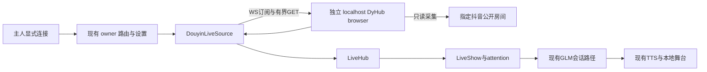

# 工程上下文：FEAT-002 抖音只读桥接与本地舞台互动

## 当前有效方案

### 架构设计

**关联产品上下文**：`.sdlc-v1/context/REQ-002.product.md`

**工程上下文**：`.sdlc-v1/context/FEAT-002.engineering.md`

**已确认需求**：产品上下文 NEED-001/002 与其分列的主方案约束；Backlog/Spec 与修正 Plan 已由主 Agent 接受，当前进度以 state.json 为准。

**创建日期**：2026-11-09

**状态**：修正 Plan 已由主 Agent 接受；REQ-002 in_delivery，FEAT-002 / TASK-002 已实际登记并进入 Build，进度以 state.json 为准。

**分支/功能基线**：`codex/macos-yovoice` / `0fa95631550857708e67684b6bbba41e102c34ae`。

#### 背景

预期结果引用产品 SC-01 至 SC-04。长期产品/架构来源为 `none`（`../project.md`）；不补造路线图。FEAT-001 已发布，继续用当前 GLM/TTS、私有试听、舞台服务和会话调度。本设计跨协议、持久化、身份和 UI，正文比简单表单功能更长，用于保留兼容/恢复约束；不另建平行设计或调研账本。

当前源码：`core/live.ts` 的平台仅 B 站、连接与房间 ID 为 number；`core/platforms/source.ts` 已有事件/状态回调，factory 只注册 Bili。`core/hub.ts` 同参判断/保存只保留 platform/roomId/cookie，礼物同 ID 按增量累加。`body/show.ts` 把事件送 attention、舞台及记录，`connect(number,cookie,remember)`、快照和状态仍假定 B 站；viewerCard/knowsViewer/optOut/画像和 runtime blocked 仍按 B 站/raw uid。`dsh/index.ts` 管 settings、连接、恢复、账号/OBS 路由；`dsh/runtime.ts` 提供保存、cookie、后台 inbox、OBS/社交对象；`dsh/agent.ts` 工具主要在注册时由 localRehearsal 限制，push 文案也只有本地彩排/B 站分支。现有 Drawer 和 `dl-*` CSS、WS 依赖、Vitest/jsdom 与 e2e fixture 可复用，无 Tailwind，不引入 shadcn/新 UI 框架。

**复用决策问题**：能否以独立 localhost 采集器接入真实抖音事件并复用 Source→Hub→Show，而不把签名、浏览器/账号和 B 站权限带进插件？重要未知是实际房间可用性、状态真实性、礼物累计数、身份和许可证边界。

| 顺序/候选 | 覆盖、证据与成本 | 决定 |
|---|---|---|
| 现有实现/依赖/官方扩展 | 复用 LiveSource、Hub、Show、attention、GLM/TTS、Drawer、`ws`。官方接口的应用资格和特定指令范围见调研来源，不能替代任意公开直播间事件流。 | 扩展现有插件适配器；官方入口不作为本次通用采集接口。 |
| [DouyinLiveWebFetcher](https://github.com/saermart/DouyinLiveWebFetcher) | Python/签名运行时及许可分发约束，增加集成成本。 | 不选，不复制签名实现。 |
| [UniBarrage](https://github.com/BarryWangQwQ/UniBarrage) | Go、多平台范围与额外许可核查成本，维护资料较早。 | 不选，不复制采集/签名代码。 |
| DyHub browser branch | 固定 [3a79c57d85c59289db3b77211b3ec01fae47d42c](https://github.com/ymstar/dyhub/tree/3a79c57d85c59289db3b77211b3ec01fae47d42c)，v0.3.1，Node≥20，真实浏览器/CDP + WS/HTTP，插件无需嵌入采集代码。 | 采用独立本地 browser runtime；插件原创协议适配，不复制/打包 AGPL 签名脚本，不启用 lightweight。 |

外部调研与源码核查日期为 2026-11-09。候选 stars/维护/许可声明、官方原始链接与决策召回范围唯一引用兄弟目录 `../douyin-research/RESEARCH.md`，不复制完整调研；当前准备复核固定 DyHub 源码与离线证据。知识召回 `NO_MATCH`，未据一般爬虫资料选型；上游许可范围是源码/分发风险观察，不是法律结论。

二次验证引用兄弟目录 `../douyin-research/dyhub-offline-verification.md` 与固定 checkout `../douyin-research/repos/dyhub/probe-offline.mjs`：Mac arm64 Node 26 的安装、typecheck/build 和实际 protobuf→normalizer→LiveSession→WS 离线探针已通过；大于 2^53 字符串 ID 保真，证明 `__connected.room.status` 可为 connecting，订阅会启动采集且关闭客户端不停止采集。同一证据文件另记录公开上游样例房间的一次匿名 browser 探针：Chrome 157.0.8103.38，28.084 秒含清理，connecting→live→stopped，138 条归一化事件（含 4 chat、11 like、86 member、3 room、34 unknown），测试后所属资源关闭。未观察到礼物；这不证明用户目标、插件集成、金额/连击、重连或长期稳定性。正式插件验证资产须纳入候选 commit，不能只依赖仓库外探针。

#### 架构与组件

该图覆盖 FR-01 至 FR-04，插件与采集器是两个生命周期；正文接口规则包含失败、停止与晚到数据边界，未绘制的 B 站功能仍按原行为隔离。

##### 平台目标、设置与能力判断

- **职责**：单一共享平台/房间校验与运行时能力判断，供 settings、路由、UI、agent、恢复和后台任务调用。仅增加当前两平台所需能力，不建设通用权限框架。
- **接口**：数据模型和 API 契约见下。始终从调用时的生效设置/连接读取能力；owner 仍为原 DSH route wrapper，不增匿名连接入口。活动订阅使用 config/source 是否存在判断；抖音含错误保留对象但不自动重订阅。切目标同时检查同步登记的 Bili 操作/清理 lease 和广播/所属 OBS 活动，不能只用 `isConnected`。
- **覆盖**：FR-01/03/04。

##### DouyinLiveSource 与 factory

- **职责**：校验本地 bridge 与目标、首次显式订阅单房间、处理 WS/有界状态查询/心跳、过滤/归一化事件、正增量礼物、停止与代际隔离。传输失败或房间终态只报错，首期不自动重新订阅。注册进现有 `createLiveSource`，复用 `ws`，不引入上游运行时依赖。
- **接口**：实现现有 `LiveSource` listener；仅 WS `/ws?roomId=<string>` 与 GET `/api/rooms/<string>`。状态与事件规则见专节。不会调用 bridge 的 chat、账号、Cookie、POST disconnect 或 DELETE room。
- **覆盖**：FR-01/02/03。

##### LiveHub、LiveShow 与 attention

- **职责**：保留完整 discriminated config、转发事件/状态，沿现有 attention→push→TTS→stage 处理；扩展房间与记录的平台标记，隔离 B 站身份与长期记忆。未知价礼物进入既有小礼物节奏，无大额优先权。
- **接口**：保留 `show.connect(number,cookie,remember)` 的 B 站兼容入口，增加接收共同 `LiveConnection` 的连接入口或独立 Douyin 入口；抖音强制 remember=false，viewerCard/画像/optOut/knowsViewer 和 B 站 blocked 仅在 B 站使用。目标 epoch 变化/断开通过 scoped clear 清除旧 Hub、Show、控制台和舞台临时上下文，用户历史/TTS/已保存 Bili 设置保留。优先复用既有 reload/reset；只允许必要 additive metadata 或局部清空语义，不重设计 stage 协议。
- **覆盖**：FR-02/03/04。

##### 现有 Drawer 与全局 usage

- **职责**：沿用现有控件，增加平台/房间保存、只读本地地址、准确状态、帮助和断开说明；抖音屏蔽 B 站专属操作与推流选项，保留声音区。
- **接口**：客户端只调用现有 owner 路由，不直接访问采集器；错误保留草稿，先保存再连接。Operate 目标，已有视觉 baseline，不新增原型/设计系统。Impeccable 能力检查复用主会话既有结果，Build 按 design 卡及实际已具备能力做有界检查，不自动安装/下载。
- **覆盖**：FR-01/04/05。

#### 关键设计决定

##### 决定 1：独立固定 browser 采集器 + 原创插件适配器

选型依据见复用评估。插件不嵌入采集器源码、依赖或签名资源；主人手动启动专用 localhost runtime、管理自己的采集生命周期。接受额外本地进程与真实平台兼容不确定性，换取与原插件、模型及账号职责隔离。采集器功能存在不等于插件获准使用。覆盖 FR-01/02/03/04。

##### 决定 2：增量兼容、完整操作生命周期与目标 epoch

使用 union 区分 Bili(number,cookie) / Douyin(string,bridgeUrl)，不将所有平台 ID 转为 number。原 settings 字段和旧快照解释保持；抖音不会自动恢复。路由/旧工具/后台/Cookie 入口检查之外，用同步 lease 覆盖完整 Bili 异步操作与清理生命周期，target epoch 限制后续副作用和结果写入；有 lease 或广播/OBS 活动就不能提交新目标。允许切换或断开时清除旧临时上下文，平台过滤即使在新目标首次连接前也成立。覆盖 FR-03/04。

##### 决定 3：上游数据不足时保留未知

不以 WS open 或 `__connected` 当真实采集成功；不换算 diamond→CNY，不假设 `groupCount` 单位数含义，不从点赞 count 展开事件。礼物以可信组的 repeatCount 正增量处理，严格校验不可信输入；这会舍弃部分信息不足的礼物，不能为提高事件覆盖虚构语义。覆盖 FR-01/02。

##### 决定 4：首期传输恢复完全由主人显式操作

固定 room WS 对 missing/stopped 房间会启动采集，GET 预检无法消除检查后状态变化带来的副作用。初次 owner connect 可以启动只读采集；传输失败/终态后不做自动 WS 重订阅、不订阅全部房间、不修改桥接器 API。错误保留 config 锁，提示先断开订阅，再显式连接；closed/error 的上游先在采集控制台恢复或停止后重开。接受恢复需要人工步骤，避免自动重开主人已停的采集。覆盖 FR-01/03/05。

#### 数据模型 / 关键实体

以下是 schema 权威定义，其他章节引用此处，不重复类型。

| 实体 | 变更/约束 | 覆盖 |
|---|---|---|
| `LivePlatform` / `LiveConnection` | `'bilibili' \| 'douyin'`；Bili `{platform:'bilibili',roomId:number,cookie:string}`，Douyin `{platform:'douyin',roomId:string,bridgeUrl:string}`。保留 config 的全部字段，same 比较全部对应字段。禁止 Number/parseInt 处理抖音房间/用户/礼物/事件 ID。 | FR-01/02/04 |
| settings | 加 `livePlatform` 默认 bilibili、`douyinRoomId` 默认空字符串；旧 `roomId:number|null`、`ownRooms:number[]`、blocked、voice、tts 原样保留。Douyin 输入只接受 ASCII 数字字符串或无 query/hash/userinfo/port、精确 host/path 的 `https://live.douyin.com/<digits>`；保存为数字字符串。设 1–64 位边界作为有界输入默认，不去除中间字符、不抓取 URL/短链接。 | FR-01/03/04 |
| 房间/Show 状态与快照 | `LiveRoomInfo`、Show roomId/status、持久快照按 platform 判别：Bili number、Douyin string，nullable 沿原行为。旧快照缺 platform 解释为 bilibili；新抖音快照带 platform、字符串 roomId、streamId:null，决不自动恢复。日志 begin/event 带平台/目标标记；不改变 Bili 旧记录读取。 | FR-02/03/04 |
| `LiveGiftEvent` | 增可选 `valueKnown?:boolean`；抖音 `valueYuan:0,valueKnown:false`，Bili 缺字段继续原金额语义。界面/提示词/日志显示未知，不称免费或 0 元；不写入已知价值消费合计。 | FR-02 |
| 单订阅缓存 | 上游稳定 id 去重按 `douyin + room + upstreamId`；gift group key 为 room/user/giftId/groupId，输出稳定 group event id，保存最大累计值。source 组缓存与 Hub 对应抖音聚合共用或明确共享同一组常量：2 分钟无更新 TTL、最多 4000 组，活跃正增量延长本地 `observedAt`；消息 ID 去重缓存同样有 2 分钟/4000 条界限。使用本地接收时间驱逐，不用平台 ts/未来时间保留缓存。仅在同一 source 生命期内保留；传输失败不重新订阅，显式 disconnect/new source 清空，不承诺新订阅连续去重。 | FR-02/03 |
| target epoch / Bili operation lease | 仅内存的目标代际和活动操作计数。Bili 入口同步取得捕获 epoch 的 lease 后才开始任何 await；覆盖整项操作、fire-and-forget 生命周期和在途清理，finally 释放。广播持有到准备/face/推流/停止和所属 OBS health/清理完全结束；退役 Bili source 的 connect/handshake 清理也计入。切目标要求计数与所有权活动均清零，断开递增 epoch，但不提前释放未结束 lease。 | FR-03/04 |

持久设置仍由现有同目录临时 JSON+rename 保存，写成功后才更新内存，保留未知字段与 TTS 优先级。新增字段应校验，错误不覆盖当前文件；只补相关旧版/损坏 JSON/失败写入回归，不新建持久化框架。不开数据库迁移，不为抖音调用 B 站记忆写/读路径。

#### API / 接口契约

- **owner settings/state**：既有 `/api/dsh-livestream/settings` 增量接收新字段，返回既有 state。前后端同用目标校验；platform/目标变化的同步提交必要条件为：show offair、hub 无 config/source、Bili operation/cleanup lease 计数为 0，且 broadcast 不在 preparing/face/streaming/stopping、无所属 OBS health 或清理活动；否则返回既有 `{ok:false,error}` 的 409，说明先停止、断开并等待旧操作结束。相同值及声音等无关设置仍可保存；一次 patch 按最终组合校验，成功持久化后才同步发布新 epoch、清空旧临时上下文并暴露新目标，不允许任何 await 在条件检查与提交间插入旧操作。抖音请求不得设置 ownRoom、blocked、Bili 账号/广播副作用；Bili 保存值保留到切回使用。
- **owner connect/disconnect**：沿现有路径，connect 读取已保存目标并创建对应 config；Bili 继续原 cookie/remember 行为，且 `localRehearsal=1` 仍拒绝 B 站。Douyin 不读 cookie，即便本地彩排 flag=1 也允许主人首次显式只读连接。错误后同 config connect 不隐式重开，要求先 disconnect；disconnect 使 epoch 失效、关闭 source 自身 transport/timer/query、清空临时上下文，不调用采集器全局停止。Bili source 的未结束 connect/handshake/cleanup lease 继续阻止切目标，直至真正 settled；不能因 disconnect 返回就假设在途动作已结束。UI 保存成功再连接，错误不丢草稿。
- **部署 bridge 参数**：新增 `DSH_LIVESTREAM_DOUYIN_BRIDGE_URL`，默认 `http://127.0.0.1:8757`。仅 HTTP、精确 loopback 数字地址 `127.0.0.1` / `[::1]`、合法端口；禁止 userinfo/query/hash/非根 path、远端或可重定向目标；HTTP fetch `redirect:'error'`，WS 禁止 followRedirects。UI 只读展示规范化 origin 与采集控制台帮助，不提供地址/Cookie 编辑。localhost 名称不纳入首期，避免 DNS 解析扩大目标范围。
- **DyHub 固定 WS envelope 与调度时间**：控制帧 `__hello/__connecting/__connected/__error` 与普通 `{id,roomId,platform,type,ts,receivedAt,user?,data}` 分开解析。普通帧要求 platform===douyin、roomId 精确等于目标、id 非空字符串、有限正毫秒上游时间与受限字段；不接受数字 ID；未知类型安全忽略。通过校验后，下游事件 `ts` 一律取插件本地 reception time，与 cache observedAt 使用同一受控时钟；需要保留上游时间时仅作可选 metadata，绝不用于 attention 成熟/过期/调度。未来但合法的上游 ts 不能使礼物永久不成熟或不失效；Bili ts 不变。用户 ID 可空，名称经现有清洗。单 WS frame 1 MiB、文本 2000 字符、受限字段长度和有界缓存；malformed/foreign 数据不能更新 stats/state。图片只接受 http(s) URL，不执行 HTML/富文本原内容。
- **状态事实及优先级**：WS open/hello 只表示传输就绪。`__connected.room` 或 GET `{room:{roomId,status,error?,progress?,meta?,stats?}}` 校验目标后，同快照先看 status：live 发 connected，即使其中仍有旧 `progress.step==='error'`；仅 status 不是 live 时应用 progress.error。connecting 发 connecting；closed/error/stopped 及非 live 的 progress.error 显示 error 和原因。后续新 roomStatus error/closed 仍覆盖先前 live；control 名称不能覆盖 room.status，roomStatus 校验 platform/room。不从采集器消息数当在线人数。
- **状态补全与手动恢复**：先挂 WS listener 再补 GET；每次 GET 捕获 generation/状态序号，晚到快照不得覆盖期间更新的 roomStatus。connecting 时每 2 秒且最多一个 GET 在途，单 GET 5 秒上限、最多 45 秒等待采集；超限明确 error。WS 每 20 秒 ping、10 秒无 pong 判传输失败。传输失败或上游 stopped/error/closed 终态立即关闭自身 transport、GET、heartbeat 与 timer，显示“先断开订阅，再显式连接”，config/source 对象保留锁定直至 owner disconnect。没有自动 WS 重订阅或 Douyin reconnecting 状态；GET 预检不能消除 WS 自动采集的 TOCTOU，不用它声称安全自动恢复。上游 closed/error 须先在采集控制台恢复或停止后重开；插件不订阅全部房间、不改 bridge API。全部 I/O 受 generation/AbortController 管理，终态和 stop 后的晚到回调无效。常数为工程默认，非实测 SLA。
- **事件归一化与未知统计**：chat→chat，member→enter，follow→follow，like→最多一条 like（有效正 count 且有效 user），正有限安全整数 total 才更新已知 likes；room.data.total→online、totalUser→watched 同样只接受正有限安全整数。固定 normalizer 将缺失字段填 0，不能区分真实零；0、缺失及无效值统一为 unknown，使用现有替换/清空机制呈现未知，不输出已知 0，不将 popularity 猜成其他人数。valid live status 更新 stats.live；terminal 清空旧 online/watched/likes 并设 live=false，断开/目标变化清空整个房间统计。其余元数据不接入，不伪造 membership/superchat。follow 仅按固定 bridge 已提供的类型映射，不根据未验证的 social.action 数字猜测更多动作；真实关注语义验证范围保持明确。
- **礼物计数**：先用 upstream id 去重，再校验 giftId/name、正安全整数 repeatCount。giftId 和 groupId 的全零字符串 sentinel（如 `'0'`）按无效/缺失处理，不用 Number 转换；无效 giftId 丢弃，不能把所有 `'0'` 组并为一组。combo=true 必须有有效 groupId，组内新最大值减原最大值为 delta；仅 delta>0 发给 Hub，稳定 event id 是组 key，结束帧有新增仍发、无新增不发。combo=false 且缺有效组可用独立 upstream id 为组、按一次有效 repeatCount；combo 不明确且缺组丢弃。`groupCount/comboCount/diamondCount` 不乘入数量或金额。Hub 增量累加；在同一 source 的有界 group-cache 窗口内保持稳定 ID 和累计显示，不受 Bili 30 秒拆组规则影响。显式 disconnect/new source 清空；Bili 原语义保持。验证跨 30 秒续增、乱序、TTL、未来平台时间与 4000 组上限；超出窗口/容量、新订阅或进程重启不承诺 exactly-once。

#### 时序与数据流

1. 主人保存平台/房间；owner handler 原子验证最终目标、活动状态和字段，成功持久化后返回。
2. 主人显式连接，读取保存值，创建新的 source generation；连接 WS 会使 DyHub 开始该房间上游采集，这一副作用在 UI/usage 明示。GET 只补实际状态，不发全局停止。
3. 目标合法事件经去重/礼物 delta 到 Hub，再进 Show、attention、stage；开始舞台互动才进入既有 GLM 会话。测试以 fake push/TTS 验证这条实际路径，不用空 API 假页面。
4. transport 失败/terminal 关闭自身 I/O 并报错，不自动重新订阅；config 保持锁定。主人停止舞台并断开后，epoch 使旧回调失效并清除临时上下文；只有旧 Bili 操作/所属清理完全结束才允许提交新目标，采集器另由主人控制。
5. 重启保留目标配置。自动恢复函数先判断 saved/current platform 与 local flag：抖音或当前选抖音均不 connect/resume/adopt/distill；只有合法 Bili 旧行为可恢复。旧 saved.broadcast=true 不产生抖音推流。

#### 横切质量设计

- **能力与在途隔离**：统一 `canUseBilibili`/等价判断要求当前 Bili 且非 localRehearsal；state/UI 对 Douyin 有效 broadcast=false，保留原 Bili 值。账号/login/OBS/broadcast 路由、Cookie 和旧工具执行入口检查当前能力，并同步取得完整操作 lease；不能只依赖注册时 return、Cookie 读取时或一次 await 后检查。lease 从首次 await 前覆盖整个 Bili 异步操作、fire-and-forget start、newShow/inbox/placeGame/DM 等后台生命周期，finally 释放；broadcast.run 多次 await、face 等待、streaming、stop、所属 health poll/清理及退役 BiliSource connect/handshake 清理都不能提前释放。已有请求可完成，但新目标不提交，且每次后续外部副作用、状态写入/发言前复查捕获的 target epoch。过期操作只清理自己资源，不用旧凭据继续下一步。实现只增加当前两平台必要的 scoped tracking，不建设通用权限框架。
- **旧 agent 与异步结果**：Douyin 仅 show_stats；上述 lease/epoch 规则同样约束已加载 Bili 工具和异步返回。push 的 Douyin 提示优先于 localRehearsal，按实际连接说明只读输入与本地输出，未连接不声称接通，不说“仅模拟观众”，不承诺视频、账号、游戏、私信、抖音发言或推流。`topicText.idle` 在 Douyin 去除 B 站视频建议，Bili 不变；`index.simulated()` 用当前平台，Douyin UI/API 不提供 membership/superchat。
- **身份、临时上下文与隐私**：Bili blocked/optOut/knowsViewer/profile/viewerCard 只用于 Bili；Douyin 同 raw uid 不沿用 Bili 黑名单，不读写 Bili 卡片/stream、不 distill。断开/允许的目标切换同步清空 Hub recent/pending/room/stats/gifts/seen/rates，Show pending attention/identity cache/viewer context，stage/console 旧房间 feed/focus/context；清除旧 pending flush，并用 epoch 阻止晚到重新填入。lookupViewer/knowsViewer 按当前平台过滤，即使从 Douyin 切回 Bili 尚未第一次连接也成立。保留用户历史、TTS、Bili 持久设置与已接受的当前一句声音；新目标不能消费旧 topic。当前事件经既有清洗入提示词，日志带平台；不收集 secUid/Cookie/raw payload，不回显凭据/本机路径。
- **未知价与节奏**：attention 的小礼物候选将 `valueKnown===false` 作为受限可谢条件，仍受 existing thanks cooldown、batch 和 3 分钟过期约束，不按大额优先；Bili 的 valueYuan=0 免费礼物行为不变。topic/stage/record 不把未知误显示为 0 元或免费。
- **并发**：owner save/connect、操作 lease 获取与 target-epoch 提交使用同一同步检查边界；禁止 active 切目标，也禁止 offair/无订阅但 Bili 操作未 settled 时切目标。Hub config/source identity、target epoch、Source generation 与 state request version 共同拒绝晚到帧/查询/写入。断开使 epoch 失效，不虚构清理已完成。需要改变协议先报告主 Agent。

#### 风险与取舍

**实现期来源核对补充（主 Agent）**：原 `cordis.patch.yml` 的直播 preset 使用 B 站专属 system persona，不能只依靠较低优先级的 user mode 提示消除冲突。本 Task 增加独立 `dsh-livestream-douyin` preset，沿用角色、中文口语/表情与不信任观众指令的规则，system 只说明抖音只读输入、当前本地舞台输出及 show_stats，不承诺 B 站账号、视频、长期记忆或抖音发言/推流。既有 B 站 preset 保持原文；Console 按所选平台选择新 preset，GLM 模型选择沿原行为。写边界因此增加包内 `cordis.patch.yml`，不修改 Harness 或真实 profile；用确定性 YAML/preset 选择与实际加载检查验证，不增加模型消费评测。此为已接受 AC-10 真实能力说明的实现澄清，不改变产品范围。

| 风险 | 影响 | 缓解措施 |
|---|---|---|
| DyHub browser/抖音协议变动或匿名受限 | 离线通过但实际收不到 | 固定 commit、保留 error/progress、显式真实未测；有 URL 后只读检查，不自动登录或换签名内核。 |
| shared collector 生命周期 | 断开后仍采集或误停他人 | 文案明示、插件不 POST disconnect/DELETE；专用 localhost runtime，主人管理生命周期。 |
| 累计数/缺字段/缓存过期 | 重复谢礼或漏礼 | 正增量、组隔离、有界去重；缺必要组数据丢弃；无人民币承诺，不宣称无限去重。 |
| Bili 旧工具/后台或身份泄漏 | 对外动作/记忆串平台 | 完整生命周期 lease、目标 epoch 与同步切换限制、临时上下文清空、Douyin 禁长期记忆，负向测试零外部调用。 |
| 共享服务构建热加载 | 删除在用 lib 或旧模块缓存 | Build/独立验证在隔离复制目录；主 Agent 协调 offair 后本地构建/加载，不自动停止共享 3080/3081/7390/8757。 |

#### 需求覆盖

| 当前验收条件 | 权威设计/契约 | 计划 Task | 计划检查 |
|---|---|---|---|
| AC-01/07/09 | 数据模型、owner settings、lease/epoch、恢复时序 | TASK-002 | 新旧持久化/失败保存/超大字符串 ID；offair/无订阅的 deferred Bili 操作与退役 source 清理阻止切换 |
| AC-02/04/08 | Douyin source、状态优先级/手动恢复/取消、只读生命周期 | TASK-002 | WS 断开及 stopped 时零自动重订阅；GET 乱序、live+旧 progress.error、真实后续 error、断开零控制请求 |
| AC-03/05/06 | 本地事件时间、礼物 delta、Hub/Show/attention、未知价/统计 | TASK-002 | source→Hub→Show fake push/TTS；未来 ts 礼物成熟/过期、真实 normalizer 缺字段 wire fixture、去重/串组/结束帧 |
| AC-10 | 完整能力/身份隔离、临时 context clear、prompt、stage scoped reset | TASK-002 | 同 uid 的 Douyin→Bili 未连接 lookup/profile/DM、pending flush/late frames/focus、旧工具/后台零副作用、Bili/FEAT-001 回归 |
| AC-11 | Drawer/usage 组件 | TASK-002 | e2e 双视口/键盘/失败恢复，按文档实际操作并注明 synthetic/live 范围 |

### 实施计划

**关联产品上下文**：`.sdlc-v1/context/REQ-002.product.md`

**关联设计**：上文架构设计；不另设有效方案。

**创建日期**：2026-11-09

**状态**：主 Agent 已接受本实施计划，TASK-002 in_progress；由唯一 Terra worker 实施。

#### 背景

交付一个纵向集成，数据、权限、UI 和回归相互依赖，由同一 Terra worker 完成并负责必要修正。此前固定上游探针只是可行性输入，正式插件证据仍需本次任务生成。

#### 目标 / 非目标

目标是产品 FR-01 至 FR-05 的可操作本地集成与可复验资产。非目标完整引用产品 OUT-001，不扩展第三方采集器功能、官方平台应用、远端管理或生产推流。

#### 技术栈

TypeScript 6、Node/macOS、React 18、自有 Drawer/CSS、现有 `ws`、Vitest/V8/jsdom、固定 `e2e 0.23.0` / `@e2e-dev/web 0.15.5`。独立 DyHub 仅 browser 模式且固定版本；使用已有系统 Chrome，测试复用现有 Playwright 浏览器 rev 1248，无下载/新框架。

#### 实施层决定

一个完整 TASK-002，按“最小契约测试→实际适配器/Hub/Show 核心旅程→完整操作隔离/手动恢复/UI/文档→必要回归”顺序实现，默认 TDD。接口和身份约束由主 Agent 定义，一次有界只读协议复审已完成，六项采用修正见下方实际记录；本轮不是新复审。Build 决定局部实现，不改变产品范围或上述契约；出现新的实际冲突再报告。

#### 风险 / 取舍

使用完整纵向 Task 避免多个 writer 同时改 runtime/index/show/测试 fixture；真实目标缺失不阻塞离线实现，但不能给真实房间通过结论。不得通过绕过严格缓存、降低覆盖率、测试空 API 或更换 provider 获得通过。

#### 实施阶段

1. **核心增量**：在 TASK-002 内先实现模型/输入校验、真实 WS adapter、Hub config 与 Show 只读路径，运行 source→Hub→Show 的确定性 fake push/TTS 检查。最早可检验结果是隔离桥接送一条目标弹幕后，真实插件路径产生带正确平台的舞台事件与现有会话提示；同时 socket-open 不显示采集成功。记录版本、实际命令、范围及真实房间未测后报告，继续同一 Task，不将中途演示当作 done。覆盖 FR-01/02；设计：source、Hub/Show。
2. **完整旅程**：完成 scoped Bili operation lease/epoch、旧工具/后台与退役 source 清理防护、目标切换/快照兼容、临时上下文清空、本地调度时间、未知价/零统计语义和 Drawer；补错误/停止/手动恢复/身份回归。覆盖 FR-01/02/03/04，对应上文契约。
3. **正式资产**：扩展 e2e 使用真实 Console/CSS/路由/source + 独立 WS fake bridge，补双视口三条旅程；扩展 coverage include 到实际变更的 core/platforms/hub/show/shared/UI，FEAT-002 报告路径可配置且 FEAT-001 默认兼容。覆盖 FR-01 至 FR-05。
4. **操作说明与检查**：在根 `README.md`（唯一全局 usage）增加 `LIVE-DOUYIN-CONNECT` / `LIVE-DOUYIN-DISCONNECT` 稳定故事导航，链接详细示例 `examples/douyin/README.md`。记录 actor、owner 权限/本地环境、平台/房间来源、bridge env owner、固定上游 commit、browser-only/loopback、独立工作目录/数据及手动停止方式；无 Chrome 私有 profile、无 Cookie 文本、无账号动作。启动/安装命令必须在授权内实际验证后写入。用法从“保存→首次显式连接→准确状态→本地舞台→停止→断开→采集控制台停止”走通；断网错误需“先断开订阅，再显式连接”，closed/error 上游先在采集控制台恢复或停止后重开，无自动恢复承诺。未执行项单列。覆盖 FR-05。

#### 需求覆盖

完整 AC→设计→Task→检查映射仅在上文需求覆盖表维护；各实施阶段引用它，不复制 schema 或产品规则。

### 工程任务

**输入**：上文架构设计、实施计划与已接受的产品规格。

**前置条件**：Backlog/Spec 已接受；本轮协议复审已完成，Plan 等待主 Agent 接受并创建 FEAT-002、登记完整 Task 后才开始 Build；准备 Agent 不修改 state。

#### TASK-002 [US1/US2/US3] 集成抖音只读房间事件与本地舞台互动

- **所有者/依赖**：一个 Terra `worker`，依赖 `[]`，同一 worker 负责实现、必要验证和修正直到接受；不拆独立“补测试”worker。独立 Validate/Review 是后续阶段。
- **源码写边界**：`packages/dsh-livestream/src/core/live.ts`、`core/platforms/index.ts`、新增 `core/platforms/douyin/**`、必要 shared 平台校验/能力/operation-epoch tracking 模块、`core/hub.ts`、`core/attention/attention.ts`、`core/topicText.ts`、`body/show.ts`、`dsh/runtime.ts`、`dsh/index.ts`、`dsh/agent.ts`、`console/console.tsx` 及必要少量 `console/client.tsx`。为完整在途/清理 tracking 可最小修改 `body/broadcast.ts`、既有 Bili adapter/source/account/social/helper（包括 `body/biliAccount.ts`、`body/biliSocial.ts`、`body/social.ts`、`body/dm.ts`、`core/platforms/bilibili/biliSource.ts` 及实际调用链必要 helper）；仅加入 scoped lease/epoch 与 union 兼容，不重构其余业务。stage protocol/store/UI 只允许本次未知价/平台 metadata 和旧 room/feed/focus/context 的 scoped clear/reset，复用既有 reload/reset，不重设计协议。不得修改 TTS provider 行为、Harness/yovoice、upstream 项目、真实配置/数据。
- **测试/文档写边界**：包内 `test/**`，`vitest.config.ts`、`e2e.config.ts` 及必要独立 FEAT-002 e2e 配置；`README.md`、新增 `examples/douyin/**`，必要 `.env.example` 只写变量名，`.gitignore` 只处理本次产物。无新增运行依赖；现有 package 脚本仅为 FEAT-002 隔离入口必要时调整。Feature 实现/证据章节由被授权的阶段 writer 更新，state/project 与产品行为变更仍归主 Agent。
- **完成条件**：AC-01 至 AC-11 的离线/本地合成范围全部有实际结果；准确说明真实房间/浏览器/生产 owner 身份缺口；完整 FEAT-001 回归与必要 Bili/本地彩排检查通过；usage 命令与实际步骤一致；源码正常分行、无无关重构。零 provider/model/账号/推流动作、零共享服务变更。未满足不得请求 done。
- **覆盖**：FR-01 至 FR-05；计划：全部四个实施阶段。完整 write boundary 是一个可验证结果，不是多个并行任务。

#### 依赖与执行顺序

TASK-002 为唯一计划 Task；无并行 writer。正式执行由主 Agent 的 `start-feature`、`add-task` 后进入 Build。源码与测试提交完成、业务树干净后，独立 Terra Validate 执行已提交资产，随后独立 Sol reviewer 检查产品/架构/安全/设计/QA；主 Agent 保留最终接受。原授权内连续推进不新增逐阶段用户确认。

#### 执行策略与计划验证

**correctness / OpenAPI / eval-bench（零模型调用）**：用当前 Vitest/V8，直接调用真实 owner handlers、Source、Hub、Show 和现有 agent/tool 接口。基础检查包含新旧设置/快照、失败写入保护、严格房间/bridge URL、>2^53 ID、foreign/malformed frame、same-config、原 Bili/FEAT-001 回归。Source→Hub→Show 以 fake brain push/synthesize 观察真实提示/舞台，GLM/TTS provider 调用预算 0；prompt 仅确定性检查，不声称模型质量评测。以下为本次必要边界：

- 传输失败后即使 bridge 变 missing/stopped，也观察到 WS 连接次数仍为 1、零自动重订阅/控制请求；config 锁定、提示手动断开再连接，disconnect 取消 query/heartbeat，旧回调无效。已 closed/error 上游在插件重连前需要控制台处理，测试不通过改 bridge 或 all-room 订阅绕过。
- 同快照 `{status:'live',progress:{step:'error'}}` 仍 connected；后续真实 error/closed 终态生效，晚到 GET 不覆盖较新 roomStatus。
- deferred `BiliSocial.postDynamic` submit_check 返回前、broadcast.start 多 await 期间，在 offair/无订阅条件尝试切目标得到 409；操作/所属 OBS health/stop/cleanup 全部 settled 后才允许。退役 BiliSource connect/handshake cleanup 同样锁住切换；下一副作用前 epoch 检查，所有网络/OBS 均用替身，无真实动作。
- Douyin raw UID X→停止/断开→选择 Bili 但不连接：lookup/profile/DM 不得选中旧 X；pending flush、late frame、attention/topic/identity cache、console feed 与 stage focus 清空，不把旧 topic 交新目标。用户历史/TTS/Bili 配置保持，已接受一句声音可完成。
- 礼物 duplicate/out-of-order/end/missing-group/全零 groupId 或 giftId/interleaved-user、跨 30 秒、TTL/4000 组界限与独立新订阅缓存清零；实际 Source→Hub→attention 输入 future ts，按本地时钟成熟并过期，Bili ts 语义不变。正常热度未知价礼物可受节奏约束地谢礼，不称免费。
- stats 的缺失字段须通过固定上游真实 normalizer 生成最小 wire fixture（含 provenance：commit、method、合成输入、生成方式），提交 fixture 后经真实 adapter 证明缺失→0→unknown；不只手写省略字段，不嵌入上游 runtime/签名依赖。相同 fixture 补全零 groupId/giftId sentinel；正数总量与终态清空检查，点赞 count N 不展开 N 条。

**Web 三条旅程**（e2e CLI/Web engine）：①选择抖音→保存刷新→connecting→真实 bridge live→事件进入控制台/舞台/假脑；②采集器不可达/非 live 的 progress.error/传输断开→输入保留与错误→无自动重订阅→断开→必要的采集控制台恢复说明→显式连接→断开及采集仍运行提示；③活动操作/订阅切换被拒绝→全部停止/清理→断开→Bili 尚未连接时无旧用户/feed/focus→声音保存/私有试听回归。真实 Console/CSS、真实路由/source，隔离真实 WS server 模拟固定协议；fixture owner 不等同完整 Harness 鉴权。桌面 1440×900、narrow 375×812，检查键盘、焦点、溢出、错误、console/network 与确定性业务结果；截图/trace 不替代断言。

**资源与产物**：`cache.mode:'read-only'`、`strict:true`、workers=1、retries=0；不用 `agent.*` 或模型配置，预算 0。单用例 120 秒、单动作/断言 5 秒、整次 Web 10 分钟；单次测试批次 10 分钟内，超时保留日志并归因，不无限重跑。所有 HTTP/WS 端口用 loopback ephemeral，临时 DSH_HOME/独立 mutable 数据，fixture/server/socket/timer 由本任务关闭。禁止使用共享 3080/3081/7390/8757 或真实 DSH_HOME；不下载浏览器/模型/新框架。FEAT-002 原始报告写包内忽略目录 `.e2e/feat-002/`（report/JUnit/trace/screenshot/fixture.log）与 `coverage/feat-002/`（JSON/LCOV）；FEAT-001 历史证据保留，失败证据归档后重跑。

**命令与度量入口**：复用 project.md 已实际执行的 `pnpm --filter dsh-livestream check`、`build`、`exec vitest run --coverage` 与包内 `pnpm exec e2e run --config … --workers 1 --retries 0 --trace on --reporter list,junit --max-duration 600000`（保留 `npm_config_manage_package_manager_versions=false`）。FEAT-002 配置/报告参数需 Build 从本地工具 help 验证并记录实际成功命令后再写入指南。扩展 `test/coverage-diff.mjs` 接受可选 report path，保持缺省 FEAT-001 路径；使用本 Feature 固定基线 `0fa95631550857708e67684b6bbba41e102c34ae` 与当前 V8 报告，所有实际改动 UI/adapter/core 进入测量，阈值 80% lines / 70% branches，缺报告、基线无效或零 instrumented 改动非零退出。不得拿 HEAD 作为基线或复用旧报告。

**真实目标/usage**：独立 Validate 按 README 与参数 owner 在隔离本地 synthetic 目标实际操作并记录结果；主 Agent 在当前本地部署核对实际加载版本、UI 与帮助入口。采集器选型已完成一次公开样例匿名探针；插件实现接受后，主 Agent 最多再做一次同公开样例的集成短测（单房间、并发 1、收集不超过 30 秒、全过程不超过 60 秒），核对真实 source→Hub→Show/控制台/舞台输入，保持未开播和零 GLM/TTS provider。测试使用专属采集实例，结束只清理明确由此次测试创建的资源，不停止他人采集；独立供用户使用的空闲采集服务可按已授权本地安装目标保留。用户自己的目标房间仍未验证；不能将 synthetic 或公开样例写成用户目标 live PASS。不得为补证据登录或对外发言。

## 实现记录（实际）

- **状态**：Build 尚未执行。主 Agent 已 capture REQ-002 并 mark ready；FEAT-002/TASK-002 尚未创建，Plan 待接受。
- **实际改动与 Task 引用**：本准备及本轮修正只写本文件与 `REQ-002.product.md`；无源码/测试/服务/state/Git 变更，计划 Task 为 TASK-002。当前 state 的 REQ-002 ready 修改来自主 Agent，不归为准备者写入。

### 协议复审与修正日志（实际）

主 Agent 已组织并接受一次实现前只读 Doubt 分析；审查者未编辑文件。下表六项均为源码支持的真实契约缺口，不是可延后的建议；对应修正由主 Agent 明确选择，现已写入上文同一方案和产品 AC，等待修正 Plan 接受。没有再次复审或另建结果账本。

| 发现与源码依据 | 原候选缺口 | 主 Agent 采用项及对应契约 |
|---|---|---|
| D1：固定 DyHub `src/dispatch/wsServer.ts:61–69`，missing/stopped 订阅可 connect，closed/error 直接返回现状 | GET 预检与自动 WS 重订阅不能防止重新启动主人已停采集；closed/error 重订阅也不重建上游 | 决定 4、状态补全与手动恢复：仅初次 owner connect 可启动采集，失败关闭自身 I/O、不自动重新订阅；保留 config 锁并手动断开/恢复。 |
| D2：插件 `src/body/broadcast.ts:85–135` 多 await/OBS，`src/body/biliSocial.ts:268–285` submit_check 后 POST | 入口/Cookie/单次 await 后的检查不能撤销已捕获凭据；offair/无订阅也可能有在途动作 | target epoch/operation lease、owner settings、能力隔离：首次 await 前同步登记并覆盖完整操作/后台/清理，finally 释放；全部 settled 才能切目标，下一副作用与写入前查 epoch。 |
| D3：`src/core/hub.ts:116–125` disconnect 留临时数据，`src/body/show.ts:892` lookup 与 `:931` knowsViewer | 切回 Bili 尚未连接时可把旧 Douyin raw uid 当 Bili 用户；旧 pending/feed/focus 仍在 | 身份、临时上下文与隐私：disconnect/target epoch scoped clear 全链临时数据，lookup/knows 按平台过滤，包含首次新连接前；保留历史/TTS/持久配置。 |
| D4：固定 DyHub `src/collector/collector.ts:193` 写 progress error，`src/collector/liveSession.ts:82` 可随后恢复 live | 同一快照 live 可能仍带过时 progress.error，原规则会持续误报错误 | 状态事实及优先级：同一有效快照 live 优先，非 live 才看 progress.error；后续真实 error/closed 仍终止。 |
| D5：`src/core/attention/attention.ts:432` 成熟、`:541` 过期依赖 event.ts | 只约束缓存 observedAt 仍不能避免 future upstream ts 阻止礼物调度/过期 | envelope 与调度时间：Douyin downstream ts=插件本地接收时间，上游 ts 仅可选 metadata；实际 Source→Hub→attention 时钟测试，Bili 不变。 |
| D6：固定 DyHub `src/pipeline/normalizer.ts:227/236` 将缺失总数转成 0，礼物 groupId long 默认可成 `'0'` | 单靠 adapter 缺失检查不能区分 known-zero；全零组可错误合并 | 事件归一化/礼物契约：总数 0 保守 unknown、仅正安全整数已知，terminal 清旧 stats；全零 giftId/groupId 无效，非 combo 缺组走独立消息 ID。真实 normalizer 生成并提交带 provenance 的最小 wire fixture。 |

修正后的验收可观察性已推进：上述六项均有必要测试与明确写边界；没有实现/验证通过结论。新出现的真实契约冲突再由主 Agent 处理，本次不机械启动第二个 Doubt cycle。

## 验证记录（实际）

- **状态**：插件集成验证尚未执行。上文 DyHub 离线及一次公开样例真实 browser 证据仅作为选型输入，不是本 Feature 正式 Validate。
- **准备检查**：实际读取 root AGENTS/soul/user、project/state、当前源码/测试配置与固定 DyHub 协议；核对分支 `codex/macos-yovoice`、HEAD `0fa95631550857708e67684b6bbba41e102c34ae`。通过 `/Users/mac/Documents/Codex/repos/sdlc-pilot/scripts/lifecycle_state.py` 四项 `--help`（capture-requirement/mark-requirement-ready/start-feature/add-task），exit 0；没有 mutation。
- **覆盖与缺口**：固定采集器有公开样例的 Chrome 157/28.084 秒证据，无真实礼物结果；当前没有插件集成测试、DSH 实际采集或新部署证据。用户目标未提供，synthetic owner 不代表生产身份，fake TTS 不代表真实听感。

## 评审记录（实际）

- **状态**：本轮实现前协议复审结果见上方唯一修正日志，修正 Plan 待主 Agent 接受；尚无实现 commit 的正式 Review。后续独立 reviewer 对 validation commit 只读评审，必须修复项清零后才能批准。

## 发布与观察记录（实际）

- **产品观察计划引用**：`REQ-002.product.md` 的发布后观察计划，产品指标仅在那里维护。
- **技术发布准备**：当前维护分支不变；无公开平台发布/推流。Build 不能在共享 host 运行时删除重建其 linked lib；主 Agent 协调当前 offair 后，按既有本地目标加载已评审实现版本，核对真实 build marker 与 smoke。独立采集器手动启动、只绑定 loopback、使用独立 cwd/data，不触碰 Chrome 私有用户资料。
- **回滚**：断开插件订阅、停止本地舞台，主 Agent 在同一已授权本地目标恢复此前已验证插件产物/配置，保留 settings 的新增字段以便再接入；不删除 Bili/TTS 设置、会话记录或采集器数据。采集器只由主人停止。
- **实际结果/反馈/缺口**：尚未发布；用户目前没有验证房间 URL，用户目标未验证。公开上游样例的采集器探针结果见背景引用，DSH 集成尚未实现/运行，不能把该探针视为集成通过。本准备及修正文档没有采集、调用模型、登录、推流或操作共享服务。

### Build 工作树记录（2026-11-09）

- **状态与所有权**：TASK-002 由一个 worker 在分支 `codex/macos-yovoice`、基线 `0fa95631550857708e67684b6bbba41e102c34ae` 上实施；当前为未提交工作树，尚待主 Agent 验收、独立 Validate/Review 和受控加载。该记录覆盖上方准备阶段的“尚未实现”旧状态，不改写产品上下文或 lifecycle state。实际模型元数据不可见，不能独立宣称运行时模型。
- **改动**：新增严格字符串房间/loopback 地址校验和独立 `DouyinLiveSource`；单房间 WS/有界 GET、状态序号/超时/心跳、终态停止且不自动重订阅。事件按本地接收时间调度，礼物累计转正增量、未知金额、有限本地缓存；Hub 在组过期或淘汰后使用新事件身份，避免旧累计重合并。适配器使用的缺失零/全零 sentinel 测试数据来自固定 DyHub 编码器与 normalizer，合成输入和 commit 写在 `test/fixtures/dyhub-normalized-defaults.json`。
- **隔离**：目标切换检查活动订阅、舞台、在途 Bili/OBS 操作和清理；generation 在 disconnect 失效。退役 Bili 握手持有 lease 到 pending socket 关闭；后台、账号、工具、DM/profile/video/OBS 后续请求或状态写入执行代际校验。目标切换清理 Hub/Show/舞台/控制台临时上下文；Douyin→Bili 首次连接前禁止使用旧 UID 查询。只在 Bili 平台注册旧工具，并在其已捕获引用执行时再次检查。独立 Douyin persona 不改变原 Bili persona。
- **用户入口**：扩展原 Drawer；保存后显式连接，状态、手动恢复和只断开本插件订阅的语义在界面展示。全局 README 的 `LIVE-DOUYIN-CONNECT` / `LIVE-DOUYIN-DISCONNECT` 指向 `examples/douyin/README.md`；固定上游、browser 模式、专用数据目录及未测范围在那里说明。
- **自主执行记录**：初次真实 adapter→Hub→Show 增量以隔离 WS、fake brain/TTS 验证；socket open 并非 connected。后续增加 source→Hub→attention 的未来时间礼物、未知金额及 expiry；Bili deferred credential/submit-check/handshake/OBS/DM/inbox/profile 和重启、UI、缓存容量等测试。
- **失败历史**：sandbox 内真实临时监听先失败 `listen EPERM`；授权本机临时端口后测试通过。首次完整 Vitest 自动审批因测试文件含共享 `3081` 字面量拒绝启动；主 Agent 核实这些 URL 均在内存 `fetch` 替身后，再审通过并成功运行，不能省略该历史。首轮 Web 6 个中 4 个失败，trace 显示 fixture reset 没结束上轮舞台；失败证据保存在 `.e2e/feat-002-failure-20261109-2152/`，修正后重跑通过。
- **共享舞台访问纠正**：早期两套 Web fixture 虽未启动共享服务，但原 `StageServer.url` 使浏览器 iframe 指向共享 `7390`，因此早期 Web 结果不证明零共享目标。主 Agent 发现后，两套 fixture 改成专属 app 的舞台 stub，并阻止/断言未请求 `3080/3081/7390/8757`；后续结果仅能证明修正后的隔离行为。舞台视觉页面为 stub，Source→Hub→Show 和真实路由/控制台是实际实现。
- **构建边界**：构建复制到包内忽略的 `.e2e/feat-002-isolated-build/`，只链接现有依赖并在该副本运行 `node build.mjs`。没有重建正在运行 host 所链接的 `lib/`；Vitest 明确排除 `.e2e/**`，避免重复采集隔离副本。
- **未知与未执行**：没有此 Feature 的用户房间真实输入、真实礼物/长期稳定性或正式独立 Validate；没有调用真实模型、真实 TTS provider、B 站账号/推流，未停止共享进程。先前公开样例是采集器层的短时观察，不可当作此插件或用户房间通过。最终提交与本地加载由主 Agent 负责。

### Build 验证快照（工作树，待主 Agent 验收）

- `npm_config_manage_package_manager_versions=false pnpm --filter dsh-livestream check`：exit 0。
- `npm_config_manage_package_manager_versions=false pnpm --filter dsh-livestream exec vitest run --coverage --coverage.reportsDirectory coverage/feat-002`：exit 0，52 个文件，244 项通过、8 项跳过；日志 `/private/tmp/douyin-final-vitest.log`，JSON/LCOV 在包内 `coverage/feat-002/`。8 项为现有缺失录制 fixture 的跳过项，未宣称这些项通过。
- 包目录 `node test/coverage-diff.mjs 0fa95631550857708e67684b6bbba41e102c34ae packages/dsh-livestream/coverage/feat-002/coverage-final.json`：exit 0，变更行 838/999（83.88%），分支 439/533（82.36%）；基线固定，报告来自上述当前工作树。
- 包目录 `npm_config_manage_package_manager_versions=false pnpm exec e2e run --config e2e-douyin.config.ts --workers 1 --retries 0 --trace on --reporter list,junit --max-duration 600000`：exit 0，桌面/窄屏共 6/6，报告 `.e2e/feat-002/`。包含真实 owner 路由、Console、source、受控 WS、实际 socket 中断和显式重连；本机 stage iframe 是专属 stub，fake brain/语音，零模型调用。键盘焦点、drawer 宽度、页面错误和共享端口拦截有断言。
- 同命令把 config 改为 `e2e-voice-regression.config.ts`：exit 0，原声音三旅程 × 两视口 6/6，报告 `.e2e/feat-002-voice/`；Chromium 156.0.8078.4。没有下载浏览器。两套 fixture 都断言本任务专属 stage stub 收到请求且共享端口拦截为空。
- 从当前包复制源码到 `.e2e/feat-002-isolated-build/` 后，副本内 `node build.mjs`：exit 0；无正在使用的 linked `lib/` 写入。`git diff --check` exit 0。已有 Impeccable 二进制 `detect packages/dsh-livestream/src/console/console.tsx` exit 0，仅进行了 TSX 正则检测，工具明确提示这不包含解析页面的对比度等检查；双视口截图另经人工查看。
- 最后 Web 测试的 app 端口 51537/51538 和声音测试端口 51356/51357 的 `lsof -sTCP:LISTEN` 无输出（exit 1），fixture/Vitest 命令行进程只读扫描无匹配（exit 1）。没有停止共享服务。

- **后续发现及修正**：Build 末尾复核发现 `Broadcast.run` 在 Bili `room.start` 或 OBS `startStreaming` 发出后失败/失效时，原 catch 只关闭控制 socket 并释放 lease，不能证明自己发起的直播/推流已经停止。主 Agent 确认按现有 AC-07 修正：跟踪可能已启动的所属房间/流，活动或结果不确定时持续阻止目标变更；显式 stop 等待在途 start 收敛，只清理所属资源，失败保留状态供重试，并发 stop 复用同一清理。cleanup 持有阻止切换的 lease，但不受旧 epoch 取消。`test/broadcastLifecycle.test.ts` 以替身覆盖晚到 start、取消重叠、清理失败和重试、OBS 晚到启动，未调用真实 Bili/OBS。

### 独立 Validate（2026-11-09，本地合成；INCONCLUSIVE）

- 测试 commit `a4c3c68296a7596bbaaf00c99bd6eb1f92eee1b0`，固定基线 `0fa95631550857708e67684b6bbba41e102c34ae`；测试开始业务工作树干净，`TASK-002=done`。实际 agent 模型元数据不可见。macOS arm64，Node 26.13.0，pnpm 12.18.0，HeadlessChrome 156.0.8078.4。身份是 fixture 注入的 owner，不等同生产 Harness 身份验证；模型预算 0，无 agent/model 步骤，TTS 和脑使用替身。
- 22:42 首次沙箱完整 Vitest 遇到 `listen EPERM`，4 个 source 用例超时；macOS `say` 生成的音频经 ffprobe 判无效，共 5 失败、239 通过、8 跳过、4 个未处理监听错误；收集失败摘要时对该任务发送 Ctrl-C，不能作为完整通过证据。随后在已授权本机临时监听环境重跑；`yovoiceTts.test.ts` 的 3081 字面量在 `vi.stubGlobal('fetch', fakeServer.fetch)` 的内存替身之后，不连接共享服务。
- 22:42:36 `npm_config_manage_package_manager_versions=false pnpm --filter dsh-livestream exec vitest run --coverage --coverage.reportsDirectory coverage/feat-002-validate`：exit 0，52 文件、244 通过、8 跳过；跳过为 2 项 attention / 6 项 decode 的既有缺失录制 fixture，不声称通过。`node packages/dsh-livestream/test/coverage-diff.mjs 0fa95631550857708e67684b6bbba41e102c34ae packages/dsh-livestream/coverage/feat-002-validate/coverage-final.json`：exit 0，变更行 838/999（83.88%）、分支 439/533（82.36%），超过 80%/70%；完整报告 `packages/dsh-livestream/coverage/feat-002-validate/`。`npm_config_manage_package_manager_versions=false pnpm --filter dsh-livestream check`：exit 0。隔离复制候选的 `src/`、`stage/`、`assets/`、`build.mjs`、`package.json`、`cordis.patch.yml` 至包内 `.e2e/feat-002-validate-build/`，只读引用已安装 node_modules，在该目录 `node build.mjs` exit 0，生成四个 bundle；未在共享 lib 执行构建。
- 原 Build 输出在本轮运行前复制到 `packages/dsh-livestream/.e2e/archive/feat-002-build-before-independent/`。22:43:24 包内 `npm_config_manage_package_manager_versions=false pnpm exec e2e run --config e2e-douyin.config.ts --workers 1 --retries 0 --trace on --reporter list,junit --max-duration 600000` exit 0：desktop 1440×900 与 narrow 375×812 各三条，共 6/6，20.05 秒；报告、JUnit、trace、截图在 `.e2e/feat-002/`。22:43:58 相同命令换 `--config e2e-voice-regression.config.ts` exit 0：两视口各三条，共 6/6，9.85 秒；报告在 `.e2e/feat-002-voice/`。原配置 strict/read-only cache、无重试；测试不含 Agent 步骤或 provider。两套首条旅程分别断言自有 stage stub 被访问，所有旅程断言浏览器指向共享 3080/3081/7390/8757 的拦截记录为空。舞台页面是 stub，不把它称为真实舞台 UI 验证。
- usage：根 README 的 `LIVE-DOUYIN-CONNECT` / `LIVE-DOUYIN-DISCONNECT` 指向 `examples/douyin/README.md`；在隔离目标按参数来源配置 fixture bridge、输入长字符串房间，实际经过保存/刷新、显式连接中、fixture live、测试弹幕进入控制台与假脑、错误/手动恢复、断开及采集仍运行提示。采集器安装和真实上游运行本轮未执行。真实目标房间、真实礼物、长期稳定性、真实模型/语音播放及生产 owner 身份均未验证，不能从合成结果外推。Eval-bench 仅证明预设与 mock 提示/路由行为，不声称模型质量评估通过。

| 当前验收条件 | 结果 | 本轮实际证据或缺口 |
|---|---|---|
| AC-01 | COVERED | `liveTarget`、`douyinRoutes`、`douyinConsole` 和 Web 保存/刷新：合法长字符串/URL、无效输入、保留设置。 |
| AC-02 | PARTIAL | `douyinSource`、`douyinState`、连接路由与 Web 覆盖 connecting/live、旧状态、closed/error、断网及显式恢复；本轮没有直接运行采集器不可达、超时及离线分支，不能把它们推断为通过。 |
| AC-03 | PARTIAL（合成） | `douyinSource` 真实 Source→Hub→Show、假 push/voice；Web 真控制台/路由与隔离 WS 断言聊天进入假脑，礼物/点赞在 adapter 测试；未直接运行抖音 member/follow 经 adapter 的事件断言，无真实 provider。 |
| AC-04 | PARTIAL | `douyinState`、`douyinSource`、`douyinRoutes` 覆盖畸形/异房间、同代旧 GET、身份与切换；未直接运行重订阅后的旧代响应，不能将该情景标为通过。 |
| AC-05 | COVERED | `douyinSource` 正增量与结束帧；额外内存探针以 `node --input-type=module` 接收 `.e2e/archive/feat-002-independent-keyboard/gift-sequence.mjs` 的 stdin，真实 adapter 对 `1,3,3,2,3(结束)` 输出增量 `[1,2]`、总数 3，exit 0；首次以 external ws 载入 data URL 因模块解析失败、尚未执行断言，修正测试装置用未调用的 ws stub 后通过。`douyinCache` 用户/组/去重及 TTL/淘汰、`douyinAttention` 未来时间按本地成熟过期、`douyinStage` 未知金额；固定上游 normalizer fixture 记录 commit `3a79c57d85c59289db3b77211b3ec01fae47d42c`、protobuf 合成输入及编译方法，`douyinFixture` 验证全零 gift/group sentinel。 |
| AC-06 | COVERED | 同 fixture 经真实 adapter 验证缺失统计变 0 后 unknown；`douyinState` 单次聚合、终态；无真实零的区分承诺。 |
| AC-07 | COVERED | `douyinRoutes`、`biliConnectLease`、`biliOperation`、`biliSourceCleanup`、`biliStaleResults`、`broadcastLifecycle`、`obsLease` 与 Web：活动/在途和清理时拒绝切换，旧临时数据隔离。 |
| AC-08 | COVERED（合成） | `douyinConnectRoutes`、`douyinSource` 与 Web 错误/断开/手动连接：自身清理、不自动重订阅，显示采集仍运行。 |
| AC-09 | COVERED | `douyinResume`：持久设置保留、旧快照不恢复、无 provider/network；`resume` 验证原 B 站恢复路径。 |
| AC-10 | COVERED（合成） | `douyinAgent`、`localRehearsal`、`douyinRoutes`、`douyinConsole`、声音回归和相关旧测试：工具/平台隔离、预设、声音与原路径。 |
| AC-11 | PARTIAL / INCONCLUSIVE | 两视口的提交测试成功/恢复旅程、无横向溢出、设置焦点可见及设置/保存 Enter 通过；其余连接/恢复/断开使用点击。补充桌面键盘探针两次未完成平台选择，尚不能区分键序/异步自动化问题与实现问题，不声称代码缺陷，也没有验证窄屏完整键盘旅程。确切 stdin 脚本和输出摘要在 `.e2e/archive/feat-002-independent-keyboard/`。 |

- 键盘探针一：`node --input-type=module` 接收归档 `first.mjs` 的原始 stdin，Tab 到平台后 End，立即读值不是 douyin，exit 1；可能早于异步保存。探针二同入口接收 `second.mjs`，ArrowDown 后等待抖音房间输入 30 秒超时，exit 1。均在桌面阶段终止，浏览器关闭，fixture child exit 0；未到最终拦截断言。两次未定位原因，按停止规则保留证据，不再重复或修改实现。
- 资源收尾：两套 E2E 临时端口 52773/52774/52929/52930 执行 `lsof -nP -iTCP:52773 -iTCP:52774 -iTCP:52929 -iTCP:52930 -sTCP:LISTEN` exit 1、无监听；只读 `ps` 筛选测试 fixture/Vitest 进程 exit 1、无匹配。键盘探针各自关闭浏览器并等待自有 fixture 退出。未操作共享服务。建议主 Agent 对本轮请求 `record-validation --feature-id FEAT-002 --result fail --test-command 'npm_config_manage_package_manager_versions=false pnpm --filter dsh-livestream exec vitest run --coverage --coverage.reportsDirectory coverage/feat-002-validate'`；fail 表示必要验证未完成，不代表已确认实现缺陷。

### 主 Agent 有限键盘诊断与停止（2026-11-09，UTC）

- 独立 Validate 对候选 `a4c3c68296a7596bbaaf00c99bd6eb1f92eee1b0` 报 INCONCLUSIVE；主 Agent 于 14:50:56 实际 record-validation fail。AC-02/03/04 的直接边界测试缺口与 AC-11 键盘段分别保留，不以完整套件通过覆盖缺口。
- 键盘段已经有两次未定位的尝试。主 Agent 使用唯一诊断额度：约 14:51 开始，5 分钟上限，假设为 macOS 原生 select 需确认键才能提交；仅启动专属 fixture `127.0.0.1:59463`，新 Chrome 测试页与假桥接，无真实房间/模型/语音/账号。读取既有 select，ArrowDown、Space 及展开/确认键序均未见值改变；不能据此判定实现或浏览器驱动缺陷。
- CUA `getApp('Google Chrome')` 的只读焦点核查实际阻塞 916.9522 秒，工具返回已超过本次有限期限；返回的是前台旧舞台窗口、测试页为后台标签，尚不足以证明键盘事件派发或实现根因。没有获得可复现的因果定位证据，不追加实验、不重置额度、不向其他 Agent 重新派发键盘诊断。
- 15:08:52 前已关闭专属测试页、结束 exec 98340（exit 0），`lsof -nP -iTCP:59463 -sTCP:LISTEN` exit 1/无监听。共享 Harness/yovoice/DyHub/Stage 均未停止、修改或加载新实现。当前控制台仍为旧版；不是 FEAT-002 部署通过。
- 主 Agent 已向用户询问是否明确暂缓完整键盘验收、先交付鼠标操作已验证范围，或保持候选暂不加载；答复仍待到达，不能以等待时间当批准。AC-11 当前要求不变。键盘段暂停等待用户方向，其余 AC-02/03/04 测试完善仍在原授权内，由原 Build worker 继续，不能藉此重开键盘实验。
- lifecycle 拒绝直接 `done → in_progress`（exit 2、未写 state）；按返回的合法恢复路径 `done → todo`、读取 next=build、再 `todo → in_progress`。CLI 清除待推进 validation/review/release 字段，前述失败证据及诊断额度继续在本文件保留，不可据状态清除视为新段。

### TASK-002 独立边界补测（2026-11-09）

- 在候选 `a4c3c68296a7596bbaaf00c99bd6eb1f92eee1b0` 上新增 `packages/dsh-livestream/test/douyinAdapterBoundaries.test.ts`，生产代码和 runner 未修改，测试与此记录尚未提交。原有产品上下文、state 的工作树变动属于主 Agent 的生命周期工作，未由本次补测改写。
- AC-02：真实 `DouyinLiveSource` 配合内存 WebSocket 替身与虚拟时钟，直接验证连接错误、已打开 socket 且按时 pong 仍未 live 的 45 秒超时、20 秒 ping 后 10 秒未 pong、上游 stopped/closed；每项核对错误与采集控制台手动恢复提示、终态清理及后续 60 秒无自动重订阅。AC-03：真实 adapter→Hub→Show→stage 断言 member 映射 enter、follow 映射 follow，使用假 brain 和假 TTS。AC-04：Hub 断开旧目标后连接新目标，旧 GET 的 fetch 替身故意忽略已触发的 abort 并返回旧错误，新代较旧的 GET 也迟到，断言新房间保持 connected/live 且无旧错误。
- 首次 `npm_config_manage_package_manager_versions=false pnpm --filter dsh-livestream exec vitest run test/douyinAdapterBoundaries.test.ts` exit 1：Vitest 提升 mock 工厂时，静态导入的 EventEmitter 尚未初始化，测试未运行；改成工厂内动态导入后同命令 exit 0，最终 7/7 通过。该装置问题未引起生产代码修改。
- 新增测试改变覆盖率运行输入，因此最后重新执行 `npm_config_manage_package_manager_versions=false pnpm --filter dsh-livestream exec vitest run --coverage --coverage.reportsDirectory coverage/feat-002-boundaries`，exit 0，53 文件、251 通过、8 既有 fixture 缺失跳过；覆盖 JSON/LCOV 保存在包内 `coverage/feat-002-boundaries/`。`node packages/dsh-livestream/test/coverage-diff.mjs 0fa95631550857708e67684b6bbba41e102c34ae packages/dsh-livestream/coverage/feat-002-boundaries/coverage-final.json` exit 0，变更行 844/999（84.48%）、分支 459/548（83.76%）。先前相同生产快照的独立 typecheck 和隔离 build 仍为上文证据；本轮未重跑 Web。
- 新测试自身不创建网络监听，仅使用内存 socket、无效本机目标和虚拟时钟，结束时断言无余留计时器并删除临时数据；全量测试使用已有临时端口和替身，macOS 原生声音测试如既有测试运行，未调用真实模型或语音供应商。任务 Vitest 已退出；沙箱内只读 `ps` 受限（exit 1，operation not permitted），授权只读重查无对应进程（exit 1）；Node 对 `os.tmpdir()` 的 `douyin-adapter-stage-*` 只读枚举 exit 0、剩余为空。`git diff --check` exit 0。未操作共享服务。上文首次完整套件自动审批拒绝及早期 7390 fixture 访问历史继续有效。
- 本补测满足 AC-02/03/04 以上直接合成边界，不代表真实房间、礼物、长期稳定或真实模型/语音已验证。AC-11 键盘段仍按上文停止并等待用户决定；本次没有键盘实验、修改或完成状态请求。整体 Build 仍 incomplete，保留独立 Validate 的 INCONCLUSIVE / fail 历史。
