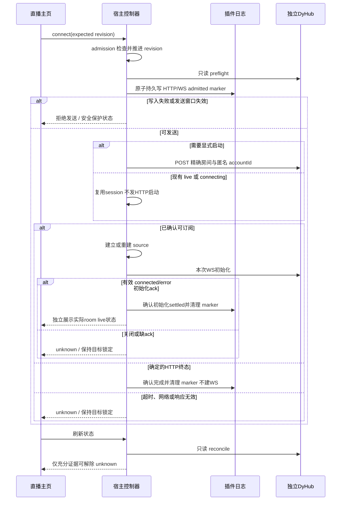

# 工程上下文：FEAT-003 统一平台与房间控制

## 当前有效方案

### 架构设计

**关联产品上下文**：`.sdlc-v1/context/REQ-003.product.md`

**工程上下文**：`.sdlc-v1/context/FEAT-003.engineering.md`

**已确认需求**：REQ-003 confirmed 条目及 AC-01–11；不复制产品规则

**创建日期**：2026-11-10

**状态**：主 Agent 已接受 Plan；FEAT-003 / TASK-003 已登记，实际进度以 state.json 为准

**分支 / 功能基线**：`codex/macos-yovoice` / `f59a586c69c81b800cf9a11f57268c528d980484`

#### 背景

当前 `console/console.tsx` 的平台切换立即保存、房间单独保存，且常用控件位于 Drawer；抖音只建立 WS 订阅，停止/恢复要求外部控制台。新需求将普通操作集中到原生主页，同时增加宿主拥有的最小房间控制器，不管理 DyHub 进程。

长期方向来源为 `none`，当前目标引用 REQ-003 NEED-001、SC-01–04 与发布后观察计划。现有 REQ-001/002 已发布能力为兼容基础，本 Feature 不修改它们的状态。主 Agent 已接受 Backlog/Spec，并采用 `unified_contract` 独立只读分析与发送时间上界修正；本文件将这些决定合为一处当前方案。没有未决产品选择。

**复用评估**：

| 候选 | 当前证据与覆盖 | 决定 |
|---|---|---|
| 扩展现有 Console、settings、source 与宿主路由 | React 18 / `dl-*`、`updateSettings()` 临时文件+rename、`shared/liveTarget.ts`、平台 lease、已有 E2E 均可复用；缺少上游 HTTP 控制、操作 revision 与不确定结果日志。 | 采用；新建少量专用 controller/journal 代码填补具体缺口，无新依赖。 |
| 直接嵌入 DyHub 页面 | 无法统一目标草稿/宿主权限/跨请求约束，且不符合已确认原生主页方向。 | 不采用。 |
| 新服务管理层或通用持久化工作流库 | 当前只有一个本地 room controller，无多宿主协调需求。 | 不采用；增加的复杂度不服务验收。 |

固定上游为独立 DyHub v0.3.1 / commit `3a79c57d85c59289db3b77211b3ec01fae47d42c`，来源 `../douyin-research/repos/dyhub/src/{api/server.ts,collector/collector.ts,collector/accountStore.ts}`。其 `connect()` 在 `await openRoom` 后才登记 session，`disconnect()` 不等待尚未登记的 connecting promise；HTTP abort 也不能证明上游取消。此次只读核对这些入口，不修改上游，不以源码推断代替运行验证。控制期间采用无外部管理器并发修改账号/启停同房间的支持假设；上游没有 CAS，不承诺外部竞争的全局原子性。已确认的产品 baseline 和 Impeccable context 为既有 Operate 控制台局部扩展；不建独立原型或 PRODUCT/DESIGN 文件。

#### 架构与组件

##### 原生房间面板与共享 DTO

- **职责**：`src/console/console.tsx` 主页承载平台/房间草稿、保存、连接/断开、显式恢复与房间级停止；声音及高级选项保留 Drawer。复用现有 CSS，必要时提取同目录小组件，不另建 UI 系统。
- **接口**：新增 `src/shared/roomControl.ts` 单一定义客户端/宿主共用 DTO；草稿仅属浏览器，server snapshot 表达已保存/活动目标与各自状态。轮询不覆盖未保存输入，按 request sequence、revision 和目标匹配丢弃旧响应。
- **覆盖**：FR-01/05；AC-01/02/03/11。

##### 宿主路由与专用 Douyin controller

- **职责**：`src/dsh/index.ts` 复用 Harness owner 路由，`src/dsh/douyinRoomControl.ts` 管理固定 loopback HTTP、匿名记录选择、单房间 admission、revision 和只读 reconcile；`runtime.ts` 提供插件 dataDir 与生命周期接入。
- **接口**：本节后面的 API 定义为唯一接口契约。Controller 的串行约束只覆盖 Douyin admission/目标提交，不把 B 站的 `await cookie()` 放入等待队列；既有 `biliOperations` / Broadcast / Hub 约束继续参与目标变更检查。
- **覆盖**：FR-02/03/04；AC-04–10。

##### 插件自有操作日志

- **职责**：`src/dsh/douyinControlJournal.ts` 在每次外部 mutation 前保存唯一 admitted marker，未确认时持久保护目标；不是 settings、任务系统或自动重放队列。
- **接口**：注入数据目录、fetch、clock 等已有可测试依赖；生产文件仅在 `${dataDir}/douyin-control.json`，测试使用临时目录。加载异常保守阻止 mutation，不静默清空。
- **覆盖**：FR-03/04；AC-08/09。

##### 既有 source / Hub / Show 与测试入口

- **职责**：复用 `core/platforms/douyin/douyinSource.ts` 的 live 确认、状态/事件校验和禁止自动重订阅；terminal source 的显式重试必须重建实例，不能依赖 Hub 同配置 `connect()` 的直接返回。复建和清理仍按 generation 归属，晚到 I/O 不影响新实例。
- **接口**：需要时局部扩展 `core/live.ts`、`body/show.ts` 的显式退休/重建路径；保留 FEAT-002 的目标退休、ending、在播声音和临时上下文清理修复，不重写事件归一化。
- **覆盖**：FR-02/04；AC-04/06/09/10。

#### 关键设计决定

##### D1：目标原子提交，revision 在宿主校验

- Native 保存一次提交 `{livePlatform, roomId}` 或 `{livePlatform, douyinRoomId}`；复用现有完整 next settings 持久化成功后发布内存，不因另一个平台字段未提交而覆盖它。错误保留草稿。
- `controlRevision` 是进程 nonce + 单调 counter 的不透明字符串，每次 accepted connect/retry/disconnect/stop 和成功目标变更都推进；Douyin admission 中比较 expected revision、目标及 active/unknown 状态后才接受。旧 revision 返回 409 和当前 snapshot，不发上游请求；A→B→A 或同房间重开后旧 stop 也必须拒绝。
- 目标保存与 Douyin admission 使用同一短临界区检查现有舞台/Hub/BiliOps/Broadcast 与 controller guard。B 站断开不排在等待凭据的 connect 后面：保留同步失效 lease、立即断开的路径及 `biliConnectLease.test.ts` 行为。UI 也保留 B 站等待凭据时的取消入口。
- **等待凭据的原生取消关联**：Native connect 发送前生成有界唯一 `connectId`；等待该请求时，取消可带同一 `cancelConnectId` 及原 admission revision。严格 revision 不匹配时，仅当这两项与服务器唯一仍在等待凭据的同次 Bili connect 都精确匹配，才允许本地 disconnect 取消它；接受后推进 revision 并立即失效该特例。不能只因“旧 revision 恰好是当前 connect 的上一值”就放行，否则连接前发出的延迟 disconnect 也能取消新连接。其他 stale mutation，尤其 room stop，仍严格 409；旧空 body disconnect 兼容语义保留。
- **取舍/覆盖**：不使用全局请求 mutex；普通声音设置仍可独立保存。对应 AC-01/02/08/09/10。

##### D2：显式 HTTP 控制之后再建立订阅

- 连接先 GET 当前房间；若为 live/connecting，复用该 session，不额外 POST connect。fresh/closed/error/stopped 仅在主人显式 connect/retry 时 POST 精确 roomId，确认 live/connecting 后才 WS 订阅；返回终态显示结束/失败，不盲目建 WS。有效 live 仍由实际房间状态确认。
- 固定 `dispatch/wsServer.ts:35–78` 在 existing nonstopped 时立即发 `__connected`，缺失/stopped 时会等待 `collector.connect()` 后才发 `__connected`，失败发 `__error`。因此 connect journal 必须覆盖 HTTP 与首次/重建 WS 的潜在启动，直到本次 source 收到有效 `__connected` 或 `__error` 等确定初始化结果。source 提供 generation 归属的初始化 settled hook/Promise 给 controller；`__connected` 只证明订阅初始化 settled，不等于房间 live。WS关闭、超时或缺ack保持unknown，不自动重建；期间不得接受第二个外部mutation。本地断开可以detach，但不能清除unknown或声称采集停止。
- 需要新采集时，GET accounts 仅选插件命名的匿名记录且 `hasCookie=false`；不盲选“默认”或其他认证账号。没有合格记录时才创建空白记录，传显式 accountId。创建名可包含本次 opId，使超时后正向识别有依据；不登录、不读取 Cookie、不改现有账号。外部管理器没有 CAS，不能承诺与其并发时“全局空账号集合”原子不变；复查所选记录，不合格则拒绝。
- **匿名部署前提（实现前源码核对修订）**：固定 WS 在服务重启或房间消失时仍可能调用无 accountId 的 connect，不能承诺它永不选择默认记录。因此每次连接/重建订阅前必须有界读取完整 accounts 状态，要求每条记录明确 `hasCookie=false` 且 `hasLogin=false`（字段缺失/超限/未知则拒绝），包括复用已有 live/connecting 的分支。检测到任何认证记录时不建立 WS、不清除或切换账号，页内提示使用现有独立匿名采集目录。HTTP 启动继续传显式匿名 accountId；WS 隐式启动只在全部账号均匿名的部署前提下支持。服务重启仍使用同一固定版本、同一匿名数据目录，控制期间不经外部管理器添加 Cookie、切换目录或账号；该前提与现有本机空 Cookie 部署一致。上游默认账号优先“默认”否则第一条，因集合全部匿名，重启窗口不会选择认证账号；不改 pinned DyHub，不订阅全房间流。
- “断开订阅”只清理本插件；房间级 stop 在页面确认共享影响后先 unsubscribe，再 POST `/api/rooms/:roomId/disconnect`。不能调用 delete、disconnectAll、其他房间或全局服务控制。dispose 仅停止自有 I/O，不停止共享采集。
- **取舍/覆盖**：复用固定上游公开 HTTP/WS，不引入浏览器登录流程；AC-04/05/06/07。

##### D3：外部请求未确认时持续保护，禁止盲目补偿

- 每次外部 connect（包括可能启动采集的首次/重建WS）、collector stop、匿名 account create 之前，都必须成功原子且持久写入 marker；先写文件、fsync、rename 并确认目录持久化后才发送。写入失败无 outbound mutation。account/stop收到完整、有效且匹配的确定响应后清理；connect按D2等待初始化settled，不能仅凭HTTP成功清理。完成且成功清理日志后才允许下一步；清理失败仍保持保护。
- 网络失败、HTTP deadline、非法/过大响应或进程崩溃均保留 unknown；不能把 abort 当取消。DSH 重启加载 marker，换新 revision，保留目标/操作保护，不自动重放。即使 settings 与 marker 不一致也不能忽略旧 marker；先按其原始 canonical origin/target 做只读核对。
- GET 404 或 stop 200 不能单独消除 uncertain connect：其 openRoom 可能仍在等待且随后启动。不得为“修复”再次 connect、stop 或 create，也不提供清空 unknown 按钮；允许仅断开本插件接收，不因此解除外部 unknown。
- 只读 reconcile 仅在得到可证明的新 session（对比 preflight 的 room startedAt/status；采用固定上游 session.set 与返回之间无 await 的事实）时确认 connect 已完成；同旧 session、缺失/相等 startedAt 或无法归属的证据保持 unknown。account-create 仅接受可正向识别的新匿名记录，或可靠服务重启后重新读取；不得盲目重复创建。
- reconcile 在异步读取完成后、同步清理前必须再次核对 captured marker 仍是当前同次操作与阶段，且 controller 未 running/disposing；HTTP→WS 即使沿用 opId 也不能让旧 HTTP 证据清除 WS 阶段。两个页面的旧查询不得清除后续操作的 marker。controller 归属一次宿主 apply 生命周期；卸载取消自有等待、失效 generation，禁止后续发送、订阅和日志修改，已发送但未知的 marker 保留。再次 apply 使用当前持久保护，不复活旧异步任务；旧实例的 finally/确认结果不得改写新实例状态或日志。
- 另一个解锁依据是可靠 bridge restart proof：记录 GET stats 的请求时间区间和 `floor(uptimeSec)`，推导保守服务启动区间 `I=[requestStart-(uptimeSec+1)s, responseEnd-uptimeSec*s]`。新区间必须整体晚于 marker 的最晚可能发送/生效边界，且与旧服务区间不重叠；版本、origin 或时钟连续性无法确认、时间跳变、区间重叠时一律保持 unknown。人工重启后仍须刷新取证，不将 Date 时钟变化当重启。
- marker 在每个可能启动采集的发送阶段前持久记录/更新 `dispatchNotAfter` 与覆盖该 HTTP/WS 初始化截止的 `activeUntil`，HTTP→WS延展之间不能出现无日志窗口；发送必须处于有限 dispatch 窗口且 wall/monotonic 连续性有效，逾期不发送。重启证明使用 `activeUntil` 这一保守上界，覆盖 fsync→发送之间重启及可能在途请求，不能仅用 admission 时间。只对已证明未发送的分支清理 marker；无法证明则保留安全可恢复状态。
- **取舍/覆盖**：接受少量不确定场景需要人工重启外部服务再核实，换取不会误解锁和串房间；不自研分布式框架。AC-06/08/09。

#### 数据模型 / 关键实体

| 实体 | 唯一字段/归属定义 | 约束与覆盖 |
|---|---|---|
| `RoomControlSnapshot` | `controlRevision`、`target`、服务 health、当前房间 collector、本插件 subscription、operation、targetLocked/reason；host/controller 生成，shared DTO 导出。 | 不返回凭据或完整 account 列表；状态可为 unknown，不能以健康替代 live。AC-01/04/05/08。 |
| `ControlOperation` | `idle / running / unknown`、opId、type、target、error/recoveryHint。 | 单宿主最多一个 admitted 外部 mutation；unknown 持久占用保护，原始 target/origin 不随草稿变。AC-06/08/09。 |
| `AdmittedMarker v1` | schemaVersion、opId、type、target、当次 revision、canonicalOrigin、preflight（room startedAt/status 或 account IDs/创建名）、admittedAt、dispatchNotAfter、activeUntil、bridge version/uptime 请求区间与 clock continuity 信息。 | 插件自有 JSON，不改 settings 格式；不存 Cookie/token/真实消息。完成写入在发送前，重启只读恢复。AC-08/09。 |

JSON 读入设字节/深度与字段上限，损坏、未知 schemaVersion、非法 target/origin、字段溢出都 fail closed，不按“首次使用”忽略。仅写固定文件名，不从 API 接收路径。临时文件同目录独占创建、0600、失败只清理自有临时文件，不破坏原 journal/settings；核实目录/原文件/临时路径别名与 symlink，不能覆盖无关文件。实现用现有 Node fs/crypto，日志有界且脱敏；测试覆盖写失败、rename/fsync/清理失败和损坏恢复。

#### API / 接口契约

均位于已有 `/api/dsh-livestream/`，依赖真实 Harness owner 校验，不新增匿名代理。请求 JSON 有界；客户端不能传 bridge URL、任意路径、Cookie 或 accountId。默认 origin 继续由 `DSH_LIVESTREAM_DOUYIN_BRIDGE_URL` + 既有数字 loopback 校验决定，拒绝重定向。下表名称为本 Feature 采用接口，响应保留 `{ok:false,error}` 兼容并附 current roomControl snapshot 供恢复。

| 接口 | 输入 / 成功输出 | 边界 |
|---|---|---|
| GET `room-control` | 无用户可控目标；返回 `RoomControlSnapshot`。 | 仅固定 origin 的 health/stats/当前房间 GET 与必要只读 reconcile，不 create/start/stop；快照单调匹配 revision。 |
| POST `settings` | Native 目标 patch + `controlRevision`；返回原 state 与新 roomControl。 | 原子目标 patch 在 controller guard 下提交；旧通用设置调用兼容，无关声音/高级设置不强制新增字段。 |
| POST `connect` | Native `{controlRevision, action:'connect'|'retry', connectId}`；目标只从已保存 settings 捕获；返回 state + roomControl。 | revision/锁定失败 409；上游不可达/无效响应/超时给可恢复错误及准确 unknown。Bili 原 lease 路径保留；connectId 只关联本次原生取消。 |
| POST `disconnect` | Native `{controlRevision, cancelConnectId?}`；返回 state + roomControl。 | 仅本插件 unsubscribe；既有空 body 调用兼容。Bili pending credentials 按 D1 精确取消关联立即取消；不得被 Douyin 外部 I/O 排队阻塞。 |
| POST `collector/stop` | `{controlRevision, confirmSharedEffect:true}`；返回 state + roomControl。 | 仅已保存 Douyin 精确房间，服务端再次校验确认值、revision 和状态；先 unsubscribe，再房间 stop。未确认/错误 origin/旧 revision 不发送。 |

Legacy 空 body `connect`/`disconnect` 保留显式调用语义，但仍经过当前目标/uncertainty 安全检查并推进 revision；不能借兼容入口绕过 marker。旧客户端没有 compare-and-set 承诺，服务端不能据旧调用恢复自动重连。Native 表单统一使用 revision。成功保存但响应丢失时以重新读取的权威配置/revision 对账，不能重用旧 revision 强制覆盖。

固定上游仅 GET `/api/rooms/:roomId`、`/api/accounts`、`/api/stats` 及现有健康入口，POST `/api/rooms/connect`、`/api/rooms/:roomId/disconnect`、`/api/accounts`；状态字段以 pinned API 实现和受控来源 fixture 校验。不接入登录、Cookie、任意 webhook 或删除接口。GET/POST、dispatch 窗口、HTTP 响应/journal 字节、集合和字符串均有明确有限上限，由同一实现者集中选择常量并验证；超限拒绝而非截断证据。用 fake clock 验证边界，不用浏览器取消去中断已 admission 的 mutation。控制器资源释放只取消自有等待，已发操作保留 marker。

#### 时序与数据流

图只表达一次 Douyin connect 的不确定性分支，字段与恢复判定见 D1–D3；stop/account-create 共用同一 admitted 写入纪律。



本 Plan 仅做 Mermaid 源码核对，未渲染预览；图不构成协议运行证据。

#### 横切质量设计

- **身份/安全**：沿用 owner identity；未认证 GET 与 POST 必须在完整安装路径检查 401/拒绝，fixture 测试身份不能代替生产鉴权。全局 service 与用户 profile 不属于 controller。
- **状态一致性**：UI target draft 与 active snapshot 分离；轮询可读但不 mutation；异步结果附操作/目标/revision 归属；保留 source generation、Bili lease、target epoch 和 ending 处理，避免新 controller 取代已有保护。
- **设计**：既有 `dl-*`、文本/语义与 responsive 规则优先；新增 inline warning/unknown/retry 提示，不暴露内部 journal/protocol 实现细节。复用已确认 mouse/Enter/焦点范围，完整键盘段不开展新实验。
- **未知结果呈现**：明确标出“操作结果未确认”、当前受保护房间及不能重试/切换的原因，显示有依据的恢复提示；具体错误单独去重，不以两遍普通请求失败替代 unknown 状态。停止终态的语义截图等待既有 SSE 的订阅 idle 后再捕获。
- **可验证性**：controller 注入 HTTP、clock、store 边界，测试用真实宿主 handler 与确定性受控 collector；关键结论必须断言外部请求目标/次数、磁盘内容及最终业务状态，不能只断言提示文字。

#### 风险与取舍

| 风险 | 影响 | 缓解 |
|---|---|---|
| 上游 delayed openRoom、stop 不等待 pending | 误判停止后迟到启动并影响新目标。 | D3 marker + 有界发送上界 + 保守只读证明；无证据保持 unknown。 |
| 上游账号由外部 UI 并发修改、无 CAS | 选到认证记录或误认为创建失败。 | 显式匿名 accountId、正向证据、复查且不盲目重建；不承诺全局并发原子性。 |
| 同配置 source terminal 后 Hub 直接返回 | 重试表面成功但仍未订阅。 | 显式退休/重建 terminal source，generation 隔离测试。 |
| 新 serializer 阻塞 Bili cancel / 旧 race 回归 | 等待凭据不能断开或污染新会话。 | D1 的窄 admission，重跑实际 lease、OBS、ending、target retirement 测试。 |
| 回旧代码忽略未决 journal | 绕过安全保护。 | unknown 未可靠收尾时不直接回滚运行版本；保留 marker，由主 Agent 先取得停止/重启确认，禁止自动停共享服务。 |

#### 需求覆盖

以下是唯一紧凑 AC→契约→Task→检查映射；实施阶段与任务仅引用此表。

| 当前 AC | 设计/契约 | Task | 计划验证 |
|---|---|---|---|
| 01–03 | 原生面板、D1、settings DTO | TASK-003 | DOM/真实 settings 路由：草稿不生效、一次保存、失败磁盘/内存均旧值、双平台保留、精度/非法输入；双视口 Web。 |
| 04–05 | D2、room-control/连接、source live 确认 | TASK-003 | 受控 HTTP+WS：健康非live、现有live/connecting零POST、fresh/terminal正确POST与匿名account、空态/离线/401/畸形大响应；安装路径另查。 |
| 06 | D2/D3、显式 source 重建 | TASK-003 | retry 的 closed/error/stopped、terminal同目标重建、HTTP→WS窗口、初始化ack与live分离、缺ack保留journal、断网不自动重订阅、poll/restart零mutation、重复点击与超时unknown。 |
| 07 | disconnect / collector stop | TASK-003 | 共享影响确认、先本插件清理后精确room POST、第二房间/全局存活、legacy断开零上游stop。 |
| 08–09 | D1/D3、journal与revision | TASK-003 | 迟到openRoom+GET404+stop200不能解锁、A→B→A/同房间重开旧请求409、DSH重启unknown、journal写/清理失败、正向session/account证据、uptime floor/区间重叠/时钟跳变/发送窗口过期、原Bili/OBS锁。 |
| 10 | 窄admission、既有lease/Show/声音 | TASK-003 | `biliConnectLease`、`obsLease`、`broadcastLifecycle`、`showEndingDisconnect`、target-retirement及完整suite；普通Bili fixture、彩排拒绝、声音Web回归。 |
| 11 | 原生面板、usage与状态设计 | TASK-003 | tester-army/e2e 双视口成功/失败/空态/停止与截图，控制台/网络/溢出检查，原Enter/焦点子集；按README真实操作并归因。 |

### 实施计划

**关联产品上下文**：REQ-003；**关联设计**：上方架构设计；**已确认需求**：confirmed + AC-01–11；**创建日期**：2026-11-10；**状态**：候选。

#### 背景

一个完整纵向 TASK-003 拥有 UI、宿主控制、必要测试和 usage 更新；同一 Terra worker 连续实现与修正，之后使用独立 Validate、独立 Review，不按文件拆写者。

#### 目标 / 非目标

- **目标**：交付 REQ-003 的统一主页与安全房间控制，验收引用上表及产品成功标准。
- **非目标**：产品 OUT-001；不触碰上游源码、运行 profile、服务进程、GLM/TTS 模型配置，不将本次合成通过写成实房间通过。

#### 技术栈

沿用 TypeScript 6.0.3 / Node ESM / React 18.3.1 / 原生 `dl-*` / Node fs+fetch / ws；Vitest 3.2.4 + V8、e2e 0.23.0 / Web 0.15.5、已装 Chrome 156。无新运行依赖、数据库、daemon 或公网目标。

#### 实施层决定

- **顺序**：先围绕验收写失败用例，再完成最小原生房间面板+真实宿主 room-control 只读路径，然后接入外部 mutation/日志和完整恢复。不是先造通用 controller 框架。
- **验证**：Build 用必要 focused 测试与完整检查；独立 Validate 在已提交候选全新执行同一相关测试，不复用实现者通过结果。只有通过/已知源码外无变化时才进入 Review/Ship。
- **资源**：所有新可变测试数据为临时 DSH_HOME，HTTP/WS 使用 `127.0.0.1:0` 动态专属端口，stage 指向自有 stub。controller 初始导入也不得访问默认共享端口；注入 bridge origin。拦截并断言共享 3080/3081/7390/8757 零访问。不使用真实模型步骤、真实 TTS、真实直播间、凭据或用户 Chrome profile。
- **既有本机回归说明**：以上零 TTS 调用预算指 yovoice、豆包和其他模型/provider 的真实任务；完整现有 unit suite 中 `macosTts.test.ts` 的两条离线系统 `say`/ffprobe 回归可按原有短文本、取消及临时文件边界运行，不新增试听、不播放、不访问共享服务。单独记录该真实 OS 回归，不能据此声称当前 yovoice 或直播配音已实测。本说明澄清工程执行预算，不增加产品声音能力或外部调用授权。

#### 风险 / 取舍

协议风险见上方设计；执行风险是构建删除正在使用的 `lib` 与 runner 覆盖旧证据。Build/Validate 在独立复制目录构建，仅链接已安装依赖；E2E bundle/报告用 Feature 自有 `.e2e/feat-003*` 和 coverage 目录，运行前归档本 Feature 旧失败证据，不改动 FEAT-001/002 报告。无 CI 配置则不新增 CI 部署范围。

#### 实施阶段

##### 阶段 1：最早可检验增量

TASK-003 先完成主页平台/房间草稿原子保存与真实宿主 `room-control` 查询，使用受控 collector 的健康/空态/离线结果走真实路由和 React。只依赖最小 DTO、目标 guard 与有界 GET，不等待全部 mutation 用例或完整 suite。通过 focused 路由+DOM/一条 Web 旅程后报告打开入口、实际工作树/检查和仍缺停止/unknown保护等范围；继续同一 Task，不宣称完成或正式验证。覆盖 AC-01–05/11，设计引用映射表。

##### 阶段 2：完整控制与恢复

同一 TASK-003 完成 D1–D3、上游 anonymous/preflight/stop、terminal source 重建、目标保护、journal 与 restart 恢复边界，逐项跑确定性失败/竞争测试。覆盖 AC-04–10，设计引用映射表。

##### 阶段 3：回归与使用文档

同一 TASK-003 更新现有 E2E fixture/config 为真实 handler+controller+受控HTTP/WS，保留声音回归；完整 suite、类型、隔离构建、差异覆盖与双视口 Web 必需。根 `README.md` 为全局 usage，保留 `LIVE-DOUYIN-CONNECT` / `LIVE-DOUYIN-DISCONNECT`，补充稳定 `LIVE-ROOM-CONFIG`、`LIVE-DOUYIN-RETRY`、`LIVE-DOUYIN-STOP` 导航；`examples/douyin/README.md` 维护具体同页旅程，Mac guide 仅更新受影响入口/限制。每个故事写 actor、Harness owner 权限、后台服务前置条件、正常结果、未知结果恢复与未测范围。参数权威仍是 `shared/liveTarget.ts`、环境部署指南和共享DTO，不复制secret。覆盖 AC-01–11，设计引用映射表。

##### 阶段 4：正式验证、评审与交付准备

实现者回传后主 Agent 接受并登记 Task；独立 Validate 按候选已提交资产重新执行，独立 Review 对真实 diff、usage→参数→实际结果及必要截图检查。批准后 Ship 对相同业务版本打包、fresh unpack smoke，并由主 Agent 在既有授权目标核实安装版本及真实 owner/未认证、空房间/离线显示。无实房间与模型消费；不将 fixture 身份算作完整 owner 验证。产品观察计划仅引用 REQ-003，不另建进度/指标文档。

#### 需求覆盖

实施顺序与 AC 覆盖唯一见架构末尾表；阶段 1 为中途可查看增量，阶段 2/3 完成同一 Task，阶段 4 属正式独立接受，不增加计划 Task 或并行写者。

### 工程任务

**输入**：上述架构、实施计划和 ready REQ-003；**测试**：默认先测试后实现，文档同步修改后做实际使用验证。

#### 路径约定

下列路径相对仓库根，源码前缀 `packages/dsh-livestream/`。写入边界包括：

- `src/console/console.tsx` 与必要同目录小组件；`src/shared/roomControl.ts`、现有 `liveTarget.ts`；`src/dsh/index.ts`、`runtime.ts`、新 `douyinRoomControl.ts` / `douyinControlJournal.ts`。
- 仅为 terminal source 显式重建及逐实例初始化 settled hook 透传所需的 `src/core/live.ts`、`src/core/platforms/index.ts`（现有 source 工厂）、`src/core/platforms/douyin/douyinSource.ts`、`src/body/show.ts`；不引入模块级全局 hook 注册表，不改无关事件/语音/OBS实现。若发现既有竞态必须修改此边界以外源码，先返回主 Agent 判断有效方案，不扩散重构。
- `test/` 下对应 controller/journal/routes/Console/source 与既有竞态回归，`test/e2e-douyin/`、`test/e2e/` 的必要 fixture，现有 `e2e-douyin.config.ts`、`e2e-voice-regression.config.ts`。`vitest.config.ts` 仅扩充 coverage.include，纳入本次新增 controller/journal/shared DTO，保留旧包含项、阈值与运行脚本。优先复用并将报告/launcher产物调整为 feat-003，不能停用既有覆盖。
- 根 `README.md`、`examples/douyin/README.md`、仅受影响的 `examples/macos-yovoice/README.md`；`.gitignore` 仅在新增产物路径确有需要时有界修改。实现者按 brief 写本 Feature 实际证据，不能改 `state.json`、REQ 正文、旧 Feature 或提交 Git。

#### 阶段 1 / 2：准备与故事所需基础

无独立基础设施 Task。TASK-003 内按实施阶段 1 只准备首个旅程必需的 shared DTO、有限GET/guard和隔离 fixture；现有依赖已满足，不安装浏览器/模型/新框架。

#### 阶段 3：TASK-003 [US1/US2/US3] 统一原生房间控制与安全恢复（优先级：P1）

- **结果**：一个可运行的统一直播主页，含完整同页房间生命周期与错误恢复；设计/AC 关联见唯一映射表。
- **依赖**：无其他 Task 依赖；前提是主 Agent 接受本 Plan、登记 FEAT-003/TASK-003，且 REQ-002 已 released。
- **完成条件**：AC-01–11 当前交付范围的确定性检查通过；D1–D3 的负路径与 journal/restart/ABA 直接测试存在并通过；现有 race 和声音/Bili回归通过；usage 与参数实际一致；变更行覆盖≥80%、分支≥70%；边界/限制和资源收尾有证据。完整键盘、真实房间/礼物/长期稳定与真实模型/配音仍未测，不能删除这些限制。

##### 用户故事验证

1. **correctness / OpenAPI**：真实宿主注册 handler + 临时配置 + 受控 collector，覆盖映射表所有 mutation 请求的目标/次数和 no-op；fake clock 和可控 promise 重现 delayed openRoom、超时后的404/stop200、activeUntil内重启、DSH重载、journal持久化故障、same-target generation、Bili凭据取消。不要将 controller 整体 mock 掉来证明其行为。
2. **Web**：复用 tester-army/e2e，桌面1440×900/窄屏375×812；①草稿切换→原子保存→刷新→健康非live→真实 source live/事件→本地舞台 fixture；②离线/空态/拒绝→原页显式重试，unknown保持保护；③共享影响确认→精确房间停止/仅断开区别→切平台，普通Bili/彩排限制；④Drawer声音保存/私有试听回归。断言持久化、HTTP计数/目标、业务终态、页面错误/网络与无溢出；保存关键语义截图和trace，视觉不代替业务断言。
3. **预算与归档**：精确 locator，无 `agent.*`/模型provider；strict read-only cache、workers=1、retries=0、每例120秒、动作/断言5秒、每套上限10分钟。输出 `.e2e/feat-003/`、`.e2e/feat-003-voice/`（report/JUnit/trace/截图/fixture.log）、coverage `coverage/feat-003-build` / `feat-003-validate`；旧失败先归档。资源归属限fixture/browser/临时目录，结束检查专属端口/子进程已释放，不能全局pkill或停止共享服务。
4. **命令**：计划使用下列既有入口；本 Plan 只核对 installed CLI help / package scripts，未运行任何业务 suite。仓库根运行 coverage/typecheck/diff；包目录运行 Web。build 仅在隔离副本使用现有 `node build.mjs`，不删除在用 lib。

```sh
npm_config_manage_package_manager_versions=false pnpm --filter dsh-livestream exec vitest run --coverage --coverage.reportsDirectory coverage/feat-003-validate
npm_config_manage_package_manager_versions=false pnpm --filter dsh-livestream check
node packages/dsh-livestream/test/coverage-diff.mjs f59a586c69c81b800cf9a11f57268c528d980484 packages/dsh-livestream/coverage/feat-003-validate/coverage-final.json
```

```sh
npm_config_manage_package_manager_versions=false pnpm exec e2e run --config e2e-douyin.config.ts --workers 1 --retries 0 --trace on --reporter list,junit --max-duration 600000
npm_config_manage_package_manager_versions=false pnpm exec e2e run --config e2e-voice-regression.config.ts --workers 1 --retries 0 --trace on --reporter list,junit --max-duration 600000
```

##### 用户故事实现

同一实现者按实施阶段1→2→3推进并完成必要修正；既有 `biliConnectLease`、`obsLease`、`broadcastLifecycle`、`showEndingDisconnect`、`showTargetRetirement`、`agentTargetRetirement`、`stageTargetReset` 不得因新入口被禁用或降低断言。独立 Validate 再执行相同相关检查，不将 Build 证据当正式 validation。

#### 阶段 N：收尾与横切关注点

无新增横切 Task。保持 TypeScript/JSX 正常缩进、分行和可读控制流；无独立formatter/lint命令则用既有check/build，不引入无关格式化。新公共DTO与响应类型只定义一处。更新指南后按故事路径实际操作并记录 synthetic/真实安装/未运行三类范围。

#### 依赖与执行顺序

仅 TASK-003 顺序执行，无并行实现候选；同一 worker 拥有代码、测试、文档与返修。主 Agent 独立验证/评审/发布职责不属于该 Task 的实现者权限；生命周期操作仍仅主 Agent 执行。

#### 执行策略

按最早增量报告后继续完整Task。失败处理沿用阶段协议：同一验收问题两次无通过条件且无新因果定位证据时停止盲改；不得以改名/新Feature重置历史。完整键盘段已延期、两次失败和唯一诊断额度耗尽，禁止重新实验。其他新段按协议由主 Agent 控制一次有限诊断，不由 worker 自行扩展。

**发布/回滚**：批准候选从隔离构建打包，逐文件对照批准Git对象与manifest，fresh unpack后临时配置smoke覆盖新controller与无自动采集。当前 last-good业务为 `63fe27163da1b918dedc27becaf893f4054b29ba`，其元数据后继即功能基线 `f59a586...`；已存在制品 `../reuse/20261110-douyin/dsh-livestream-0.0.1.tgz`，历史SHA-256 `b649ac5913906fd3c17a178a00cb9fab7b5fc6f5e82cb92448ab60e1e7665153`，Ship须再核对，不覆盖它。保留旧lib/权限受控配置基线；回滚只恢复批准旧产物、重载自有宿主并核实版本/鉴权/配置，不删除journal、不改GLM/yovoice、不重启共享DyHub。若unknown仍存在，先由主 Agent 取得可靠人工收尾/重启证明后才允许运行旧版，不能用回滚绕过保护。

## 实现记录（实际）

- Plan 阶段只写工程与产品接受状态文字；后续实际实现、验证命令和运行范围见下方 TASK-003 Build 记录。

## 验证记录（实际）

- 本 Plan 仅静态读取源码/测试/固定上游/API和 package/config，核对 lifecycle `start-feature` / `add-task`、Vitest run 与 e2e run `--help`。未运行业务检查、Mermaid预览、浏览器或服务，不能宣称AC通过。
- 正式Validate必须在当前集成业务树干净且Task完成时绑定候选commit；固定覆盖基线为f59a586，不能重用旧Feature报告。该目录内文字更新不自动使旧业务证据覆盖新要求。

### 独立 Validate（2026-11-10，当前交付范围）

- **结论：PASS**；被测业务提交 `6df2c24653793f100c43de19c9ec7e30e1c0c508`，固定差异基线 `f59a586c69c81b800cf9a11f57268c528d980484`。执行前业务树干净，TASK-003 为 done；不把 Build 结果作为本次证明。运行 UTC 04:04–04:06（本地 12:04–12:06），Node 26.13.0、pnpm 12.18.0、Vitest 3.2.4、e2e 0.23.0、HeadlessChrome 156.0.8078.4。桌面 1440×900、窄屏 375×812；严格只读 cache、workers 1、retries 0、trace on、套件限时 600000 ms，无 agent/model 步骤。
- 首次受限沙箱运行：coverage 命令 exit 1，62 文件中 4 失败，299 passed / 5 failed / 16 skipped，4 个未处理错误；loopback `listen EPERM` 导致 source/collector 测试超时或跳过，另 `macosTts` ffprobe 报无有效 MP3 帧。首次 Douyin Web exit 2，绑定 loopback `EPERM`，0 测试。原始输出分别为 `packages/dsh-livestream/.e2e/feat-003-validate-vitest.log`、`feat-003-validate-douyin.log`。随后允许隔离回环后执行同一完整套件和 Web；包括先前音频失败在内均通过。这里证明受限运行失败在允许回环的环境下未复现，不单凭复测断言音频失败的具体根因。

| 实际命令（仓库根目录，除 Web 外） | 退出 / 结果 |
|---|---|
| `npm_config_manage_package_manager_versions=false pnpm --filter dsh-livestream exec vitest run --coverage --coverage.reportsDirectory coverage/feat-003-validate`（允许本地回环） | 0；62 文件，312 passed、8 skipped；完整套件兼 coverage，日志 `.e2e/feat-003-validate-vitest-escalated.log`。 |
| `npm_config_manage_package_manager_versions=false pnpm --filter dsh-livestream check` | 0；TypeScript 检查通过。 |
| `node packages/dsh-livestream/test/coverage-diff.mjs f59a586c69c81b800cf9a11f57268c528d980484 packages/dsh-livestream/coverage/feat-003-validate/coverage-final.json` | 0；变更行 651/726 = 89.67%，分支 401/494 = 81.17%，分别达到 80%/70%。 |
| `node build.mjs`（独立 `/private/tmp/dsh-feat003-validate.S5G05R`，仅复制 src/build/package、链接现有 node_modules） | 0；构建四个入口，临时目录已删除，生产 lib 未覆盖。 |
| `npm_config_manage_package_manager_versions=false pnpm exec e2e run --config e2e-douyin.config.ts --workers 1 --retries 0 --trace on --reporter list,junit --max-duration 600000`（包目录，允许本地回环） | 0；12/12，开始 12:05:01，20.79s；日志 `.e2e/feat-003-validate-douyin-escalated.log`。 |
| `npm_config_manage_package_manager_versions=false pnpm exec e2e run --config e2e-voice-regression.config.ts --workers 1 --retries 0 --trace on --reporter list,junit --max-duration 600000`（包目录，允许本地回环） | 0；6/6，开始 12:05:46，9.56s；日志 `.e2e/feat-003-validate-voice.log`。 |

| 当前 AC | 状态 | 本次实际证据（均为隔离 synthetic 范围） |
|---|---|---|
| 01 | COVERED | `douyinConsole` 与双视口 atomic-target / douyin Web：主页草稿、已保存目标、输入及权限提示。 |
| 02 | COVERED | `roomControlQuery`、`douyinConsole`、`roomTargetPersistence` 和 atomic-target Web：原子保存、stale revision、失败草稿与刷新保留。 |
| 03 | COVERED | `liveTarget`、`douyinConsole` 和双视口 Web：字符串精度、URL/无效输入和平台保存。 |
| 04 | COVERED | `douyinSource` 与 Web：健康/连接中不等于 live，目标 live 确认后事件进本地舞台，旧目标隔离。 |
| 05 | COVERED | `douyinControlRecovery`、`roomControlIntegration`、`douyinRoutes` 和 Web：匿名账号、拒绝/未知、空态和不虚报连接。 |
| 06 | COVERED | `roomControlIntegration`、`douyinSource`、`douyinControlRecovery` 和 Web：显式重试重建、断开不自动重订阅、未知操作保护。 |
| 07 | COVERED | `roomControlIntegration` 和 Web：仅断开不发 stop，确认后先 detach、仅发送 `/api/rooms/123/disconnect`；请求目标与数量可核对，未操作全局服务。 |
| 08 | COVERED | `douyinControlRecovery`、`douyinControlJournal`、`roomControlQuery`：迟到创建、404/stop、重载 unknown、持久化失败、ABA 与正向 session/account 证据。uptime/重启不单独自动解锁；无连续时钟证明时继续保护。 |
| 09 | COVERED | `roomControlQuery`、`biliConnectLease`、`obsLease`、`broadcastLifecycle`、`showEndingDisconnect`、target retirement 与 Web 目标切换回归。 |
| 10 | COVERED | 同次完整 suite 的 Bili cancel/lease、彩排、声音/路由回归及双视口 voice Web 6/6；TTS provider 为替身，两个既有离线 macOS say 测试除外。 |
| 11 | COVERED | 双视口 Web 18/18、页面溢出/错误与 sharedRequests 断言、已有 Enter/焦点子集；根 README 与抖音指南导航及匿名/unknown 限制已对照 synthetic 操作。完整键盘旅程按用户决定延期。 |

- Web 原始 JUnit、trace、截图与 fixture 日志归档于 `packages/dsh-livestream/.e2e/archive/feat-003-validate-6df2c246/{feat-003,feat-003-voice}/`；Build 原始目录在覆盖前保存于 `packages/dsh-livestream/.e2e/archive/feat-003-before-validate-6df2c246/`，先前失败证据仍保留。coverage JSON 位于 `packages/dsh-livestream/coverage/feat-003-validate/coverage-final.json`。旧 Build 记录所引 `.e2e/feat-003{,-voice}/` 原快照见 before-validate 归档。
- 资源：fixture 使用临时 DSH_HOME、动态 loopback、stage stub；Web 浏览器和 fixture 均断言共享 3080/3081/7390/8757 请求为 0。Douyin app 60635/60636、bridge 60643/60651 的日志记录 shutdown；voice app 60948/60949，voice fixture 日志为空。UTC 04:06:32 以 `lsof` 检查上述六端口及四共享端口无监听（exit 1），按运行相关命令筛查无残留进程；未启动、停止或重启共享服务。测试没有访问真实房间、凭据、用户 profile、GLM、yovoice 或云服务；两条既有短 macOS `say` 测试使用系统语音，未播放。
- **范围限制**：真实 Harness owner 鉴权、安装 UI 与 fresh unpack 留 Ship；真实房间、礼物、长期稳定、GLM、真实 TTS/听感、外部并发账号/房间 mutation、完整键盘旅程均未证明。所有账号匿名且控制期间不由外部并发修改为部署前提；本次不将 synthetic 通过外推到真实部署。

### 独立 Validate：Review 修正批次 1（2026-11-10）

- **结论：PASS**；本轮新候选 `cda053722492e3055ac5a56752bd7772ef17aeb8`，差异基线仍为 `f59a586c69c81b800cf9a11f57268c528d980484`。执行前业务树干净、TASK-003 done；下列结果为本轮独立实跑，未复用 6df 的完整套件结果。UTC 04:35–04:37（本地 12:35–12:37）；Node 26.13.0、pnpm 12.18.0、Vitest 3.2.4、e2e 0.23.0、HeadlessChrome 156.0.8078.4；桌面 1440×900、窄屏 375×812、strict read-only cache、workers 1、retries 0、trace on、每套上限 600000ms、无 agent/model 步骤。本轮根据先前已确认的 sandbox 回环 `EPERM` 直接使用允许本地回环的环境；先前失败及证据保留在上一独立 Validate 节。

| 本轮实际命令 | exit / 结果 |
|---|---|
| `npm_config_manage_package_manager_versions=false pnpm --filter dsh-livestream exec vitest run --coverage --coverage.reportsDirectory coverage/feat-003-correction-1-validate` | 0；64 文件、322 passed / 8 skipped，开始 12:35:49，9.17s；完整套件兼 coverage，日志 `packages/dsh-livestream/.e2e/feat-003-correction-1-validate-vitest.log`。 |
| `npm_config_manage_package_manager_versions=false pnpm --filter dsh-livestream check` | 0。 |
| `node packages/dsh-livestream/test/coverage-diff.mjs f59a586c69c81b800cf9a11f57268c528d980484 packages/dsh-livestream/coverage/feat-003-correction-1-validate/coverage-final.json` | 0；变更行 702/778 = 90.23%，分支 452/552 = 81.88%，达到 80%/70% 要求。 |
| `node build.mjs`（独立 `/private/tmp/dsh-feat003-correction-validate.FTW9es`，复制 src/build/package 并链接现有 node_modules） | 0；四个入口构建成功，临时目录已删除，生产 lib 未覆盖。 |
| 包目录 `npm_config_manage_package_manager_versions=false pnpm exec e2e run --config e2e-douyin.config.ts --workers 1 --retries 0 --trace on --reporter list,junit --max-duration 600000` | 0；12/12，开始 12:35:48，22.45s；日志 `.e2e/feat-003-correction-1-validate-douyin.log`。 |
| 包目录 `npm_config_manage_package_manager_versions=false pnpm exec e2e run --config e2e-voice-regression.config.ts --workers 1 --retries 0 --trace on --reporter list,junit --max-duration 600000` | 0；6/6，开始 12:36:21，8.92s；日志 `.e2e/feat-003-correction-1-validate-voice.log`。 |

| 当前 AC | 状态 | 本轮通过的代表证据（隔离 synthetic 环境） |
|---|---|---|
| 01 | COVERED | `douyinConsole`、双视口 atomic-target / douyin Web，主页草稿、已保存目标与平台输入提示。 |
| 02 | COVERED | `roomControlQuery`、`roomTargetPersistence`、`douyinConsole` 和 Web：原子保存、失败与 stale revision、刷新。 |
| 03 | COVERED | `liveTarget`、`douyinRoutes` 与 Web：合法字符串/URL、精度、非法输入、B 站设置保留。 |
| 04 | COVERED | `douyinSource` 与 Web：连接中/live 区分、目标事件和舞台路径。 |
| 05 | COVERED | `douyinControlRecovery`、`roomControlIntegration` 和 Web：匿名前提、拒绝/未知和状态反馈。 |
| 06 | COVERED | `douyinControlRecovery`、`roomControlIntegration`、`douyinSource` 和 Web：显式重试、terminal 重建、断开不自动重订阅。 |
| 07 | COVERED | `roomControlIntegration` 和 Web：detach 不发 stop，确认后先 detach、精确房间 stop；窄屏终态截图人工核对显示没连接、房间已停止。 |
| 08 | COVERED | `douyinControlRecovery`、`douyinControlJournal`、`roomControlQuery`、`douyinControlOwnership` 和 `roomControlLifecycle`：持久 unknown、旧请求/阶段归属、重载、404/stop 与 ABA。uptime/重启不单独自动解锁，无连续时钟证明时保持保护。 |
| 09 | COVERED | `roomControlQuery`、`biliConnectLease`、`obsLease`、`broadcastLifecycle`、`showEndingDisconnect`、target retirement 和 Web 切换回归。 |
| 10 | COVERED | 同次完整 suite 的 Bili/OBS/彩排/声音回归与双视口 voice Web；provider 使用替身，两个既有短离线 macOS say 测试除外。 |
| 11 | COVERED | 双视口 18/18，包含既有 Enter/焦点子集、错误/网络/溢出与共享端口断言；README/抖音指南仍对应该 synthetic 操作，完整键盘旅程延期。 |

- Review R1：本次 `douyinControlOwnership.test.ts` 的 9 项中包含 account/connect 两个旧查询、同 opId HTTP→WS 阶段变化及旧实例卸载后迟到响应；断言新 marker 持续存在。R2：同套件覆盖 connect/stop 预检、HTTP 待定、post-HTTP 复查及 WS 等待时 dispose，真实 handler 的 `roomControlLifecycle.test.ts` 验证 reapply 与旧响应保护。R3：双视口 unknown Web 断言明确状态、房间、保护、恢复提示与错误去重、按钮禁用及 mutation 数；窄屏截图人工核对。以上均来自本轮已通过的实际执行，独立 delta review 仍由主 Agent 安排。
- 本轮 JUnit、trace、截图与 fixture 日志存于 `packages/dsh-livestream/.e2e/archive/feat-003-correction-1-validate-cda05372/{feat-003-correction-1,feat-003-correction-1-voice}/`；Build 产物在运行前归档至 `packages/dsh-livestream/.e2e/archive/feat-003-correction-1-before-revalidate-cda05372/`。旧 6df Validate 和 review 截图未覆盖。coverage JSON 位于 `packages/dsh-livestream/coverage/feat-003-correction-1-validate/coverage-final.json`。
- 资源：运行前后只读 `lsof` 均见 yovoice PID 61390 监听 3081、DyHub PID 61490 监听 8757，3080/7390 无监听；未启动、停止或重启共享服务。临时 DSH_HOME、动态 loopback 与 stage stub；Web fixture 和浏览器断言四共享端口零请求。Douyin app 65201/65202、bridge 65207/65216 日志记录 shutdown；voice app 65426/65427，voice fixture 日志为空。UTC 04:36:49 `lsof` 对本轮六端口 exit 1、无监听，相关进程筛查无残留。未使用真实房间、凭据、用户 profile、GLM、真实 yovoice 或云服务；未播放音频。
- **未验证范围**：真实 Harness owner 鉴权、安装 UI、fresh unpack 留 Ship；真实房间/礼物/长期稳定、真实模型/TTS/听感、外部并发账号或房间 mutation、完整键盘旅程未证明。所有账号匿名且控制期间无外部并发修改为部署前提；不将 synthetic 结果外推到真实部署。

## 评审记录（实际）

- 2026-11-10，独立 `unified_review` 对 baseline `f59a586…` 到已验证 `6df2c24653793f100c43de19c9ec7e30e1c0c508` 累计审查，结论 changes_requested；主 Agent 已记录并将同一 TASK-003 合法恢复为 in_progress。尚未发布或安装候选。
- 必须修正：P1，异步 reconcile 的旧 marker 响应可清除后续新操作日志，需清理时再核对同次操作/阶段及当前 controller 状态；P2，controller 缺卸载生命周期，预检或 HTTP 后仍可发 mutation/重新订阅，需取消自有等待并保护已发送日志；P2，unknown 被两遍普通错误替代，需明确未知状态、保护范围/原因和恢复说明且去重。独立 reviewer 的两项零网络内存探针复现前两项；首次封装加载失败后修正探针，两探针 exit 0，未改生产源码。
- 已覆盖累计 diff、D1–D3、DTO、owner 路由、journal、source/Hub/Show、Bili 取消、匿名部署、usage 参数及双视口截图；未发现有证据支持的重复实现或其他可避免工程债。停止截图的“已停止＋连接中”处于既有一秒 SSE 更新窗口，当前证据不证明持续错误；后续截图应等待 subscription idle。真实部署/fresh-unpack/owner 与实房间范围仍待后续对应检查，完整键盘继续延期。
- 修正后 `unified_review` 独立复核 `6df2c246…` → `cda053722492e3055ac5a56752bd7772ef17aeb8` delta 及受影响调用链，结论 approved，R1/R2/R3 均 resolved，无新增必须修复项。重跑原零网络探针：旧查询只清 old，新 unknown 保留；卸载场景只发生 GET stats，无 mutation/订阅。新桌面/窄屏 unknown 说明与停止后“没连接＋已停止”截图已核对，命名派生状态和等待 helper 职责清楚，usage 一致。主 Agent 已接受该源码与隔离验证范围；实际安装/owner/fresh unpack 另由 Ship 证明。

## 发布与观察记录（实际）

- 产品观察计划唯一引用 `.sdlc-v1/context/REQ-003.product.md` 的“发布后观察计划”。

### Ship 制品准备（2026-11-10，未安装）

- 批准源码/validation commit `cda053722492e3055ac5a56752bd7772ef17aeb8`；隔离构建和 fresh unpack 制品 `../reuse/20261110-unified-console/dsh-livestream-0.0.1.tgz` SHA-256 `4d9c0e20d276b69700575a35d94a00a09f6800e03873840ef5491c54fa0b1cd2`，详细 source/compiled/package hashes、环境和配套文件见同目录 `manifest.json`、`README.md`。119 个 Git blob 列表/内容与批准对象一致，归档 51 个安全文件与构建逐项 hash 一致，无本机绝对路径；已有依赖链接仅供隔离构建。
- `python3 prepare.py` exit 0；`node artifact-smoke.mjs` 最终 exit 0（专属 bridge/stage 动态端口、临时 home 和 peer 链接已清理）。真实编译路由覆盖无效/有效目标原子保存与长字符串、匿名 metadata/preflight/start、初始化未等同 live、受控 live/chat→Show→stage、仅断开不停止、确认停止精确目标且其他房间/全局不受影响、响应丢失后 unknown 和新进程 404 不解锁/不自动重放。模型、真实 TTS、共享/外部请求为 0；不代表真实 Harness owner 鉴权。原始 `prepare.log`、`smoke.log` 和首次断言误判日志 `smoke-attempt-1.log` 保留。首次末尾断言误将其他房间号作为长目标子串匹配，改为精确路径后通过。
- 现有 last-good 包 SHA-256 再核对为 `b649ac5913906fd3c17a178a00cb9fab7b5fc6f5e82cb92448ab60e1e7665153`；本阶段未改安装、未回滚。真实安装版本、owner/未认证与空态/离线检查由主 Agent 完成；真实房间、礼物、长期稳定、模型/TTS/听感及完整键盘旅程未测。unknown 的跨重启时钟连续性不能推定；回滚不能绕过保护。产品观察计划见上述引用，未启动后台观察。
- 已在原本机 Harness profile 加载批准实现 `cda053722492e3055ac5a56752bd7772ef17aeb8`，包 SHA-256 `4d9c0e20d276b69700575a35d94a00a09f6800e03873840ef5491c54fa0b1cd2`。制品与配套指南在 `../reuse/20261110-unified-console/`；119 源码/配套 Git blob、51 包文件及 8 编译文件核对一致，新解包隔离 smoke 通过，详见下方制品准备记录及该目录 manifest/smoke.log。
- 实际加载前确认未在播、未订阅、无未决日志，保留旧 lib 并仅重载本轮启动的 Harness；独立 yovoice 与匿名 DyHub 保持运行，无须回滚。所有服务监听数字 loopback；当前本机 DSH/Stage 为 3080/7390，原 yovoice 3081、DyHub 8757。GLM、credentials、profile patch 和声音相关四份私有配置哈希在加载及浏览器操作前后保持一致，不将凭据或认证 URL 写入记录。
- 真实宿主 owner 的 state/room-control 均 200；未认证 GET state/room-control 及 POST connect/disconnect/collector-stop/settings 六项为 401，过期 owner stop 为 409。实际客户端可执行内容按宿主 source-map 包装/末尾换行归一后，与批准包的已安装文件精确一致；实际 stage.js SHA-256 匹配制品。首次附加探针误把打包后的中文转义当作源码字面量，移除这一冗余检查并保留精确内容对照，再由实际 DOM 验证中文界面；没有修改业务代码来通过探针。
- Chrome 实际打开原生“直播”主页，验证 B 站/抖音草稿切换、B 站本地限制、保存目标未被草稿改变、声音 Drawer 的 yovoice / VoxCPM2 q8 及原音色描述，未点击保存、连接或试听。检查新页面 console error 为 0，最后返回抖音空房间并保留认证页面。真实截图 `../smoke/unified-console/final-console.png`，部署证据 `../smoke/unified-console/deployment.json`。本轮未启动真实房间或发起 GLM/TTS 任务。
- 本机交付可验收，用户手工验收反馈仍待返回；真实抖音弹幕/礼物、长期稳定、真实模型/语音重测与完整键盘旅程未由本轮证明。产品观察计划仍引用 REQ-003，后续实际问题按该计划回流，不启用后台监控。

### TASK-003 Build 实际记录（2026-11-10）

- 工作区 `codex/macos-yovoice`，HEAD `f59a586c69c81b800cf9a11f57268c528d980484`，本轮为未提交工作树；业务和测试输入的 SHA-256 清单保存在 `packages/dsh-livestream/.e2e/feat-003-build/source-sha256.txt`。实现者没有修改 lifecycle state、提交、推送或安装运行包；运行时实际模型元数据不可见。
- 主页原子保存平台/房间、区分草稿与已保存目标；状态轮询单在途，旧 revision/target 结果丢弃且其他页面目标变化不覆盖草稿。宿主以 process nonce + counter 管理不透明 revision，Bili 待凭据取消使用同次 connectId 关联。抖音只读预检现有采集，明确检查整个账号集合均匿名；需要时创建插件命名匿名账号，HTTP 启动明确指定账号。精确房间停止先本地断开并要求确认共享影响。
- journal 在账号创建、HTTP 启动、WS 初始化、房间停止前同步写入，覆盖文件、目录 fsync 和原子替换；确定结算先持久写 settled 状态再删除。配置常量：HTTP 查询 5 秒、mutation 60 秒、WS 初始化 45 秒、发送窗口 5 秒，响应上限 64 KiB、账号 256 项、日志 32 KiB。日志损坏与发送结果未知保守锁定；404、stop 200、socket 关闭/缺 ack 不是迟到创建不存在的证明。有效 pinned connect handler 的 `{error}` 400/409/500 被识别为已结算失败；畸形响应与传输失败仍未知。终态 source 显式重试重建；超时已退休 source 的晚到帧不再作为确认。
- 固定上游 stats 的 `uptimeSec` 取自墙上时钟；无法从间隔两端观测证明中间时钟连续，故本实现记录观测但不凭 uptime/restart 自动解锁。只读确认新 session/account 等正向证据可解除相应未知，缺证据继续保护；文档不承诺重启后可解锁。该保守限制未当成 uptime 正向解锁通过。
- 最早增量：真实宿主 settings/room-control + DOM 和双视口草稿保存；首轮 Web 失败定位为 fixture `writeHead` 先发 200 导致错误的 404，修正后通过。后续一次 Web 失败定位为 fixture 事件在 WS 订阅建立前发送，改为等待订阅计数；失败证据保留在 `.e2e/archive/feat-003-failed-20261110-1137/`。一次日志字段追加误放到错误对象，focused 测试暴露后修正并重跑完整检查。Coverage 首次缺少新文件白名单，补齐 `vitest.config.ts` 后按同一基线重跑。未重开已延期的完整键盘段。

### TASK-003 Build 验证（实际，待独立 Validate）

- `npm_config_manage_package_manager_versions=false pnpm --filter dsh-livestream exec vitest run --coverage --coverage.reportsDirectory coverage/feat-003-build`：exit 0，62 文件、312 通过、8 既有跳过；完整日志 `.e2e/feat-003-build/vitest-final.log`。包括 owner handler + 隔离 HTTP/WS collector、迟到创建/404、ABA、匿名与默认 fallback、journal 故障、source ack/超时、慢响应单在途、Bili credential 取消关联、OBS/Show/声音回归。两条既有 macOS `say` 测试运行短系统语音；未调用 GLM、yovoice、豆包或真实直播间。
- `node packages/dsh-livestream/test/coverage-diff.mjs f59a586c69c81b800cf9a11f57268c528d980484 packages/dsh-livestream/coverage/feat-003-build/coverage-final.json`：exit 0，变更行 651/726（89.67%），分支 401/494（81.17%）。`npm_config_manage_package_manager_versions=false pnpm --filter dsh-livestream check`：exit 0；`git diff --check`：exit 0。`node build.mjs` 在独立 `/private/tmp/dsh-feat003-final.zXIvyW` 副本中链接现有依赖并执行，exit 0；未覆盖生产 `lib`，临时构建目录已删除。
- `pnpm exec e2e run --config e2e-douyin.config.ts --workers 1 --retries 0 --trace on --reporter list,junit --max-duration 600000`：exit 0，桌面/窄屏共 12/12；`.e2e/feat-003/junit.xml` 与对应 trace/截图。`pnpm exec e2e run --config e2e-voice-regression.config.ts --workers 1 --retries 0 --trace on --reporter list,junit --max-duration 600000`：exit 0，6/6；`.e2e/feat-003-voice/junit.xml`。环境均 `npm_config_manage_package_manager_versions=false`、严格只读 cache、无 agent/model 步骤，浏览器和 fixture 进程均断言共享端口 3080/3081/7390/8757 请求为 0。synthetic 旅程覆盖 usage 的保存、连接、同页重试、断开和停止；真实 Harness owner 鉴权/实际安装、真实房间、真实礼物、长期稳定性、真实模型和语音仍未验证。
- 最终独立 fixture app 端口 59687/59688、bridge 59693/59701，声音 fixture 59864/59865；fixture log 记录 shutdown，`lsof -nP -iTCP:<各端口> -sTCP:LISTEN` exit 1、无监听。未触碰共享服务；独立临时目录已清理。完整键盘旅程依用户决定延期。

### TASK-003 Review 修正批次 1（2026-11-10）

- 基于已验证候选 `6df2c24653793f100c43de19c9ec7e30e1c0c508` 的未提交修正；累积覆盖基线仍为 `f59a586c69c81b800cf9a11f57268c528d980484`。未修改 state、REQ、旧 Feature、上游或共享后端，未 commit/push。修正涉及的源码、测试与配置 SHA-256 清单保存在 `packages/dsh-livestream/.e2e/feat-003-correction-1-build/source-sha256.txt`；运行时实际模型元数据不可见。
- **P1 marker 清理归属**：异步对账后仅在 controller 未运行、未卸载且持有的 journal marker 仍为捕获时同一对象时清理；HTTP→WS 即使 opId 相同也不会把旧阶段视为当前 marker。`douyinControlOwnership.test.ts` 对 account/connect 分别构造两个旧查询，先清旧 marker，再产生新 unknown，最后释放第二个旧响应并核对新 marker 仍在内存和磁盘；另测同 opId 的 HTTP→WS 阶段变化及卸载后迟到查询。
- **P2 生命周期**：controller 由每次 `apply()` 新建并通过对应 `ctx.effect` 清理。卸载使 generation 失效、取消并 abort 自有 HTTP 等待和 WS 初始化等待；卸载后禁止发送、订阅及修改日志，已发送但未知的 marker 保留。定向测试覆盖 connect/stop 预检卸载、HTTP 回应待定、HTTP 成功后账号复查阶段、WS 等待期间卸载和晚到结果；`roomControlLifecycle.test.ts` 经真实注册 handler 检查正常再次 apply、未决 marker 的再次 apply、revision 更新及旧响应不能清除新实例保护。abort 不作为远端取消证明。
- **P2 unknown 展示**：主页以独立“操作结果未确认”说明受保护的抖音房间、不得更换目标/重试/停止的原因及恢复提示；具体错误去重。双视口 Web 断言文案、保存/连接禁用、实际 mutation 次数及零共享请求。停止终态截图等待订阅状态回到 idle；不承诺重启必然解锁。
- 执行前将原 Build/Validate Web、bundle、覆盖率及 Validate 日志复制至 `.e2e/archive/feat-003-before-review-correction-1/`；修正输出独立使用 `.e2e/feat-003-correction-1*` 与 `coverage/feat-003-correction-1`。未重开完整键盘旅程。

### TASK-003 Review 修正验证（实际，待重新独立 Validate/Review）

- `npm_config_manage_package_manager_versions=false pnpm --filter dsh-livestream exec vitest run --coverage --coverage.reportsDirectory coverage/feat-003-correction-1`：exit 0；64 文件、322 通过、8 既有跳过，日志 `.e2e/feat-003-correction-1-build/vitest.log`。既有两项短文本 macOS `say`/ffprobe 系统回归执行；无 GLM、yovoice、豆包或真实直播间调用。
- `node packages/dsh-livestream/test/coverage-diff.mjs f59a586c69c81b800cf9a11f57268c528d980484 packages/dsh-livestream/coverage/feat-003-correction-1/coverage-final.json`：exit 0，累积变更行 702/778（90.23%）、分支 452/552（81.88%）。`npm_config_manage_package_manager_versions=false pnpm --filter dsh-livestream check` 和 `git diff --check` 均 exit 0。
- `node build.mjs` 在 `/private/tmp/dsh-feat003-correction-1.HhjXYc` 隔离副本中使用现有依赖执行，exit 0；后续 `diff -qr src <副本>/src` exit 0，确认同一源码；副本已删除，未覆盖生产 lib。
- 包目录 `npm_config_manage_package_manager_versions=false pnpm exec e2e run --config e2e-douyin.config.ts --workers 1 --retries 0 --trace on --reporter list,junit --max-duration 600000`：exit 0，桌面/窄屏共 12/12；声音配置同命令将 config 换为 `e2e-voice-regression.config.ts`：exit 0，6/6。严格只读 cache、无 agent/model 步骤，浏览器及 fixture 均断言共享端口请求为 0。结果、JUnit、trace 和截图在 `.e2e/feat-003-correction-1/`、`.e2e/feat-003-correction-1-voice/`。
- fixture app 端口 64087/64088、bridge 64095/64101、声音 fixture 64289/64290；shutdown 后专属端口 `lsof` 无监听（exit 1）。主 Agent 保留的 yovoice PID 61390 和 DyHub PID 61490 以 `ps` 只读核对仍在（exit 0）；未连接、停止或修改两者。真实 Harness owner 鉴权、实际安装、实房间、真实礼物/长期稳定和真实模型/语音仍待后续验证。
