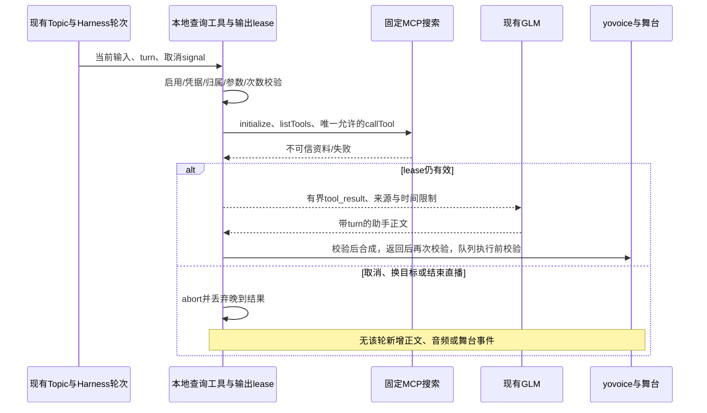

# 工程上下文：FEAT-004 直播只读天气与公开资料查询

## 当前有效方案

### 架构设计

**关联产品上下文**：`.sdlc-v1/context/REQ-006.product.md`。

**工程上下文**：`.sdlc-v1/context/FEAT-004.engineering.md`。

**已确认需求**：仅产品上下文的 confirmed 条目；本文引用 FR/SCN，不重新定义产品规则。

**分支 / 基线**：`codex/macos-yovoice` / `67d4df44e3c119b5a799029913cdef6c29c73aeb`。

**创建日期 / 状态**：2026-11-10 / Plan 与当前离线实现检查已由主 Agent 接受；可信真实天气、GLM/语音链路及独立 Validate/Review/Ship 未完成，Task 仍为 in_progress。生命周期状态仅以 `state.json` 为准。

#### 背景

当前抖音与本地彩排的 Agent 仅声明 `show_stats`，不能查天气。本 Feature 在既有 GLM Coding Plan → 助手正文 → yovoice → 本地舞台旅程内增加两类有来源查询。长期方向来源为 `none`，预期结果和发布后观察引用 REQ-006，不建立额外路线图。REQ-005 下的后台冻结、REQ-008 Papermorph 课程互动及产品 OUT-001 均不进入本次实现。

决策问题是：如何复用成熟查询传输，同时只暴露已选只读能力，并使晚到结果在取消、换目标、下播后失效。约束是固定官方服务、既有凭据、无任意 URL 抓取、无新增运行时和页面、无共享服务操作。主 Agent 已取得两次真实搜索与已观测的输出 profile；公开资料样本可支持许可证结论，天气样本仍不能确认北京此刻实况。天气成功路径与 Coding Plan 持续适用边界仍影响真实验收，不能由连接或调用成功替代。

来源与版本：

- 本插件源码基线见上；宿主包实际为 `@deepseek-ai/dsh-*@0.2.2-rc.1`。只读 upstream checkout 为 `fcc0ad462172522aaf5c93a7b2e01f6b9f0b0159`，不是本 Feature 的修改范围。
- upstream `packages/web/web`、`tool-web` 已有 provider-neutral search port、schema/result card 与取消信号；默认 provider 不能直接继承 GLM 凭据。`packages/mcp/mcp-client/src/{transport,tools}.ts` 使用 `@modelcontextprotocol/client@2.2.0`，但桥接器全量注册远端工具；`tools.restrict` 不能作为同 scope 自注册工具的过滤证明。`web-fetch-http` 明确支持内网访问，不能暴露为本 Feature 的工具。
- 官方 [搜索 MCP 说明](https://docs.bigmodel.cn/cn/coding-plan/mcp/search-mcp-server)、[套餐说明](https://docs.bigmodel.cn/cn/coding-plan/overview)、[支持工具说明](https://docs.bigmodel.cn/cn/coding-plan/tool/others)，由主 Agent 于 2026-11-10 核查。官方声明兼容 MCP 客户端，联网搜索计 1.2 积分/次；DSH 未列于支持工具列表，不能承诺套餐权益、免费或新付费回退。
- 主 Agent 的真实、脱敏 metadata 观测投影：[`metadata.json`](../../../smoke/readonly-tools/metadata.json)，2026-11-10，SDK 2.2.0，固定端点初始化与列工具，共 4 个 HTTP 请求，搜索/模型/TTS 调用均为 0。实际工具名是 `web_search_prime`，与文档 camelCase 名不同；无 `outputSchema`、无 annotations。这是连接/schema 证据，不是搜索或天气成功证据。
- 主 Agent 在用户明确授权后取得的真实 provider 样本：[`provider-check.json`](../../../smoke/readonly-tools/provider-check.json)，`observedAt=2026-11-10T08:41:09.000Z`，两次串行 `tools/call`，均 `isError:false`，模型/TTS/直播输出均为 0。天气调用 2060ms、公开资料调用 1304ms，仅为 call 阶段观测，不含初始化/列工具，不是 SLA。两个 `content[0].text` 都须恰好两次 JSON 解包才得到 9 行数组，行字段仅见 title/link/content/refer，无独立时间字段。OBS Studio 许可样本返回官方 GitHub 仓库及 obsproject 官网，仓库摘要明确 GPLv2 或以后版本，可作为真实公开资料层成功样本；天气结果混有旧报道、异地气温、未来预报及无关报道，只证明服务可调用。无天气准确性或 GLM/声音/播出通过结论。
- SDK 2.2.0 已在父工作区安装，其 package 声明 MIT、Node >=20；插件生产依赖仍须显式声明并锁定，不能把父层可解析误当成发布依赖。

本文比小型工程示例长，因为 FR-08 涉及查询、模型、语音及播放队列四个异步阶段，并增加真实 MCP、凭据和设置兼容契约；没有按模板制造独立基础设施 Task。

#### 架构与组件

##### 固定搜索适配器

- **职责**：复用 SDK 的 Client / StreamableHTTPClientTransport，仅调用经实际 metadata 核对的 `web_search_prime`，把返回资料转成有界、可追溯的本地结果；不实现 MCP 协议，不注册远端工具目录。
- **接口**：新 `src/body/readOnlyQuery.ts` 接受本地已校验的查询请求及合成取消信号；唯一生产 URL 为 `https://open.bigmodel.cn/api/mcp/web_search_prime/mcp`。以真实插件名/版本标识客户端，Bearer 只在 header；自定义 fetch 强制精确 URL 与 `redirect: 'error'`。模型、设置、结果均不能改变 URL/header/远端工具名；不发送平台凭据、参与者身份或对话历史。
- **覆盖**：FR-01、FR-03、FR-05、FR-07。

##### 查询设置与能力 admission

- **职责**：新 `src/shared/readOnlyQuery.ts` 维护浏览器/宿主共用的非机密设置、请求/结果 DTO 与校验；复用 `runtime.ts` 的 settings 原子保存、`index.ts` state/settings 路由，以及现有设置 Drawer/SecretField。新增 `readOnlyQueries: { weather: boolean; publicSearch: boolean }`，旧文件缺字段及首次安装均为两个 `false`，升级不自动联网；部分更新保留另一字段，错误类型拒绝且不改变文件/内存。无格式迁移、无 URL/密钥/预算的持久化配置。
- **接口**：`weather_lookup` / `public_search` 作为本地工具，在 `agent.ts` 的 localRehearsal 提前 return 之前独立注册；使用宿主已有 `tools.register(..., { when })` 对每步的 session、模式、主人启用和凭据状态做条件 admission，执行时再核对。它们只属于当前有效直播线，不进入游戏线，不扩大 B 站条件注册、执行检查或 lease。
- **能力一致性**：同一 availability 计算供 `when`、执行检查和主人 state 使用。persona 的静态说明只说“查询工具实际可用时可尝试”；更新两种 persona 和每轮 `push` 说明，移除“仅 show_stats”的冲突。`complete: true` 下不依赖其他 system section 自动注入。设置读取/状态轮询/能力 admission 不发远端请求；真正执行查询才初始化和列工具。
- **凭据**：沿用 `GLM_CODING_PLAN_API_KEY`，普通设置不保存它。查询专用 resolver：有 credentials 服务时只采用该服务本次成功解析的非空值；错误/空值为不可用，禁止悄悄回退旧 env。仅服务根本不存在时允许同名 env。不要为本需求更改旧 TTS/Bili resolver 的兼容语义。主人看到 configured/unconfigured/error，不回显值；如复用 SecretField，说明它与现有 GLM 共用、修改会影响模型。工具执行再次解析，取消/关闭/凭据变化后不得用缓存 key 继续新调用。
- **覆盖**：FR-06、FR-07、FR-09。

##### 当前提问上下文与输出归属

- **职责**：复用 `LiveShow.deliver()` 的现有 Topic、实际推入的消息 ID 与 Harness `agent/pre-step` 的 `agent/turn/step/signal`，为本轮建立宿主所有的输出 lease；不再建 session runtime。不能在 execute 时重新读取可能已变化的 `lastTopic` 冒充原请求。
- **接口**：lease 绑定 `sessionId`、target/session identity、直播输出 epoch、turn、宿主提交的 topic/message 与其输入来源，持有统一的失效判断和取消信号。`exec.agent` / `exec.signal` 必须匹配；这些身份不由模型参数提供，也不发给搜索服务。多条观众输入并入一个 Topic 时保留每条可靠参与者归属，不能拼接成某人的澄清。主人直接在会话输入时使用已 admission 的本次 user message；无法绑定可信输入则先澄清。
- **地点契约**：`weather_lookup.location` 必须逐字来自本次可信输入，或同一可靠 participant ID 的本次澄清片段；没有依据返回 `needs_clarification`。只允许现有会话里一个待澄清问题的有界关联，不新增长期地点记忆；会话/目标失效清除，无法关联就重新问城市。日期从同一输入确定，支持明确绝对日期；相对日期的具体日历日/时区不明确就澄清。来源不能唯一匹配地点/日期时不得把搜索命中当成定位成功。
- **输入校验细化**：地点与日期必须来自同一个可信问题或同一参与者的有效澄清，日期与尚未解决的预报/相对时间意图一并保留，不能因后来只补城市而退回当前天气。其他参与者的无关话语不否定一个独立完整的问题，也不能为它补字段；气温、几度、降水等通常天气问法不以字面“天气”为必要条件。存在不相容的日期或无法可靠选择请求归属仍先澄清。公开资料中文关联按有界实词/主体检查，不要求来源复述完整问句；优先复用内置分词，不引入 NLP 框架。天气候选先将一致地点、时间与事实去重，再判断真实冲突，不能把重复命中本身当冲突；来源及时间充分性要求不变。
- **失效契约**：统一应用到查询接纳、工具结果提交、live assistant 正文接纳、TTS 开始、TTS 返回和舞台广播之前，以及 mic 队列执行前。原生停止生成只在活动 turn 中通过其 signal 传播；宿主明确规定 idle 时 cancel 是 no-op，不能借该 signal 观察已经结束生成后的待播取消。现有直播控制台的查询区提供“停止查询回复”入口，显式撤销该查询的插件输出 lease，无论模型仍生成还是已 idle；原生仍执行同一查询 turn 时才同时请求 native cancel，并保留后续 inbox。忽略取消的替身即使返回也不能提交。正常 turn/end 不撤销已接纳且仍有效的待播句；取消状态保留至该轮所有队列任务结束，不能因为下一轮开始而重新有效。live 的 `interrupted: true` 消息不朗读；不能只看已持久化 `assistant/message` 就认定可播。
- **下播兼容**：begin ending 立即停止新查询 admission、使旧查询输出失效并取消其工作，谢幕使用单独的现有 ending 旅程。fully offair 显式结束直播输出 epoch，拒绝旧 live 正文、音频、工具状态和待播句；不能只设置 `onAir=false`。不粗暴禁止所有 game 行为，保留既有 B 站游戏收尾规则。现 `currentSessionGeneration` 返回 sessionIdentity，不能把它与内部 sessionGeneration/turn lease 混用。断开抖音订阅本身不令有效本地舞台关闭；主人随后可创建合法的新本地查询。
- **断订阅的旧查询清理**：沿用基线 `show.disconnect()` 的 `invalidateSession(this.onAir)`，断开前快照的查询 lease 和尚未播放的输出全部失效，包括当时主人发起的查询；旧 provider、模型及 TTS 回调不得在断开后重新输出。此动作不调用原生 `agent.cancel`，保留 `onAir`、brain session 和舞台，断开后主人可在同一保留会话中创建新的本地查询。不能以“没有调用原生 cancel”声称在途查询未被取消。该决定澄清原 FR-09 的含糊表述，依据是基线和 REQ-002 对旧目标临时上下文的清理，不是新增用户范围；已开始播放内容仍可完成。SCN-13 分别覆盖断开前主人/观众查询失效和断开后新主人查询成功。
- **原生同轮多步不可重新授权**：QueryTurn 的查询归属以宿主 agent、session 和原生 turn 标识冻结，跨 pre-step 延续同一归属；输出 epoch、配置或凭据失效后，同一原生 turn 的后续 step 仍保留已失效查询及 `called` 标记，不能重建为未查询的新 lease，也不能覆盖 `forTurn` 后把旧模型续答降为无归属语音。只有新的原生 turn、仍有效目标与输出身份可接纳新查询；无法确认归属时拒绝。该决定来自 SCN-13 主人在 provider 等待中断订阅的可复核失败：原 turn 8 在 step 2 重建 `called=false` lease，旧 assistant/message 被当普通句广播。实现者须同时检查设置/凭据/目标失效的同轮续步，以及后续合法新 turn；不靠调用 native cancel 掩盖归属错误。
- **零晚到的输出范围**：失效检查拒绝插件对旧查询结果及模型续答的接纳、查询反馈、直播正文、字幕和音频；不删除或伪造宿主原生会话历史。特别是断订阅不调用 native cancel 时，底层模型仍可能完成并持久化 `assistant/message`，watcher 必须消费后拒绝将其调度到直播，不得把内部记录解释为新直播回复或声称原生事件数为零。测试同时保留该宿主事件和插件零新输出的观察，不能只看取消请求。
- **覆盖**：FR-02、FR-08、FR-09。

##### 主人证据与舞台反馈

- **职责**：现有侧栏显示当前查询状态与最近一次有界证据，现有 stage tool 提示显示“正在查询天气/公开资料”。终态区分取得资料、证据不足、失败和取消；不能把它们命名为语音/播放成功。无独立页面，不播原始 JSON、堆栈或认证错误。
- **接口**：state 仅返回安全 DTO；最近结果限制为本轮/当前目标的有界记录，切换/结束时清理。可复用现有工具结果 card 展示来源，控制台提供可核对链接、检索时间及未知时间说明。可见文本用 React 转义；外链使用 `noopener noreferrer`。口播由 GLM 基于 evidence 生成短句，只说来源名和时间限制；复用 `core/speakable.ts` 已有的 Markdown 链接/裸URL清洗，不另造同类口播过滤器。调用轨迹通过现有 show JSONL 记录结构化 query 状态（queryId、kind、turn、phase、耗时、结果类别/来源数，必要时安全来源），不存 key、请求 header、私有参与者信息或完整远端原文；取消后可有内部丢弃记录，不能产生新的舞台反馈。无 tool 行不能作为“未调用”的证据。
- **通用反馈边界**：`LiveShow.toolCall()` / `note()` 入口带 `assertBiliCurrent()`，新查询不得直接调用它们。仅在 `LiveShow` 增加独立的通用只读查询状态/广播入口，接收 query lease 和安全状态 DTO，先核对有效归属，再发布现有 stage tool 状态及主人证据。保留两个 Bili helper 的断言，不为了抖音查询删除/放宽；不顺带修正旧 show_stats 行为。测试实际抖音/彩排 query 的反馈路径，不能用 mock helper 绕过该区别。
- **输出能力状态**：复用主人 state/现有侧栏显示舞台协议能力，区分支持当前协议的非预览输出、仅预览、需刷新旧舞台和未连接；混合连接须分别统计/说明，不能因有一个新输出而隐藏旧连接。支持协议仅表示该连接可接收 owned live 事件，不证明浏览器允许出声或音频已播放。握手、订阅过滤和连接失效唯一契约见下文“舞台能力与连接归属”。
- **覆盖**：FR-03、FR-04、FR-05、FR-08。

#### 关键设计决定

##### 决定 1：窄适配器复用官方 SDK，不复用全量桥接

| 候选 | 覆盖与成本 | 测试/维护/供应链 | 决定 |
|---|---|---|---|
| 固定搜索适配器 + `@modelcontextprotocol/client@2.2.0` | 精确对接现有 Coding Plan 搜索入口；本地两意图共享一次执行器，少量胶水与结果过滤 | 现有 upstream 已使用同版本；MIT，显式生产依赖/lock；SDK 替身和固定网络策略可独立验证 | 采用：引入成熟依赖，复用现有工具/设置/语音链 |
| 扩展现有 dsh-web search port / dsh-tool-web | provider-neutral 搜索契约可复用，但现成 provider 不支持当前凭据，仍需 GLM MCP adapter；还需 preset 和发布依赖接入 | 官方宿主方案，集成面更大且 `complete` persona 指导仍需显式处理 | 暂不采用；仅在当前窄适配器被实证证明无法满足现有契约时重新评估 |
| 直接启用通用 dsh-mcp-client | 传输可用，但会注册整个 tools/list，readOnlyHint 不是隔离，restrict 不保证同 scope 工具过滤 | 成熟桥接器，当前版本缺本需求所需 allowlist；为了一个工具引入更广服务依赖 | 不采用；不能靠远端描述自称只读取得权限 |

不自研搜索引擎/MCP，不暴露 `web_fetch`。SDK bundle 必须只进入 Node 侧；`shared` DTO 模块不能反向导入 Node/SDK。package 与 lock 显式固定生产依赖，保持 Node22 和宿主 0.2.2-rc.1 兼容，并检查产物及许可要求。

##### 决定 2：本地稳定输入，共用有界执行器

天气和公开搜索是实际存在的两个变体，共享固定访问、schema 核对、预算、取消、来源和错误机制；仅本地参数校验、查询句构建及时间要求不同。采用普通有类型函数/适配器，不引入 provider 插件体系、DSL 或可执行配置。天气沿搜索证据回答，不伪装成已接入结构化气象 API；数据不足的安全失败是必要行为，不能取代真实成功路径验收。

#### 数据模型 / 关键实体

以下为本地权威语义，具体 TypeScript 定义只维护在 `src/shared/readOnlyQuery.ts`；不得复制远端私有字段猜测。

| 实体 | 核心字段与约束 | 覆盖 |
|---|---|---|
| QueryRequest | `kind: weather/public_search`；天气 location（1–40 Unicode 字符）、可选 ISO 日期；搜索 query（1–70 字符）；禁止模型提供身份、URL、远端参数或凭据 | FR-01、FR-02、FR-07 |
| QueryLease | 宿主内部归属、turn 取消信号、有效输出 epoch；非持久化、不可被模型构造 | FR-08、FR-09 |
| QuerySource | `name`、`title: string/null`、`url`、`retrievedAt`、`providerTime: {kind,value,verbatim}`；已观测数组 profile 的 title/link/content 分别映射原文标题/URL/摘要，refer 仅远端索引；没有经过实际返回确认的时间角色/值时 `kind=unknown,value=null` | FR-03 |
| QueryResult | queryId/kind、status、bounded evidenceText、sources、限制说明/稳定 error code；status 区分 evidence/limited/needs_clarification/empty/unavailable/busy/timeout/failed/unsupported_response/cancelled。evidence 只说明取得可核对资料，不等同天气事实、正文、音频或播放已验收 | FR-03～06 |

`providerTime` 只接受来源原文中可明确归属的时间，保留原文；未有真实字段/语义证据不得给私有 JSON key 臆定 observed/published 含义。只有未分类时间文字时保留在 evidenceText，DTO 仍为 unknown。既不按检索时间生成观测值，也不自创天气过期阈值；日期不符、角色/时区不清、来源冲突按 FR-03 降为 limited 并明确限制。

#### API / 接口契约

1. 本地 `weather_lookup({location,date?})` 和 `public_search({query})` 使用同一 `defineTool` 输出 schema。天气 query 由校验后的 location/日期组装为不超过 70 字符的请求，不拼接其他观众/账号资料。缺城市/歧义先澄清；预报不支持或来源不匹配不能用当前资料替代。
2. 每次真实执行均在 SDK 建立的连接内有界初始化并 `listTools(undefined,{cacheMode:'refresh',signal})`，只选择唯一的 `web_search_prime`；其实际 input schema 必须与已观测 profile 兼容（object、required 仅 search_query、5 个已知 string 属性、additionalProperties=false）。未知必填字段、重复/缺失工具、未完成分页或不兼容 schema 显式 `unsupported_response`，不轮流猜名字/参数，也不注册其他工具。调用 `callTool({name:'web_search_prime',arguments},{signal,timeout,toolDefinition})`。
3. 只映射 `search_query`、`content_size:'medium'`、`location:'cn'`；当前天气使用 `search_recency_filter:'oneDay'`，明确日期预报与一般公开资料使用 `noLimit`。检索过滤不证明资料新鲜或目标日期覆盖；`location:'cn'` 是服务搜索区域设置，不是观众位置。天气采用简短的“地点 + 明确日期 + 当前天气实况/天气预报 + 更新时间”查询，并在适配器内固定 `search_domain_filter:'weather.com.cn'`；该更简明查询与固定域名策略尚未真实验证，不能承诺会改善命中。首版不向模型/设置开放 domain filter/high/区域选择；固定域名不授权本地抓取页面，也不证明具体城市/日期正确。
4. 远端没有 outputSchema；仅消费 MCP 标准 text content 与可序列化 structuredContent，视为不可信资料。对已观测 text profile，先检查总字节限制，再对字符串最多执行 2 次 `JSON.parse`；每层都重新检查大小和类型，只接受解包后数组，最多校验 32 行候选，每行 title/link/content 为字符串，refer 若存在仅为远端索引。title、link、content 按原文字段映射为来源标题、URL、摘要；refer 不是来源、引用权威或时间。第三层字符串、损坏 JSON、过大/过多、错误行类型均显式 unsupported_response，不追加解码、不猜其他私有字段；不能对尚有 JSON 转义的原始字符串用 URL 正则补救。标准容器中的普通文本若本身不需 JSON 解包，可沿既有 Markdown/bare URL 方式处理；只有明确的原文链接标题才填 title，否则 title=null、name 为校验后的 hostname。未认识的 structuredContent 私有形状保持 unsupported，不猜字段。
5. URL 校验拒绝 userinfo、非 HTTP(S)、loopback/private/link-local/reserved IP、localhost/内网名称等；不自动请求任何来源、资源或嵌入内容，不解析模型续答生成的 URL 为来源。允许 hostname 只说明已做格式/地址分类，不能声称已验证其 DNS/公网可达性。先校验全部有界候选的关联性，再选最多 3 个来源，而非先取前三条；公开资料优先匹配问题的原始/官方来源。没有可核对来源返回 insufficient_sources（对外归为 limited/failed）。天气候选须核对显式城市、请求日历日及当前实况/目标日预报的区别：明确异地、日期不符或无关报道不得作为天气事实传给 GLM；未知归属/时间的候选只能说明限制。来源有 URL、isError=false、oneDay 命中或文章今天发布均不足以确认实时天气；原文“今天”只能按该来源已确认的绝对日期理解，不能改为检索日。没有可信当前观测则 status=limited，明确“无法确认此刻天气”，不得给出确定当前温度；不得把鸡西气温归给北京或把 11月9日文章的“今天”当11月10日。上述实际样本中保留日期相关报道作为有限资料也不等于当前观测成功。providerTime 按数据模型处理，不把 refer、检索相对时长或 retrievedAt 填为天气观测时间。
6. 初始工程预算：单次总 deadline 15 秒（含初始化、list、call、读取），每轮最多一次远端搜索调用，全插件搜索并发 1，忙时直接返回 busy、不排长队；自动重试 0、自动 fallback 0。所有底层工作须传递合成 signal 并在 abort 后收束、关闭自有连接。HTTP/每层解包文本上限 1 MiB、模型 evidenceText 总量 12,000 字符、最多 3 个来源、单个摘录最多 2,000 字符；达到模型展示边界标明截断，不截成伪完整证据。数值是本候选的保守初始工程配置，不是官方实测性能或 SLA，有限真实验证可据证据调整。
7. owner 设置复用 POST settings 的既有权限和 `{ok:false,error}` 语义；state 返回启用范围、凭据配置/错误和服务“未验证/上次可用/不兼容”状态。配置可用不等于服务一定成功。GET state/页面挂载/保存为关闭均不得请求 MCP；关闭或凭据不可用立即取消旧查询并撤销新 admission。保存失败保持原文件与原内存，沿用已有同目录独占临时文件/rename 保护。
8. 舞台接口由 `src/stage/protocol.ts` 维护类型，`src/body/server.ts` 的 SSE 入口读取客户端能力并传给 `Stage.subscribe` 的连接信息；`runtime.ts`/`index.ts` 提供安全的主人输出能力投影，既有 `preview` 语义保留。具体字段名在这些类型化边界内收敛；固定能力参数与接纳/失效规则只按下文“舞台能力与连接归属”实现，不另建 build 身份系统或把能力声明当认证。
9. owner 控制接口 `POST /api/dsh-livestream/query/cancel` 接收 `{sessionId, queryId}`，沿现有 Harness owner 鉴权；模型不获得这个工具。无效输入拒绝，目标不是当前直播会话/最新匹配查询、或查询所绑输出 epoch 已变化时返回 409，不能取消新目标或不相关查询。先取得匹配 lease 并同步失效，再处理中止；重复取消同一已失效查询幂等，不清空其他观众待处理事件，不停止游戏/guest或共享服务。只有原生 session 自身事件与当前 agent 状态能证明仍在该查询 turn 时才请求 `agent.cancel({kind:'user'},{keepInbox:true})`；仅凭最后一次 pre-step 缓存不足时宁可只撤销插件输出。生成已完成时仍必须撤销该查询尚未播放的 TTS、mic 队列及浏览器回调。UI 的“停止生成”保留原生语义，不能用 idle 状态下该操作返回 accepted 来宣称待播回复已撤销；查询区入口承担此时的验收。

#### 时序与数据流

图只表示本 Feature 的 live 查询输出，不重新定义 B 站游戏线。正文的 lease 检查适用于每个 await 之后；舞台端若已有 say 事件进入待播放状态，也须带归属并在失效时撤销尚未播放的该轮内容。仅停止服务端后续广播不能证明已排队内容不会开播；已开始播放的历史内容按产品规则无需追溯撤回。图未经渲染预览，以上契约为等价文字说明。

##### 舞台能力与连接归属

舞台 v1 协议采用增量兼容：live say 增加可选的归属标识，并新增针对该标识的失效事件；客户端的 Audio metadata/play/fallback 回调在修改字幕或开始播放前检查归属。无该字段的既有 game/guest 事件保留原语义，不做全局音频清空。新舞台脚本在 SSE 请求中显式声明 `outputProtocol=owned-live-v1`，服务端只向声明支持的连接发送带归属的 live say/失效事件；未知或缺失能力的旧连接仍可接收原有非归属事件，但不得收到新查询语音，不得通过去掉归属字段降级补发。hello 传递所需协议及当前输出身份，主人状态区分可用输出、预览和需刷新舞台；preview 即使声明能力也不计为出声输出。不能把首次服务端 hello 的 build 或文件 mtime 当成实际加载脚本的身份；保留原缓存刷新机制，但发布必须显式刷新旧舞台并确认新能力，不能声称旧机制已保证兼容。

SSE 断线/连接替换时，客户端立即撤销尚未开始的 owned live 内容、其计时器和 Audio/pendingClick 回调，令旧连接归属失效；每个异步回调在产生字幕或开始播放前再校验。重连先处于等待 hello 的状态，hello 同步当前输出身份后才接纳新连接的有效事件，不重播或重新授权已撤销内容；Stage 的 latest 状态不得缓存并补发 say。已经开始的内容按产品约定可完成，game/guest 保持原语义；创建 Audio 或调用 play 不等于已经播放，已显示字幕也不授权取消后再开始尚未播放的音频。测试必须阻塞 Audio 开始，断流期间取消并同 build 重连，再释放 metadata/play/fallback，断言旧字幕与新播放均为零；另以旧脚本延迟首次 SSE、宿主升级、再释放 hello 的交错证明缺失能力连接收不到新查询语音。只做服务端队列测试或比较两次 hello.build 都不能代替这些验证。

#### 横切质量设计

- 错误代码映射为短中文下一步；provider 错误原文不直接进入模型台词/公开日志。资料包明确是不可信引用，不能改变系统身份、权限、工具集合、凭据或配置；不创建资源链接抓取回路。
- 归属在接纳时冻结，晚到失败也不能广播“失败了”到新舞台。turn 正常结束和取消分开；自然完成后仍可播已接纳语音。取消/目标切换/end ending/fully offair 都必须以观测的新增输出数验证，不能把调用 abort 当结果。
- 来源口播与 UI 共用 QueryResult，不让 UI 成功状态代替真实语音合成/播放。有限真实验证记录实际 latency、来源/时间字段和限制，不能根据 metadata 成功删除缺口。

#### 风险与取舍

| 风险 | 影响 | 缓解措施 |
|---|---|---|
| MCP 权益或实际结果不支持所需天气/资料 | 真实旅程受阻 | 尽早由主 Agent 在明确预算内串行真实验证；无结果保留失败证据，不伪装其他客户端、不换付费服务 |
| 真实天气样本混有北京旧报道、异地气温、未来预报，且无独立时间字段 | 不能确认当前北京天气，URL/oneDay可能造成伪成功 | 已观测双层JSON按字段解包；地点/日期/天气类型逐候选核对，错配不传天气事实；unknown/limited如实说明；新查询/固定域名策略尚未实测，天气成功样本缺口保持未通过 |
| 取消后 SDK/GLM/TTS/浏览器回调继续完成 | 晚播/跨目标 | turn/output lease、各提交点检查、浏览器待播失效与延迟替身断言；保留必要游戏谢幕兼容 |
| 断流丢失 invalidate，或旧脚本第一次收到新宿主 hello | 同 build 重连后晚播，或误把旧舞台当支持新协议 | 按“舞台能力与连接归属”显式声明/过滤能力，onerror撤销待播及旧回调；两个交错试验必须覆盖，部署显式刷新确认，不把服务端build/mtime当页面JS身份 |
| 新依赖由父 node_modules 偶然解析 | 发布后缺包 | 精确生产依赖/lock、隔离构建与包内容/解析检查，不使用 upstream 私有源码 import |

#### 需求覆盖

下表为唯一“验收 → 契约 → Task → 计划验证”关联；所有行均属于 `FEAT-004-T001`，SC-001～03 按对应场景/证据层汇总。

| 规格 / 场景 | 设计契约 | Task 内计划验证 |
|---|---|---|
| FR-01 / SCN-01、02 | 稳定天气输入、固定搜索、地点/日期/类型匹配及 limited | 天气/明确日期/不支持日期 fixture；实际北京查询的鸡西页面、旧“今天”、未来预报须排除/受限；真实当前天气成功样本仍缺，不能以合成数据代替 |
| FR-02 / SCN-03 | 宿主 Topic/message 绑定、逐字地点依据、同参与者澄清 | A/B 交错、缺城市、同名区划、无可靠身份、旧会话；不发出含另一人的城市的远端请求 |
| FR-03 / SCN-04、05、07 | QuerySource/Result、双层解包数组profile、URL过滤、providerTime unknown | 用脱敏真实profile构造提交fixture，断言两层解包后标题/摘要保真、URL无JSON转义残留、refer不是来源/时间；第三层/损坏/超限/错类型拒绝；天气错配、缺时间和公开许可来源逐字核对 |
| FR-04 / SCN-01、05 | 同一 Harness native tools→tool_result→续答→现有 say 旅程 | 真实 adapter/loop + 模型协议替身捕获两步请求；再分层记录真实 GLM、yovoice/本地舞台及正式观众端缺口 |
| FR-05 / SCN-02、06 | deadline/一次/串行/无重试/错误分类 | 假时钟与忽略 abort 的延迟服务；timeout/error/empty/insufficient/schema drift；精确远端调用计数与收束 |
| FR-06 / SCN-08 | 默认关闭、条件工具集、严格凭据、有效 persona | 旧设置、缺/错/撤销 key、服务存在不回退env；实际模型请求的 schema与提示一致；关闭中途生效 |
| FR-07 / SCN-09 | 固定URL/远端工具/参数、Node-only SDK、Bili原隔离、通用query反馈入口 | 恶意 tools/list、MCP注入/重定向/资源、Shell/文件/账号/私信/任意URL请求零执行；三模式schema/执行断言，抖音/彩排query不调用Bili专属toolCall/note |
| FR-08 / SCN-10、11、12 | 请求/正文/TTS/待播统一lease，ending与offair；舞台能力与连接归属 | 在query、GLM续答、TTS完成/队列分别延迟、取消/换目标/完成下播再释放；新增正文/合成提交/舞台事件/新播放数0，谢幕不受误伤；断流丢invalidate后同build重连释放旧Audio回调仍无晚播；旧脚本延迟首连后遇宿主升级仍收不到owned查询语音 |
| FR-09 / SCN-13 | 断开前旧查询快照失效，订阅连接与有效本地舞台分开 | 分别释放断开前主人/观众查询及待播回调，新输出0；断开后新平台输入0，同一保留会话的新主人本地查询成功；Bili游戏回归 |

### 实施计划

**关联产品上下文**：REQ-006；设计及覆盖以本文上文为准。

**创建日期 / 状态**：2026-11-10 / 已接受的有效实施方案，Build 待最终验收。

#### 背景

由同一 Terra 实现者连续完成一个纵向 Task，涵盖最小查询旅程、必要生命周期修复、设置与证据 UI、测试及使用说明。代码实现前主 Agent 接受此契约；过程中不为单个文件/命令再拆派。

#### 目标 / 非目标

- **目标**：满足上表全部场景；先给出可检查的本地隔离旅程，再分层核实真实服务、GLM、yovoice与舞台，保持测试与正式播出结论分开。
- **非目标**：唯一范围外规则引用产品 OUT-001；不改 upstream、不改变现有模型/声音/共享部署，不把独立 REQ-005/008 纳入本 Task。

#### 技术栈

沿用 TypeScript 6、Node ESM/Node22 目标、Harness 0.2.2-rc.1、React18/现有 Drawer 与 dl CSS、esbuild、Vitest3.2.4、e2e0.23.0/@e2e-dev/web0.15.5。新增精确生产依赖 `@modelcontextprotocol/client@2.2.0`；无数据库、UI框架或新运行时。

#### 实施层决定

采用默认 TDD：先为真实边界写失败断言，再实现最小路径。最早增量不等待所有回归，但其展示不结束 Task。复用现有 `test/e2e-douyin` 的真实控制台/routes 与隔离资源约定；为缺失的真实 Harness 工具循环增加有界 fixture，不能只 mock `ctx.tools` 后声称模型用过工具。upstream llm-pi-ai mock-server/test-support 可作接口参考，不复制成生产依赖或写 upstream。

#### 风险 / 取舍

真实 provider 需要有限外部授权和权益核实，由主 Agent 管理，worker 不调用；它可与已授权离线实现准备并行，但真实成功依赖不能拖到全部实现末尾才发现。两次无新增证据的实现/修正后遵循父 AGENTS 的停止规则，不靠换名字/拆 Task 重置计数。构建不得覆盖活跃 `lib`。

#### 实施阶段

##### 阶段 1：最小查询旅程

在 `FEAT-004-T001` 中先完成本地工具、固定 SDK adapter/替身、实际 Harness 工具循环与 safe evidence 投影；只补该旅程必需的配置和归属接口。**最早可检查结果**：隔离控制台输入“北京天气如何”，模型协议替身实际收到工具 schema，发起 `weather_lookup`，固定 MCP 替身收到一次允许调用，随后模型收到来源 tool_result 并产生正文，控制台/舞台展示正在查及来源；该 fixture 的新舞台以既定能力握手，记录非preview输出能力和本次连接/输出归属。提供运行入口、fixture产物、版本/工作树、请求/事件断言；它只证明隔离完整链路，不证明 GLM、实际天气或 yovoice声音。覆盖 FR-01、03、04；设计：固定适配器、证据与归属组件。

主 Agent 已完成用户授权的两次真实 provider 调用，并据此收敛上述双层 JSON profile 与天气过滤契约；公开资料层有 OBS 许可证成功样本，当前天气层仍不满足成功条件。将该脱敏结果的最小、带来源合成版本纳入已提交测试资产，不依赖父工作区原始证据才能运行。更简明天气 query/固定天气域名策略仍待以后获准的有限真实验证；实现者不得自行发真实搜索、GLM或TTS。没有可信当前天气结果时明确记录该层未通过，继续不依赖它的隔离工作，不猜字段、不新增调用。

##### 阶段 2：完整故事与异步边界

同一 Task 完成两意图的设置/凭据状态、persona/每轮能力一致性、错误/空态、参与者澄清，以及上表全部失效时点和 Bili/断订阅回归。SSE服务端能力过滤、主人输出状态和浏览器连接失效按唯一舞台契约完成，包含两种新增交错试验。新增来源/输出状态控件仅复用既有页面，检查键盘/焦点、desktop1440×900与narrow375×812。覆盖 FR-01～09；设计：上文全部组件。

##### 阶段 3：验证、使用文档与收尾

复用项目实际命令入口，补提交测试资产、按固定基线生成变更覆盖率，隔离构建与包解析，记录使用指南实际操作范围。真实外部层由主 Agent 独立串行执行并注明缺口；Build 证据不替代正式独立 Validate/Review。覆盖 SC-001～03；设计：需求覆盖表。

#### 需求覆盖

见架构设计末尾的唯一关联表；没有额外准备/收尾 Task，三个实施阶段均由同一 `FEAT-004-T001` 拥有。

### 工程任务

**输入**：上述设计与实施计划；Requirement 已 ready。

**组织**：仅一个完整纵向 Task，无并行 Task、无依赖。

#### 用户故事 1～3：有来源的只读查询与有效输出

- **FEAT-004-T001 [US1/US2/US3] 接通有来源查询并验证直播生命周期隔离**。
- **输出**：两意图在同一现有旅程内可用，所有必要安全/失败/生命周期分支具备确定性证据；未执行的真实层明确保留，不能将全部 Feature 标为验收通过。
- **代码范围**：`packages/dsh-livestream/src/shared/readOnlyQuery.ts`、`src/body/readOnlyQuery.ts`（新）；现有 `src/dsh/{runtime,index,agent}.ts`、`src/body/{show,stage,server}.ts`（server为SSE握手/订阅过滤入口）、`src/stage/{protocol,store}.ts`、`src/console/{console.tsx,client.tsx}`（样式位于现有 client 内）、`cordis.patch.yml`；仅与查询接纳/输出失效有关的 `src/core/attention/topics.ts` 或 `core/topicText.ts` 增量。上述 `src/` 均相对包根。依赖范围为包 `package.json`、根 `pnpm-lock.yaml`；测试范围为该包 `test/`、`vitest.config.ts` 与必要 e2e query 配置/launcher；构建脚本仅在隔离输出确有需要时作最小变更。新文件名称是计划，不是已存在资产；未列业务目录不授权顺带重构。
- **文档范围**：根 `README.md` 全局 usage 入口增加稳定 `LIVE-QUERY-WEATHER`、`LIVE-QUERY-SEARCH`、`LIVE-QUERY-CONTROL` 导航，链接现有 `examples/macos-yovoice/README.md` 的详细操作。说明 actor、现有控制台入口、主人启用/凭据/服务条件、示例城市/日期、默认关闭、失败/撤销/缺时间和支持范围，并写明旧舞台需显式刷新、主人如何核对输出/preview/需刷新状态。参数唯一来源是 shared schema、固定 provider profile、stage protocol及该详细指南；协议能力参数由舞台JS声明，不要求主人手改URL，key只给引用名。保留旧 Mac/声音/抖音 usage 导航，不复制产品规格。
- **完成条件**：上文每一行有对应运行结果；设置兼容/安全失败/真实工具循环/晚到输出和既有三模式隔离通过；新增舞台能力过滤与两种断线/升级交错均有业务断言，缺能力客户端不能当已验证输出；包依赖与隔离构建/typecheck通过；变更源码行80%/分支70%采用现有 coverage-diff；没有用提示词代替调用/输出断言。必要真实层缺证据时上报具体缺口，不伪称全链路完成；由主 Agent 按产品 SC-002 判定后续验收。
- **验证范围**：下列计划为本 Task 的必要验证，不是本轮执行记录。
  - Vitest 覆盖 QueryRequest/Result/profile、严格secret、设置持久化与失败保护、SDK固定请求、预算/并发/取消、正文/TTS/队列/stage失效。provider profile fixture 覆盖已证实的两层JSON字符串/9行结构、title/link/content映射和refer忽略、第三层/损坏/超大小/超行数/错误行类型拒绝，以及北京查询混入鸡西、前日“今天”、未来预报时返回limited而非当前温度；普通文本fallback不得接收仍转义的JSON。复用并扩充 douyinAgent/localRehearsal/agentTargetRetirement/showTargetRetirement 等现有测试；新生产模块加入 coverage include。全部使用临时 DSH_HOME、假key与自有动态端口，断言共享3080/3081/7390/8757及真实外部访问数0。
  - Harness 集成 fixture 走实际 Agent loop/native tools及实际模型 adapter，以真实协议替身驱动 schema → tool-call → tool_result → 续答；捕获各步 requests。真实 Show/Stage 与合成/音频替身验证归属，不用 e2e-douyin 的 push/synthesize stub 冒充全链路。必须检查 query、模型续答、TTS返回/排队三个释放时点，包含服务忽略abort，取消后新增输出数0。
  - 通过真实 `StageServer` SSE handler/`Stage.subscribe` 检查能力参数缺失、未知、正确，以及preview与混合新旧连接；只把owned live事件发给能力匹配连接，legacy game/guest行为保留，不降级补发，不缓存/重放say。主人状态精确区分各连接能力；不能只测伪造订阅选项而绕过server实际入口。
  - tester-army/e2e 的已提交 query 旅程覆盖启用/保存/刷新、缺凭据、天气与公开搜索成功、失败/空态/来源不足、关闭和取消；保留实际Console/routes，fixture拥有Stage与服务替身。Chromium沿已有缓存，不自动下载；两种 viewport；workers1/retries0/read-only strict cache、纯locator无agent步骤，模型预算0。归档 `packages/dsh-livestream/.e2e/feat-004-{build,validate}/` 的report/JUnit/trace/截图/fixture日志，保留失败产物，数据/端口只清理本次所有的资源。
  - 在同一已提交e2e query fixture验证“舞台能力与连接归属”中的两个交错：阻塞真实stage store的Audio开始，SSE断流丢invalidate、同build重连后释放metadata/play/fallback，旧字幕/新播放均为0；旧脚本延迟首次SSE跨宿主版本变化后仍没有能力声明，收不到新查询语音，主人状态需刷新。记录实际请求能力、连接/输出身份、事件接纳及播放调用断言；截图/hello.build比较或浏览器缓存推断不能代替这些结果。断线后已开始内容的例外、legacy game/guest及正常新连接输出一并回归，无新增基础设施Task。
  - 使用项目已验证入口：`npm_config_manage_package_manager_versions=false pnpm --filter dsh-livestream check`；Vitest/coverage入口和e2e完整调用形状见 project.md。Build核实本版本CLI支持后，将coverage输出指向 `coverage/feat-004-build/`，独立Validate用 `coverage/feat-004-validate/`；变更覆盖固定基线为本文基线，必须显式给本轮report，不能用FEAT-001默认旧报告。新增选项/配置须实际验证后写操作指南，不把计划当执行证据。
  - `test/macosTts.test.ts` 明确排除：此前触发系统真实 `/usr/bin/say` 且 MP3/ffprobe 问题尚未解决，当前不修改该路径。运行剩余相关 suite/coverage，记录实际收集数/排除项，不能写“全套通过”；其他新失败按证据归因，不能继续扩大排除。
  - 构建在包的隔离复制目录执行已存在 `node build.mjs` 入口，包含所需src/stage/assets/package/patch；依赖解析指向本轮锁定的隔离依赖环境。输出只写该副本lib；禁止在活跃包目录运行 pnpm build，installed plugin的lib symlink仍被共享Harness使用。检查四个bundle、Node-only SDK、发布package依赖/打包内容；只读现有活跃lib，不覆盖或重载服务。
  - README按文档入口实际操作并记录环境/输入/参数来源/终态；合成使用与真实目标分开。真实provider天气/资料、真实GLM工具续答、yovoice音频与本地播放分别记录，正式观众端另列未执行，未经授权不正式播出、不批量花费。保留主Agent已有metadata观测层，不升级其证明范围。
- **依赖/执行顺序**：无Task依赖；同一Terra按三个实施阶段连续完成与修正。首个可开始的Task为本Task。没有第二个实现者、额外基础设施或未来Task占位。

#### 回滚与发布观察

主人关闭两项查询即可撤销新 admission并取消在途查询；不影响既有模型/声音配置和订阅。代码回滚使用经确认的上一版本部署流程，不重写用户设置；新增字段旧版本可忽略，不删 credentials、不操作共享进程。真正加载新插件/重启/正式播出均由主 Agent 在现有授权内协调，worker不执行。加载新版本后显式刷新旧舞台，并从主人输出能力状态与实际SSE请求核对所需协议；缺能力/仅preview/需刷新时不报告查询音频已可播放，不以首次hello.build或mtime替代。该检查不授权本阶段操作共享舞台。

产品观察计划只引用 REQ-006“发布后观察计划”；技术侧观察固定预算是否适用、source/time缺失、schema变化、错误类别、被丢弃晚到输出及权限拒绝计数。失败按现有Requirement/工程记录回流，不另建状态/指标数据库。

## 实现记录（实际）

- **同轮失效与资料边界补正**：同一原生 agent/session/turn 的查询 lease 首次创建后冻结；后续 pre-step 不因 epoch 或 signal 更换而覆盖失效归属，新 turn 才可接纳查询。地点和日期从同一可信参与者的当前输入或该参与者的有界澄清一起校验，不跨人拼接；无关观众输入不否定独立完整问题，未解决未来时间不降为当前。中文公开问题用 Node `Intl.Segmenter` 做有界主体匹配，只识别关联、不承诺通用语义核验；同一地点、规范化时刻和事实的天气观测去重，真正冲突仍 limited。

- **Task**：FEAT-004-T001；基线 `67d4df44e3c119b5a799029913cdef6c29c73aeb`，实现位于该 HEAD 上未提交工作树；主 Agent 管理生命周期状态。无提交、部署或共享进程操作。
- **查询与归属**：在两个现有直播 preset 中条件注册天气和公开资料工具。`src/body/readOnlyQuery.ts` 使用固定 MCP endpoint、精确 SDK 与唯一 `web_search_prime`；`src/dsh/queryCredential.ts`、`queryTurns.ts` 为查询专用小 helper，绑定可信参与者、实际 turn/signal/session/epoch、单次调用与取消。原始来源仅作不可信资料，城市、日期、来源时间不足返回有限结果；两项开关默认关闭。
- **地点输入边界**：首版接受北京、上海、天津、重庆及明确的直辖市区县；其余只接受用户提供的省与市/县行政层级格式。裸地名先澄清且不访问 provider；格式本身不证明地点存在或唯一，仍需来源确认。仅同一可信参与者在当前会话和输出 epoch 内的有界澄清可延续上下文，不从模型或其他参与者补全地点。不支持的地域明确要求补充。
- **取消和舞台**：增加主人查询区「停止查询回复」与鉴权 POST `/api/dsh-livestream/query/cancel`，先检查当前 session、最新 query 和 epoch 并同步失效 lease；重复取消幂等，过期请求 409。仅有当前原生事件足以证明同一 turn 正在运行时调用 `agent.cancel(..., { keepInbox: true })`。原生 idle cancel 为 no-op 的负对照保留；不把原生“停止生成”当成待播输出取消。更新 SSE capability 握手、断流撤销、Audio 开始判定及旧客户端过滤，保留游戏/guest 和断订阅后本地交互。
- **界面和文档**：沿用控制台现有组件/样式展示开关、凭据状态、来源、可读检索时间与舞台状态；详细使用说明与根 README 稳定入口已更新。新 session 才加载更新后的 preset；旧 session 不自动更新。

## 验证记录（实际）

- **多轮澄清与有效提示收尾（最新）**：`/private/tmp/feat004-clarification-red.log` 保留三轮同人地点丢失及三模式真实 preset 缺提示的红灯。仅在仍要求澄清且 session、epoch、participant 匹配时，将同一待澄清问题与本次片段合并；超过 2000 字符或无法确定归属则清除并重问。跨人、目标失效与三轮正例已覆盖；原生 Loader/registry 实际组合测试检查两个 preset 与三模式的工具 schema、来源名、时间限制、实况/预报、查询原文和不朗读长链接提示。`/private/tmp/feat004-clarification-narrow.log` 对应窄测 25/25 通过。最新完整 Vitest/coverage 退出 0，69 文件、376 通过、8 跳过，唯一排除 `test/macosTts.test.ts`；`/private/tmp/feat004-vitest-final4.log` 保留结果。显式基线 coverage-diff 退出 0：行 790/851（92.83%），分支 454/584（77.74%）；隔离副本最新 typecheck 退出 0。既有 10 项浏览器 E2E 仅复用于未修改的交互路径，新增多轮和提示依上述窄测验证，不宣称真实 GLM 已遵循提示。

- **时间意图收尾（最新）**：`/private/tmp/feat004-date-red.log` 保留“今晚、明日、今夜、明晨”原先被错误视作当前天气的四项红灯；同一轮中把各用例隔离，避免复用先前澄清状态掩盖问题。使用有界的日词与常见时段组合后，`vitest run test/queryTurns.test.ts --maxWorkers 1` 退出 0，19 项通过；“北京天气如何”“北京现在几度”和同一参与者绝对日期澄清继续通过。不承诺穷尽自然语言时间表达，也不凭相对时间生成日期。更新生产源码后完整 Vitest/coverage 退出 0：69 文件、374 通过、8 跳过，唯一排除 `test/macosTts.test.ts`；`/private/tmp/feat004-vitest-final3.log` 保存结果。显式基线 `coverage-diff` 退出 0，行 783/844（92.77%）、分支 438/567（77.25%）；隔离副本最终 typecheck 退出 0。此前 10 项 E2E 报告针对未变化的当前天气、来源和控制台路径复用，不把它当成新增时间短语的浏览器证据。

- **追加真实天气单次观测**：用户另行明确授权 1 次后，主 Agent 于 `2026-11-10T10:45:28Z` 通过当前 `runReadOnlyQuery` 执行北京天气查询，固定 `weather.com.cn` / `oneDay`，仅 1 次 `tools/call`、总耗时 2435ms（含初始化/列工具），无重试、GLM/TTS/直播输出均为 0；结果仍为 `limited`，安全 DTO 中有 3 个 `m.weather.com.cn` / `e.weather.com.cn` 来源链接，不能确认实时天气。脱敏本机证据为 [`weather-check-1.json`](../../../smoke/readonly-tools/weather-check-1.json)。本次诊断只截获安全 DTO，因返回走 SSE 而未保存原始 payload；不得据此推断完整来源文本、追加私有字段格式或证明 provider 永不支持实时天气。该次授权已使用完，没有追加调用或偷偷回退。
- **同轮回归（最新）**：先保留 `/private/tmp/feat004-disconnect-{1,2,3,4}.log` 与新增单元红灯；其中第 4 次证明断订阅后原生同轮 step 2 覆盖旧归属并产生无 owner 语音。修正后 `DSH_HOME=/private/tmp/feat004-vitest-home GLM_CODING_PLAN_API_KEY= DSH_LIVESTREAM_LOCAL_REHEARSAL=0 ./node_modules/.bin/vitest run test/queryHarness.test.ts test/queryTurns.test.ts --maxWorkers 1` 退出 0（最终完整 suite 也覆盖）：真实 Topic/Harness/Show 下，主人和观众分别在 provider、模型续答和 TTS 三个时点断订阅、释放替身并等待 watcher，旧插件朗读调度/新合成/Stage say 为零，native.cancel 零次，onAir/session 保留，之后新主人查询成功；设置关闭后重启用及凭据引用更新也覆盖同轮续步。原生 agent 未被取消，因此其会话可能仍持久化 assistant/message；上述零输出只指插件接纳、语音和舞台，并不声称原生事件未写入。
- **资料和参与者回归（最新）**：`/private/tmp/feat004-context-red.log` 保存日期澄清、多人独立提问、中文主体和重复观测四类有意义红灯。修正后窄测试与完整测试通过，包括跨参与者负例、未解决未来意图、无关来源及冲突观测。未根据合成天气句式推断真实服务成功。
- **最终测试快照**：基线 HEAD 与工作树同上；上次完整 Vitest/coverage 命令在最新生产源码重跑退出 0，69 文件、365 通过、8 跳过，唯一排除 `test/macosTts.test.ts`；显式基线 `coverage-diff` 退出 0，行 783/844（92.77%）、分支 436/567（76.90%）。`/private/tmp/feat004-vitest-final2.log` 保存结果。最终同配置 E2E 退出 0，desktop/narrow 共 10 项；报告仍在 `.e2e/feat-004-build/`，独立 fixture 日志记录共享和外部请求均为 0。隔离副本最新源码的 typecheck、`node build.mjs`、Node 入口和 SDK 解析、`npm pack --dry-run` 均退出 0，活跃包 lib 未动。

- **最早增量**：`packages/dsh-livestream/.e2e/feat-004-build-increment-1/` 保存首次隔离桌面/窄屏旅程及请求/事件截图；之后的 `increment-2` 至 `increment-6`、`failure-1` 至 `failure-8` 保留修正历史。最近完整结果在 `.e2e/feat-004-build/`，包含报告、JUnit、trace、定向截图和 fixture.log。
- **Vitest**：在包目录以 `DSH_HOME=/private/tmp/feat004-vitest-home GLM_CODING_PLAN_API_KEY= DSH_LIVESTREAM_LOCAL_REHEARSAL=0 ./node_modules/.bin/vitest run --coverage --coverage.reportOnFailure --coverage.reportsDirectory coverage/feat-004-build --exclude test/macosTts.test.ts --maxWorkers 1` 执行，退出 0：69 文件、359 通过、8 跳过；`macosTts.test.ts` 是唯一排除。后补的九行双层编码样例以 `vitest run test/readOnlyQuery.test.ts --maxWorkers 1 -t 'nine-row'` 单独通过。该测试首次因 `example.org` 属于拒绝的保留域而失败，改为合规公开域 fixture 后通过，未改变生产代码。未经授权的系统 `say` 未调用。
- **变更覆盖**：`node packages/dsh-livestream/test/coverage-diff.mjs 67d4df44e3c119b5a799029913cdef6c29c73aeb packages/dsh-livestream/coverage/feat-004-build/coverage-final.json` 退出 0，行 740/810（91.36%），分支 408/539（75.70%）。新增九行测试未改变生产输入和本轮覆盖报告。最初受沙箱本地端口限制的 Vitest 已中止（退出 130）；授予本地 fixture 端口后完整重跑，不触及共享端口。
- **实际 loop / preset**：`queryHarness.test.ts` 通过真实 Harness adapter/loop 并捕获工具 schema、调用、结果、续答；`queryPreset.test.ts` 读取实际 patch 并经 native Loader/registry 验证 Bili、Douyin、本地模式的新 session persona 和可用工具。真实 Show/Stage 测试覆盖 query、模型续答、延迟 TTS、mic 队列、取消/切换/结束/下播及新回复。实际 Anthropic 格式的 `tool_use` / `tool_result` 与续答也由浏览器 fixture 捕获；OpenAI 格式测试不充当该协议证据。
- **浏览器**：`./node_modules/.bin/e2e run --config e2e-query.config.ts --workers 1 --retries 0 --trace on --reporter list,junit --max-duration 600000` 退出 0，desktop/narrow 共 10 项通过；有来源天气成功与资料不足、公开资料成功/失败/空、开关/凭据/键盘、原生 active 取消、idle 后主人取消、断流丢 invalidate、同 build 重连、旧脚本升级、断订阅后的本地交互均为独立夹具证据。天气成功为合成数据，非真实天气。最后一次 fixture 日志记录 `sharedRequests=0`、`externalRequests=0` 且自有服务停止。新增天气断言初次把模型收到的正文误当作控制台展示内容，失败保留 `failure-8`；纠正为验证实际 tool_result 后通过。
- **隔离构建**：源码复制到 `/private/tmp/feat004-build-stQngL/repo`，使用隔离依赖运行 `npm_config_manage_package_manager_versions=false pnpm --offline --store-dir /private/tmp/feat004-build-stQngL/store --filter dsh-livestream check`、包目录 `node build.mjs`、`npm pack --dry-run --json --ignore-scripts --cache /private/tmp/feat004-build-stQngL/npm-cache` 均退出 0。四个 bundle、`stage/index.html`、CSS 和 patch 存在；两个 Node 入口可导入，SDK 解析到隔离环境的 2.2.0；浏览器 bundle 不包含 SDK。一次包检查误写为 `lib/stage/index.html` 失败，核实实际包路径为 `stage/index.html` 后检查通过。活跃包 `lib` 未构建或覆盖。
- **真实层缺口**：本 Task 未调用真实 MCP/GLM/TTS/yovoice 或正式播出。主 Agent 此前两次授权的只读 provider 样本仅证明公开 OBS 查询可得来源；天气混杂旧/异地结果，新查询和过滤未做真实调用，可信当前天气未验证。真实 GLM 工具续答、yovoice 合成与播放、正式观众端仍需独立授权和验证；不可将离线替身视为 Feature 全链路通过。独立 Validate/Review/Ship 尚未执行。

## 评审记录（实际）

- **主 Agent 离线接纳**：已核对最终三轮澄清与原生同轮失效修正、有效 preset 提示及实际日志：69 文件、376 通过、8 原有跳过，新增提示/上下文路径的 Harness/Loader 窄测 25 通过，变更覆盖行 92.83% / 分支 77.74%，最新隔离 typecheck 与 diff 检查通过。既有 10 项浏览器证据仅用于未改变的交互路径，不能替代真实 GLM 遵从、天气数据或语音验收。保留全部实际失败与修正记录；未据离线结果请求 Task done、未提交/部署或结束当前直播。后续仍需获得相应提交/外部运行授权及有效证据，不将这次接纳写成正式 Review。
- **状态**：Plan 内一次有界独立协议设计复审已执行并接受处理方案；Build 离线检查见上，独立 Validate 与正式 `sdlc-review` 尚未执行。
- **范围、发现与处理**：主 Agent 的 fresh-context `query_protocol_review` cycle 1 使用 doubt-driven-development，识别两项真实兼容遗漏：断流丢失 invalidate 可让旧 Audio 回调在同 build 重连后晚播；首次 hello 接纳宿主 build 及 mtime 不能证明页面 JS 能力。主 Agent 已选择显式能力与断线撤销契约，Build 已实现并提供上述隔离检查证据，仍须独立验证和代码评审。未发起第二轮设计复审或增加 Task。

## 发布与观察记录（实际）

- **产品观察计划引用**：REQ-006“发布后观察计划”。
- **技术发布准备、实际结果、反馈证据与缺口**：尚未执行；未重启/修改共享Harness、yovoice、DyHub、Stage，未开始正式播出。
