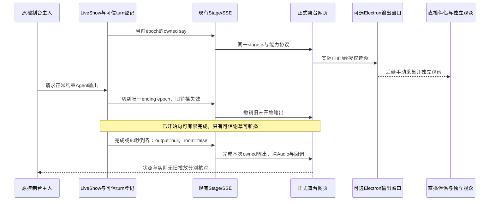

# 工程上下文：FEAT-005 Mac 舞台失焦后的观众持续播出

## 当前有效方案

### 架构设计

**关联产品上下文**：[REQ-005](REQ-005.product.md)。
**工程上下文**：`.sdlc-v1/context/FEAT-005.engineering.md`。
**已确认需求**：REQ-005 的 NEED/CON/DEC、FR-001～06、SCN-01～12 与 SC-001～04；不复制产品规则。
**创建日期**：2026-11-10。**状态**：Plan 候选待主 Agent 接受；用户新增“切回屏幕后恢复”线索后，先检查既有直播伴侣设置并核对源网页与采集预览。下文 Electron 与协议升级仍未采用，不可自行实施。Feature/Task 登记及进度仅以 `state.json` 为准。
**分支/读取基线**：`codex/macos-yovoice` / `67d4df44e3c119b5a799029913cdef6c29c73aeb`，另有 FEAT-004 未提交实现；本轮只有文档读写，无业务执行。

#### 背景

- 既有 Chrome 正式舞台→Mac 抖音直播伴侣→独立观众的前台主路径已现场成功；用户报告失焦后声音继续、视频不变。既有 `widgets.tsx` 的字幕/视频使用 rAF，并无已确认的 blur/visibility 主动暂停。这些事实不能确定根因在源渲染、窗口采集还是最终输出。
- **实际复现条件已明确**：用户回答主 Agent 的聚焦问题：“舞台仍在屏幕上可见，只是没有焦点”。REQ-005 的必要 SCN-04 正对应本次原现场故障；真实关闭 P0 必须在该状态回归通过，并分开证明源 bitmap、直播伴侣采集和独立观众内容变化/新回复/声音。状态明确不等于根因已证、修复已完成或支持已实测。
- **当前诊断顺序**：用户进一步提出可能是直播伴侣或缺少设置，切回屏幕后推流恢复。先复用现有应用检查采集/性能选项，再以约 10 秒、不发新弹幕的可见失焦对照区分 Chrome 网页自身停更与直播伴侣采集预览停更；待得到该观察再选择最小修复。不能把症状直接归因于 Chrome 节流或先实现新播放器。
- **用户对照结果与下一变量**：用户随后确认网页继续动，直播伴侣预览和手机观众画面都停住；故障已收窄到伴侣采集/合成/编码输出链路，源网页停更可先排除。主 Agent 的只读打包源码/日志调查发现伴侣 renderer 存在 hidden 状态记录、预览有 rAF frame mailbox，已找到的显式 transport 暂停只对应锁屏，不能据此声称普通 blur 会主动停推流。先请用户让伴侣自身始终部分可见、在其他 App 操作约 15 秒，区分失焦与伴侣被完全遮挡；本轮复测条件见下条。本机调查及局限见 [FINDINGS](../../../../20261110-douyin-background-capture/FINDINGS.md)，源码副本与原始日志不随本仓发布。不改安装包，不启用新播放器，不因静态线索自动添加启动参数或重启直播。
- **复测条件**：用户对上述 15 秒对照选择“当前未开播或暂时无法测试”。因此本轮没有取得伴侣自身保持可见时的结果，不要求用户为此重新开播，也不把该回答解释为修复通过或同意重启应用。下次具备条件先复用同一对照；若不再停，记录为伴侣窗口可见性的临时使用条件，若仍停，再依据新观察选择有界采集/启动参数试验。当前没有实施修复。
- **历史推断（已替代）**：此前因舞台使用原生全屏，曾保留切 app 可能切 Space/完全遮挡的待核推断，并暂缓计划接受；用户上述答复已消除这个复现条件缺口。该推断不是根因观察，不再作为现行阻塞；Space、遮挡、最小化继续按产品分类表分别声明，不成为本次故障新增必要承诺。
- 目标是修复 REQ-005 的必要可见失焦状态，保留其余窗口类别的诚实支持声明、恢复和结束约束。长期方向文档为 `none`，使用 [project.md](../project.md) 的现有产品/工程边界，不增加课堂平台或推流服务。
- FEAT-004 候选已按用户授权提交推送为 `a920022b720cdac44a793c56bdee60641ae3d6e2`，其离线检查已接纳，真实层仍未验收。该 commit 包含 `src/{dsh/agent.ts,body/show.ts,body/stage.ts,body/server.ts,stage/protocol.ts,stage/store.ts}` 的 `owned-live-v1` 查询输出归属，可作后续静态接口基线；实际共享代码写入仍须等待本 Plan/契约被接受和写界交接。不是要求 REQ-006 必须先 released，也不以全局 `next` 当前指向 FEAT-004 代替本目标决策。
- **结束语义来源**：主 Agent 本轮明确沿现有正常谢幕；begin ending 停止新输入、失效旧待播，允许已开始句及受限谢幕收尾；完成终态后实际无旧播放/字幕/音频。不是点击立即硬打断。REQ-006 的查询取消仍允许已开始声音完成，不能把该例外带到完成终态。

#### 架构与组件

##### 可选本地舞台播放器

- **职责**：在独立受限 Electron BrowserWindow 中加载同一正式舞台网页，替代原 Chrome 输出窗口。控制、Agent、GLM、yovoice、舞台状态及直播伴侣仍由现有系统负责。没有新推流器、业务舞台、课程管理页或通用浏览器。
- **位置**：计划为 `tools/stage-player/` 的小型可选独立包，与根 `packages/*` workspace 分开；不把 Electron 加进直播插件的 production dependencies 或默认启动链。独立 package/lock、纯策略模块、main 入口、静音 fixture 和运行探针均属同一个 Task；具体文件为下文代码范围。
- **接口**：读取 owner 本地提供的舞台 URL，成功后只显示舞台窗口；默认静音，声音开启与页面播放授权必须显式操作。退出/关窗只关闭该输出连接和自有 Electron 子进程，不请求 offair、停止采集或服务；不自动重启、重开窗口或恢复输出。
- **覆盖**：FR-001/002/006、SCN-01～08。能持续画出源 bitmap 是可行性证据，不能证明直播伴侣已采集或观众已收到。

##### 现有舞台与直播输出归属

- **职责**：`src/body/{show,stage,server}.ts`、`src/dsh/{agent,queryTurns}.ts`、`src/stage/{protocol,store}.ts` 继续拥有会话、turn、mic 队列、SSE、音频回执和迟到结果处理。播放器不拦截/重放 SSE，不复制 QueryTurns，不提供服务器取消的替代实现。
- **已观察缺口**：当前 `agent.ts` 181～187 仅 `lease.called` 的查询回复带 owner；普通 live 走无 owner 的 `show.say`。`store.ts` 334～354 的普通 Audio metadata/play/error 回调没有归属；269～277 的 `revokeOwned` 不撤销已经开始的声音。`show.endLive()` 当前设置 ending、清 output epoch、排谢幕，90 秒兜底 finish；普通异步合成及客户端旧回调不能仅靠新窗口得到保护。
- **接口**：在 FEAT-004 已接受协议上，把普通 Douyin live 和受限谢幕纳入同一可信 turn/输出归属，详见下文。B 站 game/guest legacy 路径不改；查询自身输入授权、配额、服务选择与成功标准仍归 FEAT-004。
- **覆盖**：FR-003～06、SCN-09～12。

##### 有限观测与操作说明

- **职责**：独立静音 fixture 分析源 bitmap；现有直播伴侣只在主 Agent 协调的后续窗口手动切源；独立观众负责最终视频/声音观察。证据逐层标明实际、失败和未知，分类表引用产品正文。
- **接口**：不新增监控服务。全局 usage 入口仍为根 `README.md`，计划增加稳定导航 `LIVE-DOUYIN-OUTPUT` 至 `examples/macos-yovoice/README.md` 的唯一实际操作段；参数 schema 在 helper 策略模块，舞台地址唯一来源仍为原控制台，预算/执行证据在本页。
- **覆盖**：FR-001～06、SC-001～04。

稳定机制仍是现有 StageEvent 与单一 LiveShow/mic 执行器；实际变体只有 Chrome/可选 Electron 输出容器、live/ending 阶段及窗口类别。前者是渲染适配，后两者是参数/有限状态；不需要 provider 插件体系、配置脚本或独立输出调度循环。新 helper 使用现有 stage.js，不复制 React 舞台或课程实现。

#### 关键设计决定

##### 决定 1：先验证薄 Electron 候选，不先改 rAF 或引入整套 OBS

决策问题是“能否以可维护的小输出容器满足必要失焦状态并被既有直播伴侣采集”，不是寻找任意浏览器优化开关。证据范围为本地依赖/代码、主 Agent 已核对的官方文档与后续有限实验；本轮没有安装或联网。

| 候选（最多三项） | 复用覆盖与成本 | 测试、维护及供应链 | 本候选决定 |
|---|---|---|---|
| 复用现有 Chrome + 仅修改舞台调度 | 无新 runtime，但代码没有已证实的主动失焦暂停，rAF 替换不能解决采集冻结 | 最易回归；目前缺因果证据，不能靠不断追加 Chrome 私有 flags 试错 | 保留现有前台 baseline；只有可重复观察定位到具体舞台机制才作局部修复 |
| 引入成熟 Electron 的薄可选播放器 | 同一舞台 URL/脚本，官方 webPreferences 可关闭后台限流，能隔离个人 Chrome | 增加本地二进制、版本/许可和安全配置；必须先验证源绘制，再验证普通窗口采集 | **优先有限评估，非已验证采用**；只实现本地输出容器，不自研浏览器 |
| OBS Browser Source→虚拟摄像头→直播伴侣 | 成熟网页源，仍需本机安装、采集权限和独立音频接线 | 现场 `/Applications/OBS.app` 缺失；路径更长，兼容性未测 | 本阶段不采用、不安装，Electron 无效也不自动切到此方案 |

官方依据由主 Agent 已核对：[Electron BrowserWindow](https://www.electronjs.org/docs/latest/api/browser-window) 的 Page visibility/WebPreferences 描述 macOS 遮挡与 `backgroundThrottling: false` 的 draw/swap 行为；[OBS Browser Source](https://obsproject.com/kb/Browser-Source) 描述 Mac 网页源及独立 FPS。它们证明 API/候选存在，不证明本机原因、已安装或直播伴侣兼容。offscreen paint 也只证明源 bitmap。

**依赖与许可前提**：候选固定 **Electron 45.2.3**，来源为主 Agent 本轮实际打开官方 [releases/latest](https://github.com/electron/electron/releases/latest) 后重定向到 [v45.2.3](https://github.com/electron/electron/releases/tag/v45.2.3)（2026-11-04 发布）；这是工程可复现选择，不是用户待选择项。本轮未重复联网；npm 元数据和安装未验证。仓库 manifest/lock 没有 Electron，未盘点全机安装，不推断全机不存在。首次运行前核对本机实际架构、该版本 darwin 资产、官方 SHASUMS/实际 hash 和 `process.versions`，独立 manifest/lock 固定精确版本，不用“最新版”或宽范围依赖。核对该资产 LICENSE 与 Chromium/Node 等 third-party notices 并随发行保留；仓库自身 LICENSE 为 MIT，不推定它替代二进制许可。根 pnpm 配置当前仅允许 esbuild 构建脚本，不能为 Electron 下载偷偷放宽全局脚本策略；必要安装只作用于隔离 helper 包且先说明实际下载/磁盘边界。二进制/许可/依赖获取仍是运行前提，未声称已下载或启动。

##### 决定 2：沿现有协议统一 Douyin live 归属，分开取消、谢幕与完成

复用 FEAT-004 的可信 pre-step turn 登记、`StageOutputOwner {epoch, turn}`、`output`/`invalidate`、`room.onAir` 和 SSE 能力机制。普通回复不以“是否调用查询工具”为是否受归属保护的条件；查询开关/凭据变化只取消相关查询，不能因此撤销无关普通回复。结束/切换/原生 turn 取消对共同输出归属生效。主 Agent 在共享代码实施前组织一次有界复审，仅核对这里的跨端失效/完成、能力兼容和已开始语音竞态，不重复广泛架构评审。

**显式能力升级**：基础 `StageEvent.v=1` 及既有事件/owner 形状保留，完成终态保证使用新能力 `owned-live-v2`；hello 增加可选 `requiredOutputProtocol` 说明当前要求。原因是已声明 v1 的 FEAT-004 旧脚本在 `room=false` 仍不停止 started owned Audio，不能据 v1 字符串假定它具备本次终态保证。新服务只向 v2 连接发送 owned 输出；v1/缺失/未知能力统一标需刷新，不降级去掉 owner；legacy B 站 game/guest 非归属事件继续原样。新脚本在 hello 缺失/不匹配要求时不接纳本条 owned 输出。切换前明确刷新/关闭旧有声输出，服务端无法替旧脚本停止既存 Audio。任何超出这一能力升级的新字段/事件或取消语义再回主 Agent，不由 Build 临时扩大。

#### 数据模型 / 关键实体

| 实体 | 权威表示和约束 | 覆盖 |
|---|---|---|
| PlayerLaunch | 仅本地 URL、静音状态、固定运行版本；URL/token 只在当前进程内使用，不写设置、公开命令参数或公开产物 | FR-001/003 |
| Output admission | 既有 registry 的可信 session/turn/epoch/AbortSignal，补充内部 purpose=live 或 ending；purpose 由宿主推入的 topic/消息 ID 冻结，不能从模型文字推断；不复制 map/lease | FR-004/005 |
| 输出阶段 | LiveShow 现有 live→ending→offair，ending 有唯一当前身份及有限 grace；每次阶段/会话失效推进 epoch，完成后无当前输出身份 | FR-004/005 |
| ProbeResult | fixture/播放器版本、窗口 focus/visible/minimized/Space 类别、单调时间、实际 bitmap 区域变化、观测方法/干扰限制、结果和自有资源归属；没有账号或私有 URL | FR-002/003、SC-004 |

不新增持久化业务 schema 或迁移。helper 的临时 userData/cache 放独立自有目录，正常关闭只清理该实例目录；不得使用个人 Chrome profile、共享 DSH_HOME、yovoice 数据或凭据存储。

#### API / 接口契约

1. **本地启动与信任边界**：helper 的计划入口通过当前进程环境 `DSH_STAGE_PLAYER_URL` 接收控制台提供的完整地址；不接受外部 argv URL、不枚举 owner credentials、不开放监听端口/控制服务。校验只允许 `http://127.0.0.1:<明确端口>/` 或 `/index.html`、恰好一个非空 token、可选 `preview=1`，拒绝 userinfo、fragment、重复/未知 query、非数字 loopback、file/data/javascript/远端与重定向。fixture 使用自己的假 token/动态端口；该模式强制拒绝共享 3080/3081/7390/8757。正式模式的唯一 origin 来自这次经过校验的 URL，不以运行测试授权实际连接 7390。
2. **Electron 权限**：BrowserWindow 明确 `nodeIntegration: false`、`contextIsolation: true`、`sandbox: true`、`backgroundThrottling: false`；无 Node preload、无 renderer IPC、无 webview/远程模块、默认 DevTools 禁用。只允许已核对舞台 origin 的顶层文档和所需同源资源；阻断外部/跨 origin 子框架、弹窗、外链跳转、下载及远端重定向；媒体捕获、麦克风、摄像头、通知、剪贴板等权限拒绝。不开 `shell.openExternal`，不关闭 webSecurity 或 sandbox。旧 B 站远端 game 内容不属于 helper 的支持面，保持原 Chrome/B 站路径，不扩大本条兼容承诺。
3. **静音与真实接线**：Build 全程使用静音合成 fixture，WebContents 层静音；不加载当前真实舞台、不修改直播伴侣源。正式 helper 启动也先静音，由操作者在原有页面/最小本地菜单明确解除静音并完成已有页面音频授权；不加 autoplay 绕过参数。只有主 Agent 已安排旧输出退出/静音、单一播放方和系统音频路由后才能启用；能力计数/取消静音不等于实际可听。窗口标题固定不含 URL/token，错误和 Chromium 日志先脱敏，不输出完整环境变量。
4. **舞台握手与恢复**：直接加载更新后的原 stage.js，其 `/events` 声明 `outputProtocol=owned-live-v2`；hello 同步当前 epoch，并以可选 `requiredOutputProtocol: 'owned-live-v2'` 明确服务能力要求。服务端只把精确 v2 声明计为 capable，v1/缺失/未知声明不得收 owned 输出；旧端仍可收既有非归属事件，owner 状态明确需刷新。新脚本等待 hello 并核对要求匹配才接纳 owned 内容，preview 不计 speaker。同 build 重连也先撤销旧连接未开始的音频、pendingClick、metadata/play/error/fallback/timer 回调，然后只接纳当前 hello/epoch。服务端 latest 不缓存 say；恢复不重发旧 say。helper 不保存/重放事件、不注入 owner 字段。已开始句在普通重连/查询取消下的现有收尾规则保持，完成终态另按第6项；hello.build/文件mtime不能替代实际能力声明或版本核对。
5. **普通 Douyin live 与谢幕接纳**：在共同可信 pre-step registry 中冻结 purpose 和当前输出身份，所有普通 Douyin live 回复进入 mic 前、每次异步合成返回后、广播前检查 session/turn/signal/epoch。原生直接 owner 消息也须有可信 turn；没有可信归属时不回退到 legacy 播放。begin ending 停新输入并旋转到只供当前可信 ending 使用的 epoch，旧普通/查询待播和在途结果失效；唯一 ending topic 经宿主消息 ID 绑定该 ending 身份。不能把晚到普通 assistant 文本误当谢幕，不能让结束阶段调用查询工具。QueryTurns 继续作为一处 registry，query-specific claim/cancel/设置变化与普通输出接纳分开处理；B 站 game/guest 和私有试听不改。
6. **正常结束与完成终态**：begin ending 允许已经实际开始的当前句完成，再沿唯一受限 ending 走既有谢幕；90 秒 `ENDING_GRACE_MS` 保持为工程上限，不新增无限等待或 TTS 重试。取消旧 admission 不等于音频完成：已向舞台提交的当前句继续用既有 `/said` 与有界 wait/grace 收尾，不能仅因 abort 让 mic 认为已播放完、立刻用谢幕覆盖当前句；未提交/未开始的旧内容失效，不恢复播放。不新增虚构的“已开始”回执，实际开始仍由客户端/观众事实确认，保守等待也受同一 grace 限制。正常完成或 grace 到界时失效全部本次 ending/live admission、定时器和未提交回调，发 `output=null` 及 `room.onAir=false`。客户端把完成终态作为 owned 输出的最终截止：包括已开始的本次 owned Audio 都停止并清理其字幕/延迟回调，不把 query invalidate “started 可完成”的例外用于此处；无关 legacy game/guest 不被全局清空。取消请求、`onAir=false` 状态与实际无音频/字幕是不同事实；若客户端断线或 grace 到界仍有声音，显示/记录未知或失败，不能声称已停。强制到界后的 helper 本地关窗可结束该窗口声音，但不能代替服务器旧回调已撤销的验证。
7. **关闭、崩溃与平台边界**：关 helper 不发 owner mutation，不等同于结束 Agent。服务器仍有效时可能继续处理当前输入，是否结束须由原控制台明确操作；重新打开只获取当前状态，不恢复客户端旧队列。renderer 崩溃后不自动重启/恢复声音；提示 owner 显式恢复，并重新核对单一输出/声音授权。所有 B 站自动播出/OBS 操作继续由原平台校验拒绝 Douyin，不使用新增 helper 绕过。

#### 时序与数据流

图只表示本条 Douyin 输出，不改变 B 站直播生命周期。图未运行渲染；其边界和失败语义以上述接口条目为准，SSE 丢失不能由服务端状态推定客户端已停止。

#### 横切质量设计

- 主机只启动一份自有 Electron 实例/一次探针，默认 1280×720 静音 fixture、单窗口，两个配置串行；不启真实模型、TTS、DyHub 或额外浏览器 profile。实际采集尺寸按现有 16:9 舞台/直播伴侣配置核对，不以 fixture 尺寸宣称正式分辨率通过。
- 使用相同动态页面、版本和环境比较后台限流 true/false。页面有确定性 10 Hz 颜色/位置/数字变化，测量原始 bitmap 固定内容区域，不只保存编码文件 hash、rAF 次数、DOM 或推流 FPS；另有同尺寸静态负对照，避免截图编码噪声造成伪变化。
- 测量会影响渲染是已知风险：普通可见 BrowserWindow 的实际 bitmap 采样须记录是否会促成 draw/swap。优先无聚焦的被动绘制/目标窗口观测；若用 capturePage/调试录屏，至少注明它可能驱动合成，不能据其单独证明未观测时或直播伴侣采集时持续输出。offscreen paint 可作为最早源 bitmap 证据，但与普通可采集窗口结果分列；不能把 offscreen 当成窗口采集修复。
- 实验结果只用于选择候选：false 下源仍冻结则拒绝该候选；true/false 都正常则仅证明本地可行性，不能归因；只有主动截图时正常或窗口状态无法确认则结论 inconclusive。没有观测差异不能宣称 Chrome/rAF 已被定位，不追加私有 flags 或无限重跑。
- 已有图形、设置和键盘 baseline 复用，无新原型；新增局部错误/声音提示可读且不能只靠颜色。完整键盘延期、旧取消/断线证据与其非收敛/唯一诊断历史继续引用 REQ-005，不重置、不在本 Task 偷做旧段实验。

#### 风险与取舍

| 风险 | 影响 | 缓解措施 |
|---|---|---|
| Electron 源绘制正常但 Companion 采集不更新 | 候选不能解决真实 P0 | 先静音源对照，再在主 Agent 安排的单独窗口做真实采集/独立观众；未做仍保持缺口 |
| 新依赖版本/二进制与许可未供给 | 无法复现实验或安全发行 | 首次运行前固定 V/hash/notice；依赖缺失不伪造通过，也不自动安装 OBS |
| 普通 live/谢幕绕过归属，或 finish 后旧 Audio 开始 | 结束/恢复违约 | 共用可信 turn/epoch，阶段区分，延迟到各提交点的反例与实施前有界复审 |
| FEAT-004 工作树变化/共享锁与构建冲突 | 覆盖他人实现或旧协议被误用 | 独立 helper 包先行；共享路径串行交接、固定集成 commit、必要检查重验；不碰在用 lib |
| 静音解除后两个输出窗口同时播放 | 重复声音与回执 | 正式切源前人工核对唯一播放方，helper 默认静音；本阶段不动当前直播 |
| 90秒到界或断线，服务端已结束而客户端未停 | 假报结束 | 终态停止 owned 回调、客户端与观众实观；未知/失败明确记录，不能靠关窗口抵扣服务器验证 |

#### 需求覆盖

以下是本 Feature 唯一“产品→设计→Task→验证”关联；所有条目同属计划 `FEAT-005-T001`。

| 当前产品条件 | 设计/契约 | 计划 Task | 计划验证 |
|---|---|---|---|
| FR-001/006、SCN-01～03、SC-001 | 可选播放器、接口1～4/7、usage | FEAT-005-T001 | 静音假源与正式源分开；当前候选前台真实弹幕→同GLM/yovoice→独立观众画面/声音，权限/preview反例 |
| FR-002、SCN-04、SC-002；用户确认原现场为可见失焦 | 决定1、源bitmap对照、普通窗口采集 | FEAT-005-T001 | 无模型静音 true/false 对照；真实可见失焦状态回归，源绘制/采集/独立观众分层记录，观众连续内容变化及失焦后新回复/声音通过才能关闭P0 |
| DEC-002、SCN-05～08、SC-003 | 产品分类、测量限制、接口4/7 | FEAT-005-T001 | 遮挡、Space、最小化分别记 supported/unsupported/unverified，不作为已确认可见失焦的替代结果，不以返回后恢复抵扣期间连续 |
| FR-003、SCN-02/09、SC-003 | 分层观测、状态/错误与usage | FEAT-005-T001 | 无输入/生成失败/音频缺失/源不变/采集不变分别反例；未知不乱归因，零 shared/external 访问 |
| FR-004、SCN-10/11、SC-003 | 决定2、接口4/5/7 | FEAT-005-T001 | 同build断线丢invalidate后重连，释放旧metadata/play/error/fallback/延迟TTS，无旧字幕/新播放；新事件仍可用 |
| FR-005、SCN-12、SC-003 | 接口5/6、有限90秒grace | FEAT-005-T001 | live/ending各阶段延迟、已开始句可收尾、唯一谢幕、finish后旧回调新增输出0，query cancel例外/legacy回归 |
| CON-001/002、FR-006、SC-004 | 安全/资源限制、固定版本/许可、运行预算 | FEAT-005-T001 | URL/导航/权限/日志拒绝；自有资源退出；授权/版本/调用计数与独立观众分层证据，不停共享资源 |

### 实施计划

**关联产品上下文**：[REQ-005](REQ-005.product.md)。**关联设计**：上文架构与接口。
**已确认需求**：需求覆盖表引用的当前绑定规则。**创建日期**：2026-11-10。**状态**：候选待主 Agent 接受；原现场窗口条件已明确，尚未实施。

#### 背景

由同一 Terra 实现者连续完成一个纵向 Task 及必要检查/修正；先交最小静音本地增量，不把每种测试变成新 Task。Plan 接受不授权切换当前直播、下载未知二进制或调用真实模型/TTS。

#### 目标 / 非目标

- **目标**：找到并交付能满足用户已确认原现场可见失焦状态的最小输出方案，连同自身归属、恢复/结束、安全、usage 和有限证据；前台成功保留，但当前候选的可见失焦与观众结果独立验证。
- **非目标**：课程能力、天气/搜索的实际服务验收、B 站游戏/guest 改造、自动推流/账号 API、新控制服务或个人 Chrome 设置；不承诺锁屏、休眠和无限运行。

#### 技术栈

- 原插件 TypeScript/React/esbuild、Vitest 3.2.4 与 tester-army/e2e 0.23.0/Web engine 0.15.5 保持。
- helper 采用小型 Node ESM main/纯策略模块、精确 Electron 45.2.3；二进制和许可按决定1首次运行前核对。无 electron-builder、自动更新器或新前端框架。独立 lock/config 避免更改现有 workspace 安装策略。
- 无数据库和持久化业务格式变化。测试监听固定数字 loopback 的自有 ephemeral 端口，临时 DSH_HOME/userData 与假 token；调用外部 provider 预算 0。

#### 实施层决定

默认 TDD：先为 URL/权限/归属/完成竞态写必要失败断言，再实现；真实窗口绘制用受控探针补足 DOM 单元测试缺口。最早可检查结果是下阶段1的同一静音 fixture 在固定 Electron 的两种节流配置下的 bitmap 与窗口状态记录；它不依赖 FEAT-004 共享路径，也不证明正式观众或原现场故障通过。当前只完成候选文档，不能由此自行开始 Build；主 Agent 接受/登记工程计划后，运行仍须具备固定二进制/获取授权及可用本机窗口观察权限。前提不足则明确未执行，不假报最早增量已展示。

#### 风险 / 取舍

运行预算是初始工程限制，非产品 SLA；失败保留本次证据，按阶段协议的非收敛规则处理，不重置既有失败段。不能为等候真实依赖而自动增加测试轮次/调用量。

#### 实施阶段

##### 阶段1：最早静音隔离增量与候选判断

- 正式接受并登记后的首个 Task 是 `FEAT-005-T001` 的此阶段：只准备 `tools/stage-player/` 自有文件，核对独立包管理入口/本机版本/许可、拒绝策略和静音合成动态页；不写根 lock、插件共享路径或在用 lib。原现场条件已明确，但本页仍是待主 Agent 接受的计划候选，不自行派工或开始 Build。
- 依赖准备由主 Agent 协调下载/运行边界后执行。一个动态 fixture，配置默认 true 与 false 各一次，串行：前台10秒→失焦仍可见30秒→返回5秒；每份启动/静态负对照/收尾合计最多15秒（其中静态负对照5秒），两份总墙钟上限120秒，采样最多1次/秒，原始内容区域以10Hz确定性变化。每样本记录实际窗口状态和单调时钟，每份结束核对自有资源退出。所有网络只访问自有假源、模型/TTS调用0，重试0。
- 依“横切质量设计”的判定返回版本、实际入口、配置/命令、bitmap证据及干扰限制。假源 bitmap 变化只可说明该源运行方式；普通可见窗口尚未观察时明确列缺口。候选明显无效则停止沿该候选实施，保留证据交主 Agent 裁定，不连续追加 flags 或临时转 OBS。
- **覆盖**：FR-002/003、SC-004；**设计**：决定1、播放器与观测组件。

##### 阶段2：在已接受共享基线上接入真实舞台和完成契约

- 主 Agent 接受 FEAT-004 并固定集成 commit/文件快照后，同一实现者核对能力握手、registry、普通/ending 和测试，再做接口4～7的最小增量；共享接口改变先有界复审。不能在未交接的工作树上预写这些改动。
- 用隔离真实 StageServer/LiveShow/Agent 路径和合成角色、静音/音频替身验证已接受 stage.js 与 helper 普通窗口；输入、语音及 owner 路由使用自有资源。不接真实直播或真实 yovoice。
- 在同一 Task 覆盖普通回复、查询回复、已开始句、可信 ending、强制90秒 finish 与重连；缺口修复由同一实现者完成。所有 late-release 断言包含客户端真正开始播放和字幕修改数，不能只检查服务器广播/abort 调用。
- **覆盖**：FR-001/003～06、SCN-09～12；**设计**：共同归属和接口4～7。

##### 阶段3：完整检查、usage 与待协调真实验证

- 完成下文确定性、窗口及 Web 回归，隔离构建，不删除/重建在用 `packages/dsh-livestream/lib`；更新根 usage 导航与 Mac 唯一说明，记录参数来源及真实未测边界。
- 只准备后续真实方案，当前 worker 不切直播伴侣源、不解除真实舞台静音、不发送弹幕或调用 provider。主 Agent 在独立可操作窗口落实授权/观察者后串行执行下列有限批次；当前公开直播不受影响。
- **真实主路径拟定批次（待协调授权）**：最多8分钟，对应用户已确认的可见失焦原现场；前台30秒、舞台仍可见而另一 app 持续有焦点60秒、返回15秒及余下输入/传播核对时间。真实弹幕2条（前台1、失焦后1），最多2个GLM turn/4次模型HTTP调用、4个yovoice job，公开搜索/MCP调用0、重试0。源 bitmap、直播伴侣采集与独立观众连续内容变化分别记录，新回复/声音必须来自失焦后输入；此批次不新增 Space/完全遮挡必要承诺。到任一上限停止新增输入，保留实际调用和未完成结果。不关闭公开直播；若环境不能控制上述上限则该批次不启动。不用音频正常抵扣视频，也不以源 bitmap 成功替代采集/观众结果。
- **其他类别拟定批次（独立待协调）**：每类最多30秒、返回15秒，四类总观察上限4分钟；只对获准执行的类别操作。若要声明某类 supported，最多增加1条该状态真实输入、1个GLM turn/2次HTTP、2个yovoice job；未获相应调用/观察条件则该类 unverified。一次普通窗口的本地行为不够证明 supported。
- **结束拟定批次（独立待协调）**：仅在可结束该 Agent 输出的窗口，原控制台请求正常谢幕，最多1个谢幕GLM turn/2次HTTP、2个yovoice job，原90秒grace加30秒核对总上限120秒；完成后至少10秒独立观察无本次旧字幕/声音。当前公开直播保持；未获准不得结束当前 Agent 来完成此表。到界仍有输出/无法观察即失败或未知，不能无限等候或关共享服务补成功。
- **覆盖**：SC-001～04；**设计**：唯一需求覆盖表与产品观察计划。

#### 需求覆盖

见架构设计末尾的唯一关联表；三个阶段均由 `FEAT-005-T001` 连续拥有，没有独立基础设施、测试或文档 Task。

### 工程任务

**输入**：上文架构设计、接口及实施计划。**前置条件**：主 Agent 接受本候选并登记完整计划；共享代码另满足 FEAT-004 交接和有界复审条件。
**组织方式**：一个纵向 Task，由同一 Terra 完成实现、必要测试、usage 与修正。以下文件均为允许的计划范围，不表示已存在或已执行。

#### 用户故事1～3：可见失焦持续播出及诚实恢复/结束

- **计划 ID / 标题**：`FEAT-005-T001` — `交付可选舞台播放器与持续播出生命周期验收`。
- **独立结果**：交付当前可复现候选的可选输出容器、必要生命周期保护和说明，证明必要失焦状态与真实可见可听；未具备真实条件时保留未完成范围，不以离线 Build 证明整体完成。
- **代码范围**：新增 `tools/stage-player/{package.json,pnpm-lock.yaml,.npmrc,.gitignore,main.mjs,policy.mjs,test/}`，其中 fixture/探针只在该自有目录；该目录不成为根 workspace 包。共享基线交接后，允许直播包 `src/dsh/{agent.ts,queryTurns.ts}`、`src/body/{show.ts,stage.ts,server.ts}`、`src/stage/{store.ts,protocol.ts}` 的归属/完成最小改动；protocol仅限决定2的能力升级与hello可选声明，其他公共变化返回主 Agent。必要的现有 console 状态/错误反馈仅限 `src/console/{console.tsx,client.tsx}`，无新管理页。不得动查询provider、礼物算法、Bili game/guest或其他业务。
- **测试/文档范围**：包内现有归属/Show/Stage/Agent 测试与新增 `test/stagePlayer*.test.ts`、`test/e2e-output/`、`e2e-output.config.ts`；`vitest.config.ts` 仅覆盖实际新生产行/分支；根 `README.md` 与 `examples/macos-yovoice/README.md` 的 usage 输出段。helper 的纯策略单测使用已装 Vitest/Node 能力，不为它引入新测试框架。根 package/lock/workspace 配置默认不改；确有必要时先报具体依赖冲突，不扩大全局脚本许可。
- **完成条件**：需求覆盖表全部当前必要条件有实际证据；helper策略/隔离/退出、普通窗口源绘制、阶段/连接竞态和既有回归通过；真实 SCN-03/04 有当前候选独立观众证据，其中SCN-04就是用户明确的原故障状态。05～08分类诚实，09～12必要恢复/完成证据齐备。仅静音增量、文档、本地bitmap或采集预览成功不能请求整个Task done；真实可见失焦及新回复/音频未通过、或外部条件缺失时保留准确缺口，不宣称P0已关闭。
- **依赖/顺序**：计划 Task 的 `depends_on=[]`；主 Agent 正式接受/登记之前不开始 Build。其后新 helper 静音部分可先准备，涉及共享路径严格串行等 FEAT-004 已接受 commit/快照交接，不用 lifecycle 跨Feature依赖字段冒充工程交接。满足上述前提后，首个 Task 为本 Task。

##### 用户故事1～3的必要验证

- **确定性 correctness**：URL允许/拒绝、重复token/未知query、导航/重定向/弹窗/权限/下载阻断、默认静音与secret脱敏、关窗零服务mutation；同一registry普通/query/ending归属、查询关闭不误取消普通、失效后合成/队列/Audio各提交点零旧输出；新当前回复保持可用。能力矩阵覆盖v2、v1、缺失、未知、preview与混合连接，旧端零owned输出、新端不接受缺失/不匹配hello，legacy事件保持；不能只测试源码常量或hello.build。保留 query cancel 允许已开始句、Bili game/guest legacy 和原声音/目标隔离回归。
- **结束竞态**：分别把普通模型、TTS、mic队列、metadata、play promise、fallback和ending合成阻塞，begin ending后释放旧普通结果不能开播；已实际开始句能在有限grace中完成；只一次可信谢幕。推进90秒后finish，再释放所有回调，当前/新连接的旧字幕、新播放和旧新增声音数均0。服务忽略abort也要测。客户端丢失完成事件时记录未知，不把onAir=false作可听停止证明。
- **Bitmap/窗口**：阶段1 true/false、动态/静态负对照与普通可见窗口证据，明确采样是否干扰合成；额外本地类别按产品分类表，不强求全部 supported。其测试资源只归此Task，不录个人桌面或无关窗口。
- **Web / OpenAPI**：复用项目已固定 tester-army/e2e CLI/Web engine，提交 `e2e-output.config.ts` 与真实Console/routes/StageServer/store fixture；desktop1440×900、narrow375×812，workers1/retries0、read-only strict cache、纯locator无agent步骤，模型预算0。验证从当前usage入口准备舞台URL、静音/需授权、连接失败/空态、当前能力/旧脚本需刷新、正常新事件、断流丢invalidate同build重连、正常结束和超时终态；精确断言输出/回调、权限和请求结果，截图只辅助。Electron原生窗口生命周期/bitmap由上述自有原生探针补充；未用e2e完成核心Web旅程不能用补充探针替代。既有完整键盘延期段不重开实验，只验证本次新增必要局部入口。
- **资源与证据**：所有fixture使用数字loopback动态端口、假token/合成素材、自有临时home/userData；拦截并断言共享3080/3081/7390/8757与外网请求0，测试不发真实模型/TTS。归档 `packages/dsh-livestream/.e2e/feat-005-{build,validate}/` 及 `coverage/feat-005-{build,validate}/`；helper探针原始bitmap/帧记录也存同一Feature现有产物目录，不写state或第二份进度库。失败原始产物保留，清理仅本次明确拥有的进程/目录。
- **命令策略**：复用 project.md 已实际验证的 `pnpm --filter dsh-livestream check`、`build`、Vitest覆盖率及 e2e CLI形状；Build在隔离副本执行并记录完整真实命令/exit。覆盖检查沿已有80%行/70%分支，功能基线使用共享路径交接后固定的FEAT-004接受commit，不用当前活动tree冒充。新增 helper/fixture命令尚不存在，先由Build核对实际CLI/依赖并运行后写usage，本文不声称计划命令可用。只跑与diff相称的必要回归，不能复用 FEAT-004 的旧通过作为本次归属变化通过。

#### 回滚与发布准备

- helper是可选输出，不改变默认Chrome路径；失败可先保持原前台baseline并明确P0未解，不把切回旧窗口称修复。真实切换只由主Agent在获准窗口安排，先保留现有接线，确保任何时刻只有一个有声输出。回滚不修改共享模型/语音设置或停止服务。
- 共享业务修改在集成后完成必要检查并按既有授权提交；业务代码干净、测试/fixture随被测commit后，独立Validate运行该commit，Review只读核对diff/实际证据及usage，Ship只分发批准同一commit。新 helper入口、实际Electron版本/许可与稳定部署事实变为真实可用后，返回Onboard候选刷新project；本轮不把计划写成已安装事实。
- 交付物包括可选helper源码/精确lock及说明，不自动打包/签名/上传Mac安装器、不自动下载runtime或更新用户机器。Ship需fresh-unpack核对helper和插件版本、notice、假源smoke及已授权真实接线/播放证据；没有真实观众SCN03/04仍不能将REQ005整体发布为通过。
- 产品结果观察仅引用 [REQ-005发布后观察计划](REQ-005.product.md#发布后观察计划sdlc-补充)；本页记录实际技术版本/接线/证据与缺口，不复制产品指标、负责人或另设持续监控。

## 实现记录（实际）

- **状态**：尚未执行。原现场可见失焦事实已记入产品与本页；下一步由主 Agent 验收此计划后登记并派同一 Terra 准备阶段1，依赖获取与运行边界仍须落实。
- **实际改动与 Task 引用**：本轮仅新增本工程候选；无 helper源码、插件实现、测试或usage改动。

## 验证记录（实际）

- **现有应用只读检查**：主 Agent 通过原生 UI 查看直播伴侣的视频、高级视频、窗口素材与菜单设置。视频面板所见为 1280×720、4000 码率、30fps、默认编码；窗口素材参数仅见“显示光标”，本次未见后台采集或失焦暂停选项，不能据此断言所有版本都无该设置。当前 Chrome 舞台标签仍存在，但直播伴侣预览为黑屏，重新选择窗口的列表未出现舞台；该列表用于选新目标，不据其默认选择推断已保存的真实采集目标。未应用新目标、未改配置、未开关播；没有通过这些静态观察定位旧冻结根因。原生应用显示“开始直播”而账号标题提示“正在直播”，不能声称当前 Mac 正在推送或重开一次直播来验证。用户端对照观察尚待答复。
- **依赖预检**：本机为 darwin/arm64、Node v26.13.0，工作区所在卷约有 772GiB 可用；仅检查的 Electron 缓存与父工作区安装位置均无现成包，不推断全机不存在。经 GitHub 官方 release API 得到 45.2.3 darwin-arm64.zip 大小 121208238 字节、SHA-256 `4d7c429064087a47b855d9bd06c76ead4819b7f02b385de232d4a5c37ecef55f`；未下载或启动。共享 3080/3081/7390/8757 监听进程保持原 PID。
- **状态**：Plan 制作阶段为静态核对，后续既有应用只读检查见上；未运行候选 Electron、模型/TTS 或新业务测试，未重新开播。
- **读取版本**：`67d4df44e3c119b5a799029913cdef6c29c73aeb` 加 FEAT-004 未提交tree；不是被测/已验收集成commit。
- **本地来源**：`package.json`、直播包manifest、`pnpm-workspace.yaml`、LICENSE、上述Show/Stage/Agent/registry源及FEAT-004当前工程上下文；REQ005在state中为ready。当前Electron不在仓库manifest/lock、Mac OBS缺失继承既有现场观察；未重新检查全机安装。
- **覆盖与缺口**：当前仅完成候选可追溯设计；用户已明确原现场为舞台可见但失焦，复现条件缺口已消除，根因与修复仍未验证。固定Electron二进制/许可、静音bitmap、普通窗口采集、真实观众、新归属/完成机制、独立Validate/Review/Ship均未执行，不能认作通过。

## 评审记录（实际）

- **状态**：候选协议的有界独立设计复审 cycle 1 已执行，正式代码 Review 未执行；协议和播放器均未采用或实现。
- **范围、发现与处理**：`output_protocol_review` 只读核对 `a920022b720cdac44a793c56bdee60641ae3d6e2`，指出三个可操作契约缺口：断流跨过旧场完成与新场开播时，必须依据 hello 的不同/null epoch 或能力不匹配终止旧 started Audio；`waitSaid` 的回执、timeout、abort 不可混为实际播放完成，否则谢幕会提前截断延迟开播的旧句；同保留会话在 ending 中仅断输入订阅时，应保留唯一 ending 身份及 lease，同时撤销旧 live/query。主 Agent 将这些列为候选采用前必须解决的条件；当前优先完成既有应用/源渲染诊断，没有为此改协议或发起第二轮复审。

## 发布与观察记录（实际）

- **产品观察计划引用**：[REQ-005发布后观察计划](REQ-005.product.md#发布后观察计划sdlc-补充)。
- **技术发布准备、实际结果、反馈与缺口**：尚未发布本候选。已只读检查直播伴侣设置和 Chrome 相关标签是否存在，未改采集/推流配置、未开关播或改动共享 Harness/舞台/TTS/DyHub。已有前台成功继续有效，失焦修复仍未证明。
